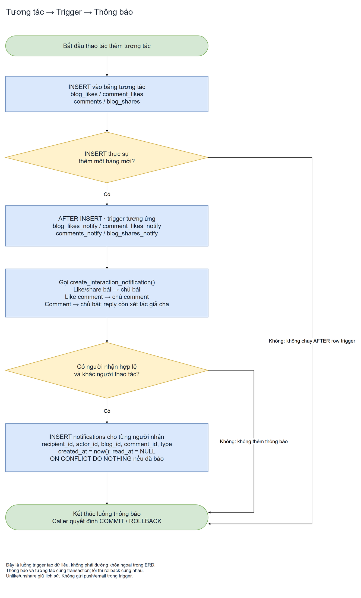

# Sơ đồ SQL: procedure, counter và invariant

Bộ sơ đồ được đối chiếu trực tiếp với [V3__counters_and_invariants.sql](../../soulspace/src/main/resources/db/migration/V3__counters_and_invariants.sql), hiện có **10 function, 18 trigger**; 22 trang V3 dưới đây mô tả 9 function/14 trigger counters và invariants, phần thông báo mới được tách tại [V4/05](v4/05-interaction-notification.drawio.png). Lập ngày 31/10/2026; cập nhật phạm vi constraint trigger, bỏ giới hạn độ sâu comment và chỉnh bố cục ngày 01/11/2026.

Mở [v3-counters-and-invariants.drawio](v3-counters-and-invariants.drawio) bằng draw.io để xem và chỉnh sửa **22 trang, gồm 11 cặp A/B**. Mỗi trang có một ảnh PNG riêng, kèm XML nhúng để mở lại bằng draw.io. Các file Mermaid trong `v3/source/` được giữ làm nguồn biên soạn có thể tái sử dụng khi tiếp tục review V3.

Mỗi phần có **trang A: sơ đồ diễn giải tình huống và kết quả**, rồi đến **trang B: luồng xử lý trong SQL V3**. Phần ví dụ dùng tên người và số liệu cụ thể trước khi giải thích câu lệnh, chẳng hạn bài của An có 20 lượt thích và Bình bấm Thích thì tổng thành 21. Trang A có cả ví dụ bằng lời và flowchart diễn tiến dễ hiểu, như luồng like/mất kết nối; các điều kiện khác của V1/service được giả định hợp lệ nếu ví dụ không nói khác.

Đối chiếu lại ngày 12/11/2026 sau khi xuống dòng SQL và bổ sung comment tiếng Việt trong V3: phần SQL thực thi giữ nguyên; phần counters/invariants ban đầu có 436 dòng; V3 sau bổ sung thông báo có 528 dòng. Các mốc dòng trong file draw.io, bảng dưới và PNG đã cập nhật theo SQL mới. Nguồn Mermaid vẫn mô tả cùng luồng xử lý và không chứa mốc dòng cố định. Bộ V3 mô tả trigger; procedure được trình bày riêng trong thư mục v4.

## Danh mục sơ đồ

| Phần | Trang A: tình huống và kết quả | Trang B: luồng SQL | Function | Trigger | Dòng V3 |
| :--- | :--- | :--- | :--- | :--- | :--- |
| 00 | [Ví dụ like và mất kết nối](v3/00-transaction-business.drawio.png) | [Transaction và trigger](v3/00-transaction.drawio.png) | Bối cảnh transaction | Toàn bộ V3 | 1-436 |
| 01 | [Thêm bình luận và trả lời](v3/01-comment-insert-business.drawio.png) | [Thêm comment và reply](v3/01-comment-insert.drawio.png) | `validate_comment` | `comments_validate` | 3-67 |
| 02 | [Sửa bình luận và giữ phiên bản đúng](v3/02-comment-update-business.drawio.png) | [Sửa comment và version](v3/02-comment-update.drawio.png) | `validate_comment` | `comments_validate` | 14-40 |
| 03 | [Thêm hoặc bỏ lượt thích, chia sẻ](v3/03-relation-counters-business.drawio.png) | [Counter lượt like và share](v3/03-relation-counters.drawio.png) | `update_relation_counter` | `blog_likes_counter` `comment_likes_counter` `blog_shares_counter` | 72-121 |
| 04 | [Không chuyển trực tiếp một lượt thích](v3/04-relation-immutable-business.drawio.png) | [Chặn UPDATE quan hệ](v3/04-relation-immutable.drawio.png) | `reject_relation_update` | `blog_likes_immutable` `comment_likes_immutable` `blog_shares_immutable` | 126-148 |
| 05 | [Đếm bình luận chưa xóa](v3/05-comment-counter-business.drawio.png) | [Đếm comment còn sống](v3/05-comment-counter.drawio.png) | `update_comment_counter` | `comments_counter` | 155-193 |
| 06 | [Chỉ thích bình luận còn hoạt động](v3/06-comment-like-guard-business.drawio.png) | [Kiểm tra trước khi like comment](v3/06-comment-like-guard.drawio.png) | `guard_comment_like` | `comment_like_active` | 198-235 |
| 07 | [Xóa bình luận phải gỡ hết lượt thích](v3/07-deleted-comment-likes-business.drawio.png) | [Comment đã xóa không còn like](v3/07-deleted-comment-likes.drawio.png) | `check_deleted_comment_likes` | `deleted_comment_no_likes` | 239-275 |
| 08 | [Thay đổi ảnh nhưng giữ đúng liên kết](v3/08-image-blog-lock-business.drawio.png) | [Khóa blog khi đổi liên kết ảnh](v3/08-image-blog-lock.drawio.png) | `lock_image_blog` | `image_blog_lock` | 279-311 |
| 09 | [Bài cuối cùng phải có chữ hoặc ảnh](v3/09-nonempty-blog-business.drawio.png) | [Bài phải có nội dung hoặc ảnh](v3/09-nonempty-blog.drawio.png) | `check_nonempty_blog` | `blogs_nonempty` `blog_images_nonempty` | 315-360 |
| 10 | [Bảo vệ căn cước và vòng đời ảnh](v3/10-media-identity-business.drawio.png) | [Định danh và trạng thái media](v3/10-media-identity.drawio.png) | `guard_media_identity` | `media_identity_immutable` | 364-395 |

## Sơ đồ V4 và quan hệ với trigger V3

Hai luồng share đã có sơ đồ riêng: [chia sẻ bài viết](v4/03-share-blog-trigger.drawio.png) ([nguồn draw.io](v4/03-share-blog-trigger.drawio)) và [gỡ chia sẻ](v4/04-unshare-blog-trigger.drawio.png) ([nguồn draw.io](v4/04-unshare-blog-trigger.drawio)). Chia sẻ đòi bài public và báo ALREADY_SHARED khi trùng; gỡ chia sẻ vẫn được khi bài private/vắng hoặc đã gỡ trước đó. Trigger blog_shares_counter chỉ tăng/giảm blogs.shares_count khi thực sự thêm/xóa hàng. [README V4](v4/README.md) giải thích các nhánh và transaction.

Bổ sung [sp_set_comment_like: thích/bỏ thích bình luận](v4/02-comment-like-trigger.drawio.png), kèm [nguồn draw.io](v4/02-comment-like-trigger.drawio). Sơ đồ ghi rõ điều kiện bình luận thuộc đúng bài, chưa bị xóa; năm nhánh lỗi dùng một nút kết thúc chung. Nhánh INSERT có BEFORE trigger `guard_comment_like`; AFTER trigger `comment_likes_counter` chỉ cập nhật `comments.likes_count` khi hàng thực sự thay đổi. Chi tiết phạm vi và quan hệ trigger ở [README V4](v4/README.md#02-thíchbỏ-thích-bình-luận-và-cập-nhật-bộ-đếm).

Bổ sung ngày 12/11/2026 tại [v4](v4/README.md): [sp_set_blog_like và trigger cập nhật likes_count](v4/01-blog-like-trigger.drawio.png), kèm [nguồn draw.io](v4/01-blog-like-trigger.drawio). Sơ đồ thể hiện V4 thêm/xóa blog_likes → blog_likes_counter → update_relation_counter → blogs.likes_count, cả nhánh gọi lặp không thay đổi hàng/counter. Procedure và trigger dùng chung transaction, không tự commit và không cập nhật counter sau commit. Bộ V3 cùng các mốc dòng ở bảng trên được giữ nguyên.

## Quy ước trình bày

Các nhánh có cùng bước xử lý/kết quả/kết thúc và cùng ý nghĩa được gom về một node chung, không lặp node giống nhau theo từng nhánh. Giữ riêng các điều kiện và thông báo lỗi khác nhau trước khi gom; đường nối phải rõ ràng, không xuyên node hoặc giao nhau không cần thiết. Sơ đồ Procedure thích/bỏ thích dùng một nút kết thúc lỗi chung cho ba nhánh kiểm tra.

| Khối | Ý nghĩa |
| :--- | :--- |
| Terminator bo tròn, màu xanh lá | Bắt đầu hoặc kết thúc function/luồng |
| Chữ nhật, màu xanh dương | Thao tác xử lý, khóa hàng hoặc thực thi SQL |
| Hình thoi, màu vàng | Điều kiện/rẽ nhánh; các nhánh có nhãn rõ |
| Hình bình hành, màu cam | Nhận/đọc dữ liệu hoặc trả kết quả |
| Khối màu đỏ | Thao tác phát sinh lỗi hoặc kết quả SQLSTATE; hình dạng vẫn giữ đúng vai trò xử lý/đầu ra |

Đường nối dùng đoạn thẳng hoặc gấp góc vuông **90°**, không dùng đường cong hoặc bo góc. Đường nối vào/ra hình thoi được cố định tại một trong **bốn đỉnh**: trên `(0.5, 0)`, phải `(1, 0.5)`, dưới `(0.5, 1)`, trái `(0, 0.5)`; không gắn vào giữa cạnh xiên.

Ưu tiên căn các node cùng luồng theo một trục dọc và nối bottom-center → top-center bằng một đoạn thẳng, không có waypoint. Chỉ gấp góc để tách nhánh hoặc tránh node; các nhánh gom về cùng kết quả dùng đường đi chung khi phù hợp. Bản cập nhật có **176 connector thẳng trên tổng 253 connector**, gồm 162 dọc và 14 ngang; các đoạn gấp được lưu bằng waypoint vuông góc, không giao cho thuật toán tự chọn điểm neo.

Cỡ chữ trong file draw.io: **24** cho nội dung khối, **20** cho nhãn nhánh, **32** cho tiêu đề và **18** cho chú thích. Khối được tăng kích thước để giữ nội dung trong viền. PNG là bản xem có XML nhúng; dùng file draw.io gốc khi cần chỉnh sửa hoặc xuất lớn hơn cho báo cáo. Các trang SQL 01–10 được xuất với chiều cao 2.000 px để tránh lỗi renderer khi xuất PNG lớn; cỡ chữ gốc trong XML không thay đổi.

Một khối `SELECT ... FOR UPDATE` thể hiện thao tác thực thi SQL để lấy khóa và dữ liệu. Các bước chỉ đọc dữ liệu, nhận `OLD/NEW` hoặc trả `RETURN` dùng khối nhập/xuất.

## Cách đọc đúng phạm vi SQL

- Trang 00B giải thích bối cảnh transaction khi câu DML kích hoạt V3. File V3 không tự mở transaction và không tự `COMMIT`; trigger chạy trong transaction của câu SQL gọi nó.
- `RETURN NEW`, `RETURN OLD` và `RETURN NULL` là kết quả trả từ function trigger, không phải HTTP response và không phải commit. Giá trị trả về của AFTER trigger bị PostgreSQL bỏ qua; các câu UPDATE mà function đã chạy vẫn có tác dụng trong transaction.
- Các nhánh `RAISE` thể hiện lỗi chưa được xử lý trong luồng thông thường. Câu SQL gây lỗi và tác động trigger của nó bị hủy; transaction chỉ có thể tiếp tục nếu phía gọi có cơ chế phục hồi phù hợp như rollback về savepoint. Sơ đồ không thêm cơ chế phục hồi không có trong V3.
- Hai nhóm constraint deferred đọc lại trạng thái hiện tại ở cuối transaction. `SET CONSTRAINTS ... IMMEDIATE` có thể buộc kiểm sớm; không hiểu AFTER là chạy sau commit.
- Khối trả kết quả bình thường chỉ có nghĩa function V3 đã qua kiểm tra. CHECK, UNIQUE và FK của V1 cùng quyền truy cập/luồng service vẫn áp dụng, không được thay thế bởi sơ đồ này.
- Bộ sơ đồ phản ánh nguyên trạng V3. Các đề xuất tối ưu trước đó chưa được áp dụng vào SQL không được biểu diễn như hành vi đã có.

## Chi tiết cần giữ khi đối chiếu

### Thêm và sửa comment

Trang 01B giữ đúng thứ tự khóa **blog trước, parent sau**. Comment gốc có `parent_id=NULL`. Reply cần parent tồn tại trong cùng blog và parent trực tiếp chưa xóa. Không còn CTE đếm tổ tiên hoặc giới hạn cứng độ sâu: trả lời cấp 5 tạo cấp 6, các cấp sâu hơn vẫn hợp lệ. ID mới, parent tồn tại trước và cấu trúc bất biến giữ cây không vòng từ database sạch. Ancestor là placeholder không chặn trả lời một descendant còn hoạt động.

Trang 02B thể hiện đầy đủ ba nhóm bất biến: cấu trúc `id/blog_id/parent_id`, chuyển tác giả và thời điểm xóa đã có. Chỉ thay đổi `content/deleted_at/author_id` mới tăng version và đặt lại thời gian. Thay đổi counter hoặc xóa lặp giữ nguyên version và thời điểm sửa.

### Counter và quan hệ

Trang 03B dùng `NEW` cho INSERT, `OLD` cho DELETE và cộng trực tiếp `+delta` trên hàng cha. Nếu hàng cha đã bị xóa trong cascade, UPDATE có thể ảnh hưởng 0 hàng; function không tự tạo lại hàng cha.

Trang 04B từ chối mọi UPDATE trên `blog_likes/comment_likes/blog_shares`, kể cả gán lại cùng giá trị. Thêm/bỏ quan hệ dùng INSERT/DELETE để các counter trigger chạy đúng.

Trang 05B chỉ đếm comment còn sống. Với UPDATE, trigger chỉ được kích hoạt khi câu SQL nhắm tới `deleted_at`; `delta = live(NEW) - live(OLD)`. Xóa mềm lần đầu giảm 1, xóa lặp không giảm thêm, sửa nội dung không đổi số comment.

### Like comment và constraint deferred

Trang 06B kiểm comment có tồn tại và chưa xóa, sau khi khóa blog rồi comment. Function này không tự kiểm quyền xem bài hoặc danh tính actor; các điều kiện đó nằm ngoài phạm vi V3.

Trang 07B chỉ kiểm, không tự xóa like. `WHEN (NEW.deleted_at IS NOT NULL)` được xét ngay sau INSERT/UPDATE, chỉ xếp lịch deferred cho comment đã xóa. Khi chạy, hàm vẫn đọc lại dữ liệu cuối. Transaction xóa/anonymize comment phải kết thúc với `likes_count=0` và không còn `comment_likes` của node đã xóa. Vì kiểm deferred, có thể đặt placeholder rồi xóa likes trong cùng transaction.

Một INSERT vào `comment_likes` có thể đi qua trang 06B, trang 03B, rồi trang 02B khi counter cập nhật `comments`; trang 02B giữ nguyên version trong trường hợp này. Comment còn hoạt động không xếp lịch trang 07B. Trang 07B kiểm trạng thái cuối khi comment đã xóa. Các trang là các góc nhìn của cùng luồng SQL, không phải các transaction độc lập.

### Liên kết ảnh và bài không rỗng

Trang 08B chỉ khóa blog và giữ bất biến `blog_id/asset_id` của liên kết. Cột `position` được phép cập nhật. Owner, purpose và state của asset cần được service kiểm tra theo thiết kế media.

Trang 09B kiểm **trạng thái cuối**: blog còn tồn tại phải có text sau trim hoặc có ít nhất một ảnh. Có thể insert bài rỗng rồi thêm ảnh trong cùng transaction; commit bài rỗng bị từ chối. Blog đã bị xóa được bỏ qua.

`blogs_nonempty` chỉ gắn `INSERT OR UPDATE OF content`; like/share, cập nhật counters và đổi published không xếp lịch phép kiểm này. UPDATE OF xét cột trong SET nên `SET content=content` vẫn kích hoạt. `blog_images_nonempty` giữ INSERT/UPDATE/DELETE. Hàm có nhánh lấy `OLD.id` nếu được gọi từ DELETE trên blogs, nhưng không có trigger DELETE blogs trong V3.

### Định danh và trạng thái media

Trang 10B giữ đúng thứ tự bốn nhóm kiểm tra trong code: định danh bất biến; DELETE_PENDING không quay lui; ATTACHED chỉ giữ nguyên hoặc chuyển DELETE_PENDING; metadata đã xác nhận không được đổi. V3 không thực hiện upload/destroy Cloudinary.

## Nguồn và cập nhật

- Nguồn chuẩn: SQL V3; SHA-256 của bản đã dùng: `b512b19aad75ea85d59ab0fd19407e32eaf410eced5a83ea946491c44f737010`.
- `v3/source/*.mmd`: nguồn logic để tái sử dụng khi sửa sơ đồ; các file luồng SQL có ví dụ thực tế trong chú thích đầu file. File draw.io có phần ví dụ hiển thị, cỡ chữ và chỉnh vị trí/đường nối sau import; việc sửa trực tiếp draw.io không tự đồng bộ ngược về Mermaid.
- Khi sinh lại từ Mermaid, áp dụng các quy tắc đường nối và điểm nối hình thoi của `drawio-skill` trước khi xuất ảnh; draw.io có thể mặc định nhập connector thành đường cong.
- 22 ảnh PNG nằm trong `v3/`; file draw.io nhiều trang nằm ngay tại thư mục này. Ảnh nháp và XML trung gian chỉ phục vụ kiểm tra và được dọn sau khi xuất xong.

## Kiểm tra đã thực hiện

Đã đối chiếu đủ 9 function và 14 trigger; kiểm cấu trúc XML, nhãn nhánh, bốn loại khối flowchart, cờ tắt đường cong/bo góc, điểm nối tại đỉnh hình thoi và bảo toàn các cạnh/nội dung khi căn lại bố cục. Đã xem bản render của từng trang.

Hai định nghĩa constraint trigger và quy tắc comment không giới hạn độ sâu đã được đồng bộ với sơ đồ. PostgreSQL WASM 17.5 chạy đạt V1–V5, ba smoke test và phép đếm lần gọi hai hàm deferred; test xác nhận chuỗi 100 cấp/reply cấp 101 dưới ancestor đã xóa hợp lệ, các guard cấu trúc vẫn chặn dữ liệu sai, cập nhật không liên quan không gọi hai hàm deferred, còn sửa content/xóa comment vẫn kiểm đúng. Đây chưa phải Docker/Flyway/JDBC/Neon hoặc kiểm thử nhiều kết nối.

## Thông báo tương tác bổ sung

[Luồng create_interaction_notification](v4/05-interaction-notification.drawio.png) · [Nguồn draw.io](v4/05-interaction-notification.drawio). Bốn AFTER INSERT trigger trên likes bài/comment, comments và shares; người nhận, tự tương tác, reply, chống trùng được mô tả rõ. Sơ đồ V4 01/02/03 đã bổ sung trigger notify; unshare chỉ giữ lịch sử cũ. Xem [spec thông báo](../spec/10-thong-bao.md).

## 11. Luồng tương tác tạo thông báo

[File draw.io](v3/11-interaction-notification.drawio) · [PNG có XML nhúng](v3/11-interaction-notification.drawio.png).

Sơ đồ riêng bổ sung trong thư mục v3: INSERT blog_likes/comment_likes/comments/blog_shares → AFTER INSERT trigger → create_interaction_notification → notifications. Đường nối này mô tả luồng xử lý, không phải FK giữa notifications và các bảng likes/shares. Không có hàng mới thì không chạy AFTER row trigger; không có người nhận hợp lệ thì không thêm thông báo. Unique chống trùng; dữ liệu ghi cùng transaction. Chi tiết trong [spec 10](../spec/10-thong-bao.md).

### 11A. Bản nghiệp vụ dễ đọc

[File draw.io](v3/11-interaction-notification-business.drawio) · [Ảnh business](v3/11-interaction-notification-business.drawio.png). Dùng vai trò người tương tác, tác giả bài/bình luận và người nhận; không dùng tên người hoặc câu lệnh SQL trong các bước. Bản 11B kỹ thuật là [flowchart trigger](v3/11-interaction-notification.drawio.png). Hai bản có cùng ý nghĩa: chỉ tương tác mới tạo thông báo, bỏ qua chính người thao tác và giữ lịch sử để tránh thông báo trùng.
