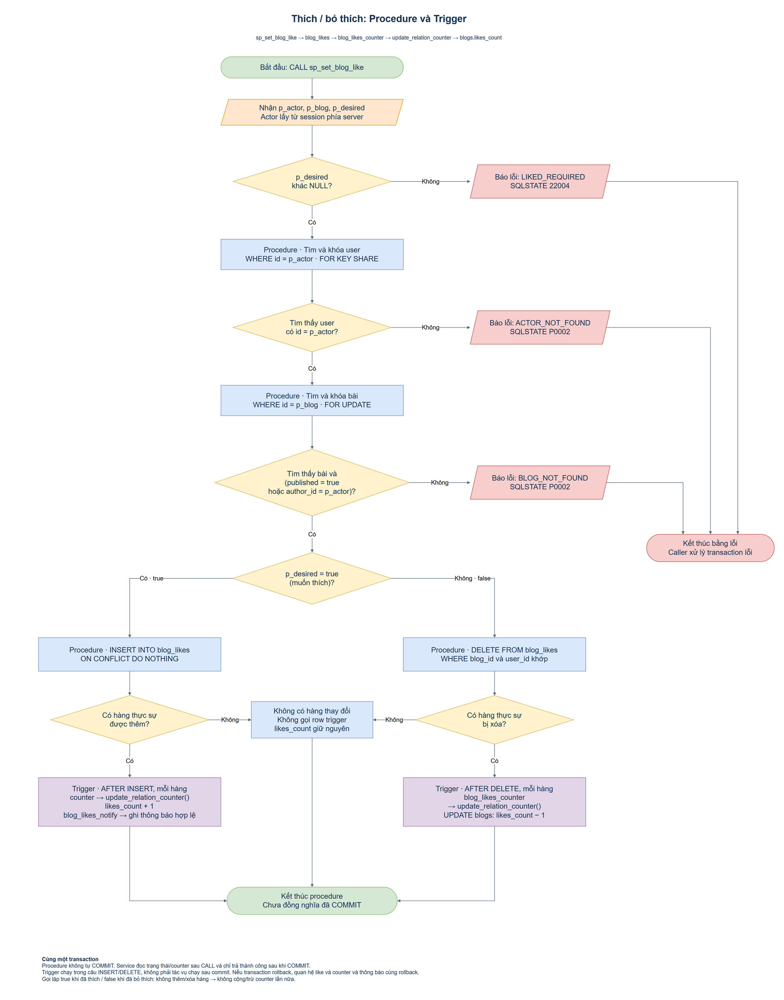
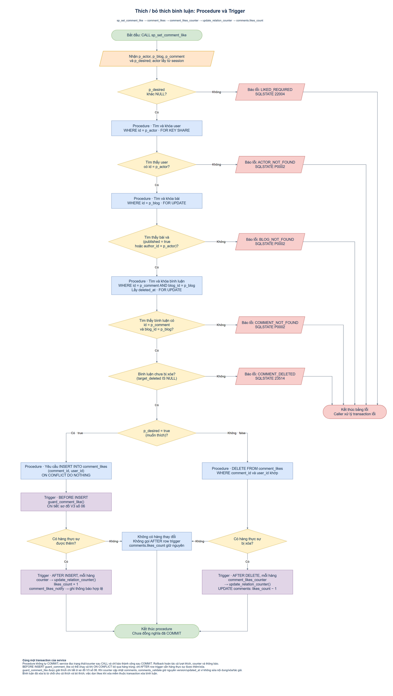
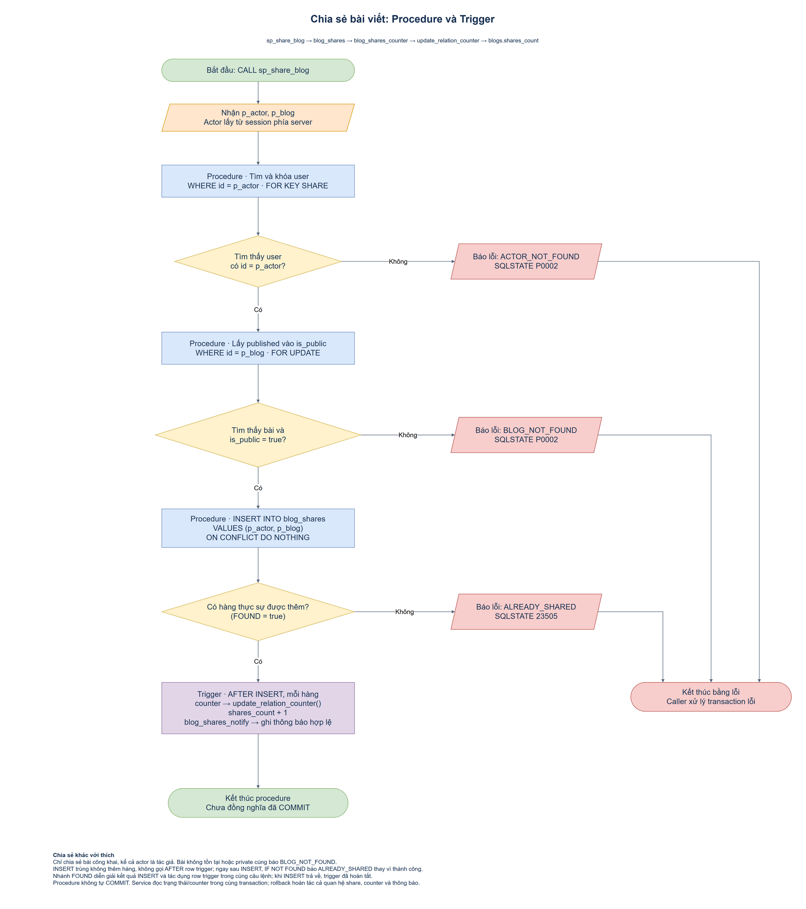
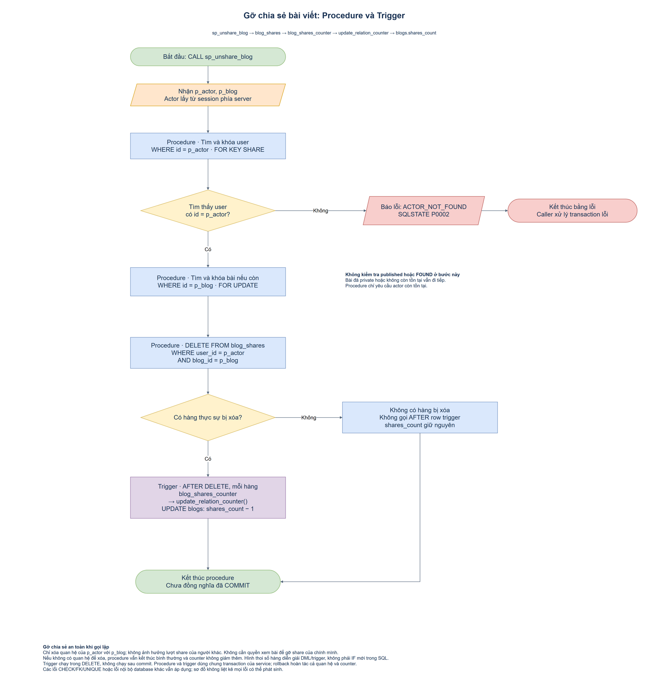
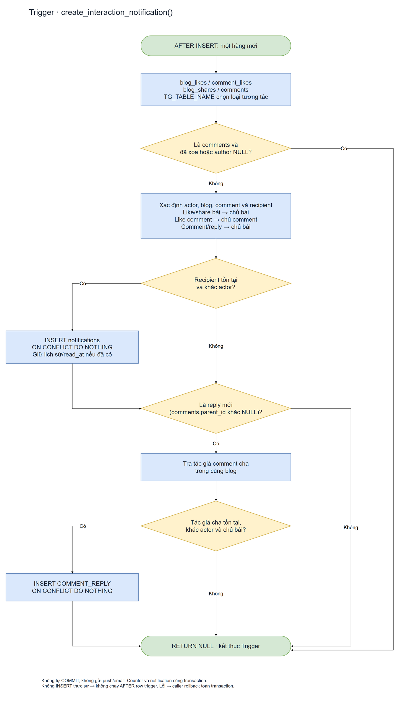

# Sơ đồ V4: tương tác và trigger liên quan

## 01. Thích/bỏ thích bài viết và cập nhật bộ đếm

Đối chiếu ngày 12/11/2026 với [sp_set_blog_like trong V4](../../../soulspace/src/main/resources/db/migration/V4__interaction_procedures.sql) và [blog_likes_counter/update_relation_counter trong V3](../../../soulspace/src/main/resources/db/migration/V3__counters_and_invariants.sql).

- [File draw.io chỉnh sửa được](01-blog-like-trigger.drawio)
- [Ảnh PNG có XML draw.io nhúng](01-blog-like-trigger.drawio.png)

Quan hệ cần đọc: `sp_set_blog_like` thực hiện INSERT/DELETE trên `blog_likes`; trigger `blog_likes_counter` chạy AFTER INSERT/DELETE cho từng hàng thật sự thay đổi, gọi `update_relation_counter()` để tăng/giảm `blogs.likes_count`.

- `p_desired=true`: thêm lượt thích nếu chưa có; INSERT thành công một hàng làm counter tăng 1.
- `p_desired=false`: xóa lượt thích nếu có; DELETE thành công một hàng làm counter giảm 1.
- Đã thích mà gửi true, hoặc đã bỏ thích mà gửi false: không có hàng thêm/xóa, không gọi row trigger và counter giữ nguyên.
- Các hình thoi "Có hàng thực sự được thêm/bị xóa?" diễn giải kết quả của DML và cơ chế row trigger; không phải các câu IF được bổ sung vào procedure.
- Mỗi điều kiện của procedure có hình thoi riêng: desired khác NULL, tìm thấy actor, tìm thấy blog và (published hoặc actor là tác giả). Khóa actor FOR KEY SHARE trước khi kiểm tồn tại; khóa blog FOR UPDATE trước khi kiểm tồn tại/quyền. Các nhánh lỗi ghi rõ LIKED_REQUIRED/22004, ACTOR_NOT_FOUND/P0002 hoặc BLOG_NOT_FOUND/P0002; bài không tồn tại và không được xem cùng báo BLOG_NOT_FOUND.
- Nhãn trên sơ đồ dùng Procedure và Trigger để thể hiện vai trò; V4/V3 chỉ là tên migration nguồn để đối chiếu.
- Ba lỗi cụ thể được giữ ở các nhánh riêng nhưng cùng đi tới một nút kết thúc lỗi chung. Các đường gom nhánh đi sang phải rồi xuống, không cắt nhau và không đi ngược luồng.
- Procedure, DML và trigger nằm trong cùng transaction do service quản lý. Trigger chạy trước khi CALL hoàn tất, không chạy sau commit. Khi transaction rollback, lượt thích và thay đổi counter cùng rollback; service chỉ báo thành công sau commit.

Sơ đồ này tập trung vào đường gọi V4 → V3, bổ sung cho [sơ đồ counter V3](../v3/03-relation-counters.drawio.png). Các điều kiện CHECK/FK/UNIQUE và lỗi database khác vẫn áp dụng, không được liệt kê hết trong sơ đồ. Đây là đối chiếu thiết kế/code, không phải bằng chứng test thực thi.

## 02. Thích/bỏ thích bình luận và cập nhật bộ đếm

Đối chiếu ngày 12/11/2026 với `sp_set_comment_like` trong V4 và các trigger `comment_like_active`, `comment_likes_counter` trong V3.

- [File draw.io chỉnh sửa được](02-comment-like-trigger.drawio)
- [Ảnh PNG có XML draw.io nhúng](02-comment-like-trigger.drawio.png)

Các điều kiện được ghi rõ theo thứ tự SQL: desired khác NULL; user tồn tại; bài tồn tại và public hoặc do actor sở hữu; bình luận có đúng id và blog_id; cuối cùng bình luận chưa bị xóa (`target_deleted IS NULL`). Khóa lần lượt user → blog → comment. Năm thông báo lỗi riêng cùng dẫn đến một nút kết thúc lỗi chung, không nhân bản nút kết thúc.

Điều kiện bình luận chưa xóa được kiểm trước khi rẽ nhánh thích/bỏ thích, nên cả hai thao tác đều bị từ chối nếu node đã xóa. Việc xóa các likes khi xóa mềm bình luận thuộc transaction xóa bình luận riêng.

Nhánh INSERT đi qua trigger BEFORE INSERT `comment_like_active` gọi `guard_comment_like()`; luồng kiểm tra bên trong được giải thích tại [sơ đồ V3 số 06](../v3/06-comment-like-guard.drawio.png). BEFORE INSERT có thể chạy dù hàng sau đó bị bỏ qua bởi ON CONFLICT DO NOTHING. Chỉ khi thực sự thêm/xóa hàng, AFTER row trigger `comment_likes_counter` mới gọi `update_relation_counter()` để tăng/giảm `comments.likes_count`. Vì vậy nhánh không thay đổi hàng được ghi rõ là không gọi AFTER row trigger, không phải không có bất kỳ trigger nào chạy.

Các hình thoi về hàng thực sự thêm/xóa diễn giải cơ chế DML/row trigger, không thêm IF mới vào procedure. Khi UPDATE bộ đếm trên comments kích hoạt `comments_validate`, version và updated_at giữ nguyên vì nội dung/deleted_at/author_id không đổi. Toàn bộ dùng chung transaction; procedure không tự commit và trigger không chạy sau commit. CHECK/FK/UNIQUE và các lỗi nội bộ trigger vẫn áp dụng, sơ đồ không liệt kê mọi lỗi database có thể phát sinh.

## 03. Chia sẻ bài viết

Đối chiếu `sp_share_blog` trong V4 và trigger `blog_shares_counter` trong V3 ngày 12/11/2026.

- [File draw.io chỉnh sửa được](03-share-blog-trigger.drawio)
- [Ảnh PNG có XML draw.io nhúng](03-share-blog-trigger.drawio.png)

Khóa/kiểm user tồn tại, sau đó khóa bài và yêu cầu bài tồn tại, published=true. Kể cả tác giả cũng không chia sẻ bài private. ACTOR_NOT_FOUND/P0002, BLOG_NOT_FOUND/P0002 và ALREADY_SHARED/23505 giữ riêng thông báo nhưng dùng chung một nút kết thúc lỗi.

INSERT thêm một hàng vào blog_shares làm AFTER row trigger `blog_shares_counter` gọi `update_relation_counter()` để tăng `blogs.shares_count` đúng một lần. Khi INSERT bị bỏ qua do trùng cặp user/blog, không có AFTER row trigger; FOUND=false khiến procedure báo ALREADY_SHARED. Hình thoi FOUND diễn giải kết quả INSERT và việc có row trigger hay không; trong thực thi SQL, trigger của hàng mới đã chạy trước khi INSERT trả về để kiểm IF NOT FOUND. Không hiểu sơ đồ là trigger chạy sau IF hoặc sau commit.

## 04. Gỡ chia sẻ bài viết

Đối chiếu `sp_unshare_blog` trong V4 và trigger `blog_shares_counter` trong V3 ngày 12/11/2026.

- [File draw.io chỉnh sửa được](04-unshare-blog-trigger.drawio)
- [Ảnh PNG có XML draw.io nhúng](04-unshare-blog-trigger.drawio.png)

Khóa/kiểm actor tồn tại, khóa blog nếu tìm được rồi DELETE đúng quan hệ (user_id=p_actor, blog_id=p_blog). Không kiểm published hoặc FOUND sau bước khóa blog; do đó bài đã private hoặc không còn tồn tại vẫn đi tiếp. Chỉ lượt share của actor bị tác động, không xóa lượt share của user khác.

DELETE một hàng làm AFTER row trigger `blog_shares_counter` gọi `update_relation_counter()` để giảm `blogs.shares_count` một lần. Không có hàng để xóa thì không gọi AFTER row trigger, không đổi counter và vẫn kết thúc bình thường. Hai nhánh cùng thành công dùng một nút kết thúc chung. Hình thoi số hàng là diễn giải DML/row trigger, không thêm IF kiểm FOUND vào procedure gỡ chia sẻ.

Cả hai sơ đồ giữ thứ tự khóa user → blog và nhãn Procedure/Trigger. Quan hệ share và counter cùng transaction do service quản lý; procedure không tự COMMIT, rollback hoàn tác cả hai. Sơ đồ chỉ đối chiếu code, không xác nhận test database/API; các lỗi constraint/database khác vẫn áp dụng dù không được vẽ hết.

## 05. Thông báo tương tác

[File draw.io](05-interaction-notification.drawio) · [PNG có XML nhúng](05-interaction-notification.drawio.png).

create_interaction_notification dùng chung cho blog_likes_notify, comment_likes_notify, blog_shares_notify và comments_notify. Sơ đồ 01/02/03 hiển thị cả counter và notify khi INSERT thực sự thêm hàng. Các khối Trigger gộp tóm tắt hai AFTER INSERT trigger, không áp đặt thứ tự notify trước/sau counter. Thông báo không sinh ở DELETE; unlike/unshare giữ lịch sử, relike/reshare không tạo trùng hoặc đặt lại read_at.

Reply báo chủ bài và tác giả comment cha nếu hai người khác nhau; bỏ qua chính actor và tác giả NULL. Mọi nhánh cùng về RETURN NULL; function không tự COMMIT hoặc gửi mạng. Chi tiết người nhận, ràng buộc và kế hoạch API/UI tại [spec 10](../../spec/10-thong-bao.md).
