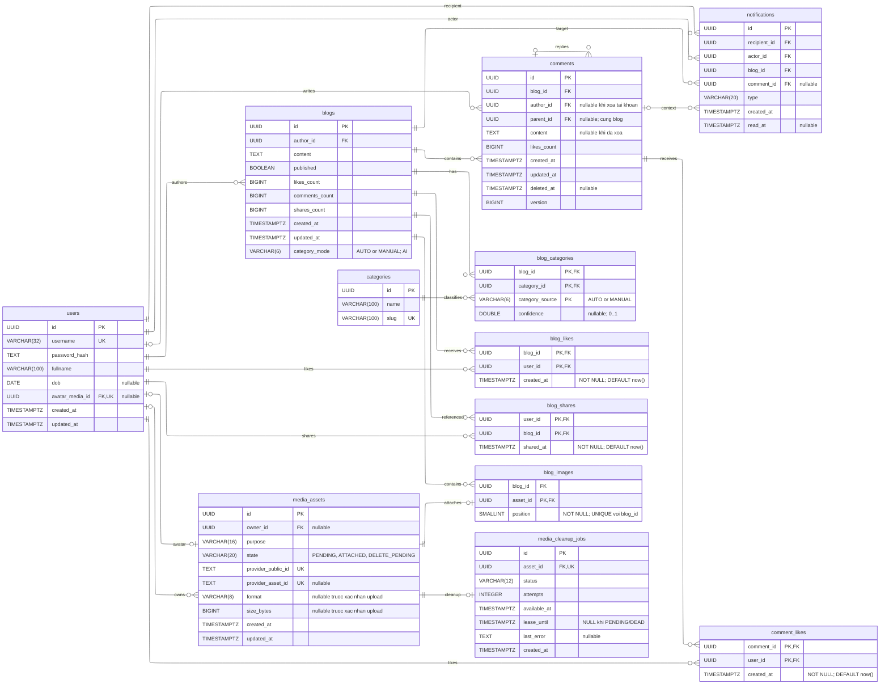
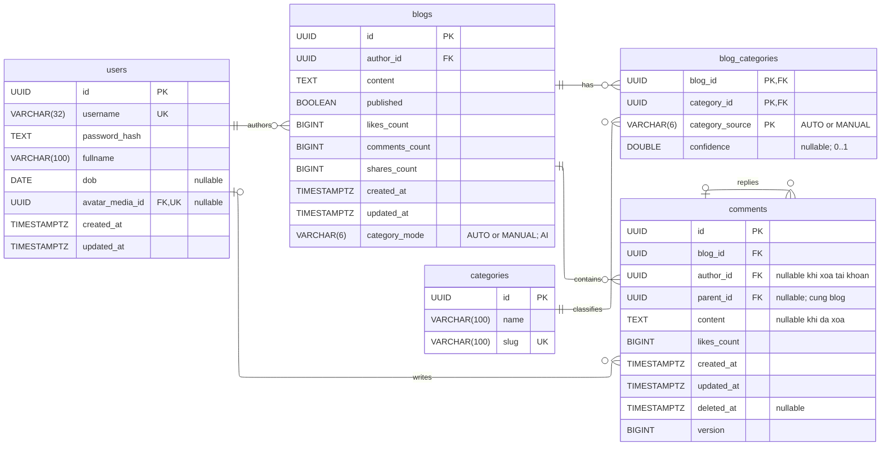
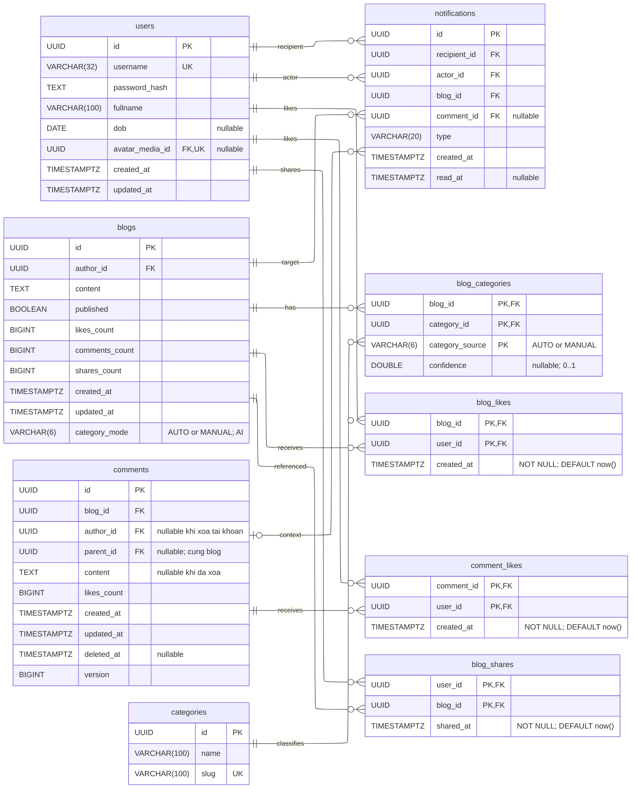
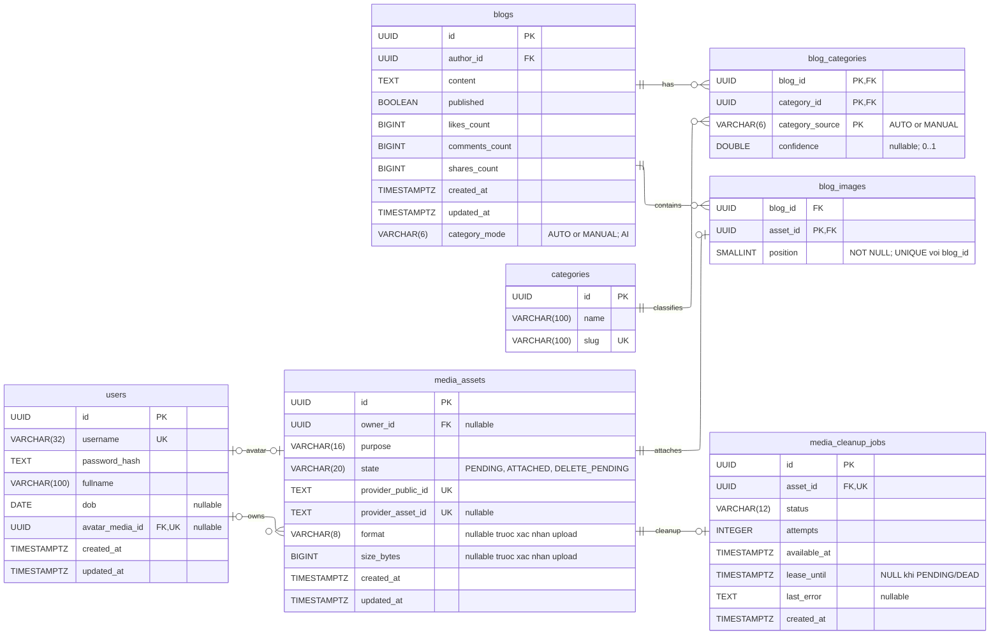

# Thiết kế PostgreSQL và giao dịch

Thiết kế cập nhật ngày 31/10/2026, gồm chủ đề bài viết theo giai đoạn AI và các quyết định đã chốt về comment, xóa tài
khoản, timestamp, media và lease cleanup. Xem [bản SVG](erd.md) và [báo cáo chốt thiết kế](erd-review.md). Đã tạo Flyway
V1–V5 và kiểm thử SQL bằng PostgreSQL WASM; chưa chạy qua JDBC/Flyway trên Docker hoặc Neon. Hướng dẫn
tại [database foundation](../../infra/postgres/README.md).

## Ánh xạ nghiệp vụ legacy sang kỹ thuật SQL

Tái sử dụng các luồng nghiệp vụ, route và field DTO đã chốt trong [hợp đồng API](02-api.md). Viết lại tầng lưu trữ bằng bảng quan hệ, query JPA/SQL và Flyway. Index, trigger và stored procedure dưới đây được viết mới cho PostgreSQL; phần Java gọi database và quản lý transaction được điều chỉnh tương ứng.

Nguồn đối chiếu: [BlogService](../../old/Blog_api/src/main/java/ctu/edu/blogAPI/service/BlogService.java), [UserService](../../old/Blog_api/src/main/java/ctu/edu/blogAPI/service/UserService.java), [AuthenticationService](../../old/Blog_api/src/main/java/ctu/edu/blogAPI/service/AuthenticationService.java), [BlogRepository](../../old/Blog_api/src/main/java/ctu/edu/blogAPI/repository/BlogRepository.java) và [UserRepository](../../old/Blog_api/src/main/java/ctu/edu/blogAPI/repository/UserRepository.java). Tên hàm trong bảng là điểm đối chiếu ở legacy, không bắt buộc giữ tên trong backend mới.

| Nghiệp vụ và hàm legacy | Phần dùng lại và phần cần thay | Kỹ thuật PostgreSQL áp dụng |
| --- | --- | --- |
| Đăng ký/đăng nhập: `UserService.createUser`, `AuthenticationService.authentication`, `UserRepository.existsByUsername/findByUsername` | Giữ luồng nhập username/password và response an toàn đã chốt; dùng PasswordEncoder/session mới. Chuyển truy vấn username sang JPA. | UNIQUE username tạo index phục vụ tra cứu; transaction insert user và xử lý xung đột đăng ký đồng thời. Kiểm tồn tại trước insert chỉ phục vụ thông báo, UNIQUE là ràng buộc cuối. |
| Feed/trang tác giả: `BlogService.getAllPublishedBlogs`, `getAllBlogsByUser`, `getAllPublicBlogByUserId` | Giữ bộ lọc public/author và BlogDTO; thay `findByPublishedTrue/findByUserId/findByUserIdAndPublishedTrue` bằng query quan hệ, thứ tự thời gian và ID ổn định. | Composite/partial index theo public, author và thời gian; đối chiếu EXPLAIN trên chính các query này. |
| Like bài: `BlogService.toggleLike` | Giữ route/response; request có `liked` bắt buộc. Thay danh sách embedded và phép tăng/giảm Java bằng quan hệ `blog_likes`. | `sp_set_blog_like` trong transaction service; PK cặp blog/user chống trùng, trigger duy nhất cập nhật likes_count. |
| Đọc/thêm comment và reply: `BlogService.getCommentsByBlog`, `addComment`, `addReply` | Giữ DTO cây và luồng trả lời; lưu mỗi node thành một row rồi dựng cây từ kết quả phẳng. Bổ sung sửa/xóa riêng comment với version và placeholder giữ replies. | Index blog/parent; FK cùng blog, parent đã tồn tại và cấu trúc bất biến giữ cây không vòng; không giới hạn cứng độ sâu; counter tính comment chưa xóa; transaction khóa blog rồi comment. |
| Like comment: `BlogService.toggleCommentLike` | Giữ route/response và dùng `liked` bắt buộc; chuyển danh sách liked users thành `comment_likes`. | `sp_set_comment_like`, PK cặp comment/user, trigger likes_count và transaction service. |
| Share/unshare: `BlogService.shareBlog`, `removeSharedBlog` | Giữ luồng share và response; thay snapshot trong user và hai lần save user/blog bằng quan hệ `blog_shares`. | `sp_share_blog/sp_unshare_blog` và trigger shares_count cùng transaction; PK chống share trùng. |
| Danh sách share: `BlogService.getSharedBlogsByUser` | Giữ SharedBlogDTO; lấy nội dung/tác giả hiện tại qua JOIN bài gốc, lọc public. | Index danh sách share theo user/thời gian; FK cascade khi bài gốc bị xóa. |
| Tạo/sửa bài và quyền xem: `BlogService.initBlog`, `updateBlog`, `updateAccess` | Giữ luồng CRUD/public-private; cập nhật content, published, image links và trạng thái asset theo contract mới. | Transaction nghiệp vụ, FK/UNIQUE/CHECK và deferred constraint bài có text hoặc ảnh; khóa blog khi sửa để phối hợp với các tương tác. |
| Hồ sơ/avatar: `UserService.updateUser`, `updateUserPartially`, `updateAvatar`, `deleteAvatar` | Giữ biểu mẫu và response; đọc tên/avatar tác giả bằng JOIN users, thay đồng bộ snapshot bằng quan hệ. | Transaction cập nhật user, liên kết asset và enqueue cleanup avatar cũ; UNIQUE username, FK avatar và index owner assets. |
| Xóa bài/tài khoản: `BlogService.deleteBlog`, `UserService.deleteUser` | Xóa vĩnh viễn bài của user; comment ở bài người khác được xóa nội dung và gỡ tác giả, giữ replies. Thu thập asset và lập job trước cascade. | Một transaction cho enqueue, chuyển comment thành placeholder, xóa likes liên quan và xóa tài khoản/bài. FK cascade dọn dữ liệu thuộc bài bị xóa; Cloudinary được worker xử lý sau commit. |

Ranh giới triển khai:

- Bốn procedure ở bảng trên đủ cho các tương tác đã chọn. CRUD user/blog và insert comment dùng JPA/SQL trong transaction service; không cần thêm procedure cho từng endpoint.
- Các lệnh Java `setLikesCount`, `setCommentsCount`, `setSharesCount` và phép clamp trong legacy được thay bằng trigger cùng giá trị mặc định của schema. Không giữ hai nơi cùng cập nhật counter.
- `BlogSyncService`, MongoRepository, ObjectId và snapshot share được thay bằng FK/JOIN theo mô hình mới. Không chuyển dữ liệu Mongo trong giai đoạn này.
- Upload, stream và xóa Cloudinary nằm ngoài transaction database; transaction chỉ ghi metadata, liên kết và cleanup job. `@Transactional` không làm tác động Cloudinary rollback được.

Luồng mẫu cho like bài khi triển khai:

```text
route /api/v1 hiện có + liked=true/false + actor từ session
  -> service @Transactional
  -> CALL sp_set_blog_like(actor, blog, desired)
  -> INSERT/DELETE quan hệ; trigger chỉ chạy khi row thực sự đổi
  -> đọc trạng thái like và counter cuối transaction
  -> commit rồi trả response
```

Gọi lặp `liked=true` giữ một quan hệ và một lượt tăng; rollback phải hoàn tác cả quan hệ lẫn thay đổi counter. Mỗi
request được xử lý và commit ngay trong transaction; backend không giữ like trong queue chờ đủ thời gian hay chờ app
đóng. Frontend cập nhật lạc quan và gộp các lần bấm nhanh theo từng mục, còn database giữ trạng thái cuối qua procedure,
khóa chính ghép và trigger chỉ cập nhật counter khi quan hệ thật sự đổi. Trong nhóm tương tác, triển khai like bài làm
mẫu để kiểm đủ procedure, trigger, transaction và constraint, rồi mở rộng comment/share. Các luồng CRUD/avatar/xóa áp
dụng ranh giới transaction ở trên theo [mốc triển khai](05-trien-khai.md). Feed và trang tác giả là các luồng đo index.
DDL được triển khai trước theo Flyway V1–V5; bằng chứng từng kỹ thuật theo [nghiệm thu](06-nghiem-thu.md).

## Mô hình và kiểu dữ liệu

Các bảng và bốn sơ đồ bên dưới thể hiện **thiết kế đầy đủ: 12 bảng/73 cột**, gồm chủ đề và confidence. V1 đã bổ sung
categories (3 cột), blog_categories (4 cột) và blogs.category_mode trước lần chạy Flyway đầu tiên theo xác nhận của
người dùng. Model triển khai theo [thiết kế phân loại chủ đề](07-phan-loai-chu-de.md#dữ-liệu-mở-rộng).
Xem [ERD mở rộng](erd.md#5-mở-rộng-phân-loại-chủ-đề-giai-đoạn-ai).

PostgreSQL là nguồn dữ liệu nghiệp vụ duy nhất của backend mới: Neon cho dùng chung/online và Docker cho local, mỗi lần chạy chỉ trỏ một database. Chọn cùng major, mặc định 17; cùng một bộ Flyway, trigger và procedure trên cả hai. Không đồng bộ hoặc tự động failover ghi dữ liệu giữa Neon và Docker. Dùng UUID sinh ở server cho các thực thể và trả string qua JSON. Không lưu ObjectId, snapshot tác giả, cây comments dưới dạng JSON, hoặc danh sách like trong một cột. `UserInfo` legacy được thay bằng JOIN users khi dựng DTO.

Các sơ đồ dưới đây hiển thị đầy đủ cột của các bảng xuất hiện trong mỗi hình, gồm kiểu dữ liệu, khóa và ghi chú
nullable. Nguồn Mermaid và [bản tổng quan đầy đủ](assets/erd/tong-quan-day-du.svg) có 12 bảng/73 cột; SVG tổng quan gọn chỉ hiển thị các cột khóa để đọc quan hệ; ba sơ đồ theo nhóm lặp lại đầy đủ cột của các bảng liên quan để dễ
đọc. Giá trị mặc định, CHECK và ràng buộc nhiều cột nằm trong các bảng mô tả ở phần sau. `PK, FK` chỉ cột vừa thuộc khóa
chính vừa là khóa ngoại; `UK` chỉ ràng buộc duy nhất trên một cột. UNIQUE ghép được mô tả riêng.

### Đọc mô hình bằng chữ

Có thể đọc bảng dưới đây rồi chuyển đến phần mô tả từng bảng mà không cần xem sơ đồ. `NULL` ở cột liên kết nghĩa là hàng đó chưa có hoặc không còn liên kết tương ứng; điều kiện được phép NULL được quy định riêng theo từng bảng.

| Bảng               | Lưu thông tin gì?                                                     | Liên kết và cách đọc                                                                                                                                                                        |
|--------------------|-----------------------------------------------------------------------|---------------------------------------------------------------------------------------------------------------------------------------------------------------------------------------------|
| users              | Tài khoản, hồ sơ và hash mật khẩu                                     | Một user có nhiều bài viết và bình luận; avatar_media_id trỏ đến một media asset hoặc NULL khi dùng avatar mặc định.                                                                        |
| blogs              | Nội dung, quyền công khai, chủ đề, thời gian và counters của bài viết | author_id trỏ đến user viết bài; category_mode chọn tập AUTO/MANUAL để hiển thị; blog_categories lưu riêng hai tập theo category_source. Mỗi bài có nhiều comments, ảnh, likes và shares.   |
| blog_categories    | Tập chủ đề của từng bài                                               | Bảng nối N–N; PK ghép (blog_id, category_id, category_source), mỗi hàng nối đúng một bài với một chủ đề và một nguồn AUTO/MANUAL.                                                           |
| categories         | Danh mục chủ đề: ID, tên và slug                                      | Một chủ đề có 0..n bài; mỗi bài có 0..n chủ đề qua blog_categories.                                                                                                                         |
| comments           | Một bình luận hoặc một reply, trạng thái xóa và version chỉnh sửa     | blog_id xác định bài chứa comment; author_id xác định người viết nếu tài khoản còn tồn tại. parent_id=NULL là bình luận gốc; parent_id có giá trị là trả lời comment đó trong cùng bài.     |
| blog_likes         | Ai đang like bài nào và thời điểm like                                | Mỗi hàng nối một user với một blog; cặp blog_id/user_id chỉ được xuất hiện một lần. Xóa hàng là bỏ like.                                                                                    |
| comment_likes      | Ai đang like comment nào và thời điểm like                            | Mỗi hàng nối một user với một comment; cặp comment_id/user_id chỉ được xuất hiện một lần.                                                                                                   |
| blog_shares        | Ai chia sẻ bài nào và thời điểm share                                 | Mỗi hàng nối một user với một blog. Nội dung hiển thị được lấy từ bài gốc hiện tại; không có bản sao nội dung trong hàng share.                                                             |
| media_assets       | Metadata của một ảnh đã hoặc đang upload                              | owner_id xác định chủ asset; purpose phân biệt avatar/ảnh bài/upload độc lập; state theo dõi vòng đời. File ảnh nằm ở Cloudinary; bảng giữ ID provider, định dạng, kích thước và thời gian. |
| blog_images        | Ảnh nào được gắn vào bài nào và ở vị trí nào                          | blog_id trỏ đến bài; asset_id trỏ đến ảnh và là PK của bảng. position xác định thứ tự hiển thị, từ 0 đến 9.                                                                                 |
| notifications | Lịch sử tương tác và đã đọc/chưa đọc | recipient_id nhận, actor_id thao tác; blog_id và comment_id nullable cho ngữ cảnh. Xem tài liệu 10. |
| media_cleanup_jobs | Công việc dọn một asset khỏi Cloudinary                               | asset_id xác định ảnh cần dọn. status, attempts, available_at, lease_until và last_error giúp worker nhận việc, thử lại và theo dõi lỗi.                                                    |

Ví dụ một bài có hai ảnh và ba người like sẽ có một hàng blogs, hai hàng blog_images và ba hàng blog_likes. Sửa tên tác giả cập nhật hàng users; khi đọc bài/comment/share, backend JOIN users để lấy tên mới. Xóa một quan hệ share không xóa bài gốc hoặc ảnh của bài.

Các trường thời gian và counters nằm ngay trên bảng mô tả đối tượng/quan hệ tương ứng. Mục bảng ở phần sau giải thích kiểu dữ liệu, khóa và cách duy trì nhất quán khi ghi.

### Sơ đồ tổng quan

Sơ đồ gồm đủ mười hai bảng và toàn bộ 73 cột, dùng ký hiệu chân quạ: `||` là đúng một, `o|` là không hoặc một, `o{` là
không hoặc nhiều. Cả bốn sơ đồ chọn bố cục ELK để ưu tiên đường nối ngang/dọc gấp vuông góc; cần trình xem hỗ trợ ELK
cho ERD. Bản SVG trong erd.md lưu sẵn bố cục để tránh khác biệt giữa trình xem.



Ký hiệu ở mỗi đầu cạnh thể hiện số lượng bản ghi ở phía đó; cột đánh dấu `FK` xác định phía giữ khóa ngoại. Khóa ngoại ghép và các ràng buộc nhiều cột được mô tả trong các phần chi tiết bên dưới.

### Bài viết và bình luận



`comments.parent_id` có thể null với bình luận gốc. Khóa ngoại ghép `(parent_id, blog_id)` tham chiếu `comments(id, blog_id)` bảo đảm reply thuộc cùng bài; không giới hạn cứng độ sâu.

### Lượt thích và chia sẻ



Mỗi bảng liên kết dùng cặp ID làm khóa chính, ngăn một user like hoặc share trùng cùng tài nguyên. Quan hệ tác giả và cây bình luận nằm trong sơ đồ trước để giảm đường nối chéo.

### Media và avatar



`blog_images.asset_id` là PK; `position` NOT NULL và `UNIQUE(blog_id, position)` giữ thứ tự ảnh không trùng trong một bài. Quan hệ sở hữu asset và quan hệ avatar là hai liên kết riêng.

`users.avatar_media_id` là FK nullable, unique: một user có tối đa một avatar; một asset không làm avatar của hai user. Owner của asset có thể null sau khi tài khoản bị xóa; asset/queue tồn tại đến khi dọn provider xong. Khác biệt giữa quan hệ sở hữu và quan hệ avatar được thể hiện bằng hai cạnh riêng trong sơ đồ.

Mọi `created_at`, `updated_at`, `shared_at`, thời gian queue dùng `TIMESTAMPTZ`. Thời gian sự kiện do server/database đặt; client không được ghi. Bộ đếm dùng `BIGINT NOT NULL DEFAULT 0 CHECK (... >= 0)`. Các FK tham chiếu ID bất biến.

## Bảng users

Mỗi hàng là một tài khoản. username dùng để đăng nhập, fullname/dob là thông tin hồ sơ, password_hash dùng để kiểm tra mật khẩu và avatar_media_id chọn ảnh đại diện. Bài viết và comment tham chiếu user bằng ID; tên/avatar được đọc từ user hiện tại nên không phải cập nhật hàng loạt bài cũ khi sửa hồ sơ.

| Cột | Kiểu và ràng buộc |
| --- | --- |
| id | UUID, PK |
| username | VARCHAR(32), NOT NULL, UNIQUE; CHECK khớp `^[a-z0-9]{3,32}$` |
| password_hash | TEXT, NOT NULL; chuỗi Argon2id hoàn chỉnh gồm tham số và salt |
| fullname | VARCHAR(100), NOT NULL; CHECK độ dài sau trim 1–100 |
| dob | DATE, nullable; kiểm ngày quá khứ trong service, không dùng CHECK phụ thuộc ngày hiện tại |
| avatar_media_id | UUID, nullable, UNIQUE, FK media_assets ON DELETE SET NULL |
| created_at | TIMESTAMPTZ, NOT NULL, DEFAULT now() |
| updated_at | TIMESTAMPTZ, NOT NULL, DEFAULT now() |

### Thứ tự tạo bảng và FK avatar

Hai bảng tham chiếu nhau: users.avatar_media_id trỏ đến media_assets, còn media_assets.owner_id trỏ về users. Flyway tạo schema theo thứ tự:

1. Tạo users với cột avatar_media_id nullable, chưa thêm FK cho cột này.
2. Tạo media_assets, trong đó owner_id có FK đến users đã tồn tại.
3. Thêm FK từ users.avatar_media_id đến media_assets.id bằng ALTER TABLE.

Thứ tự này áp dụng lúc tạo cấu trúc database. Khi đăng ký tài khoản, avatar_media_id có thể NULL và UI dùng avatar mặc định. Khi đổi avatar, backend tạo asset rồi cập nhật liên kết của user trong transaction nghiệp vụ.

### Dữ liệu xác thực

users lưu hash mật khẩu, không lưu mật khẩu gốc hoặc session. Session được Spring Security quản lý ở bộ nhớ backend, chỉ giữ user ID và dữ liệu xác thực tối thiểu. Mỗi request xác thực kiểm tra tài khoản còn tồn tại; xóa tài khoản phải thu hồi session sau commit.

## Bảng categories (giai đoạn AI)

| Cột | Kiểu và ràng buộc |
| --- | --- |
| id | UUID, PK; server/seed cấp |
| name | VARCHAR(100), NOT NULL; CHECK char_length(btrim(name)) BETWEEN 1 AND 100 |
| slug | VARCHAR(100), NOT NULL, UNIQUE; CHECK slug ~ '^[a-z0-9]+(-[a-z0-9]+)*$' |

Tên hiển thị có dấu; slug ổn định và dùng chữ thường không dấu, ví dụ Học tập / hoc-tap. Danh mục phải khớp nhãn model, không tự tạo từ đầu ra suy luận. Không xóa danh mục đang có bài tham chiếu (ON DELETE RESTRICT). Xem [quy tắc phân loại và API](07-phan-loai-chu-de.md).

## Bảng blog_categories (giai đoạn AI)

| Cột             | Kiểu và ràng buộc                                                                                        |
|-----------------|----------------------------------------------------------------------------------------------------------|
| blog_id         | UUID, NOT NULL, FK blogs(id) ON DELETE CASCADE; thuộc PK ghép                                            |
| category_id     | UUID, NOT NULL, FK categories(id) ON DELETE RESTRICT; thuộc PK ghép                                      |
| category_source | VARCHAR(6), NOT NULL; CHECK IN ('AUTO','MANUAL'); thuộc PK ghép                                          |
| confidence      | DOUBLE PRECISION; CHECK 0 <= confidence AND confidence <= 1; AUTO bắt buộc có điểm, MANUAL bắt buộc NULL |

PRIMARY KEY (blog_id, category_id, category_source) ngăn gán trùng trong cùng nguồn; cùng bài/chủ đề được lưu cả AUTO và
MANUAL. Không cần id riêng. Quan hệ blogs–categories là N–N: mỗi bên có 0..n liên kết. Tập nhãn rỗng không có hàng cho
nguồn đó. Xóa bài chỉ cascade các liên kết; danh mục đang được sử dụng không được xóa. PK hỗ trợ tra cứu theo blog_id;
index theo category_id chỉ bổ sung khi query/EXPLAIN cần. Khi thay tập chủ đề, khóa hàng blogs và chỉ thay các hàng của
đúng nguồn: thao tác tác giả thay MANUAL và đổi category_mode; worker thay AUTO, giữ MANUAL/category_mode. Không phân
trang trực tiếp qua JOIN N–N; phân trang blogs trước rồi batch lấy chủ đề khớp category_mode.

## Bảng blogs

Mỗi hàng là một bài viết của một user. published quyết định bài được xem công khai hay chỉ chủ bài được xem. Ảnh nằm ở bảng blog_images; các danh sách người like/share và comments nằm ở bảng quan hệ riêng. Các cột *_count là tổng lưu sẵn để đọc danh sách; trigger duy trì chúng từ dữ liệu quan hệ thật.

| Cột            | Kiểu và ràng buộc                                                                                  |
|----------------|----------------------------------------------------------------------------------------------------|
| id             | UUID, PK                                                                                           |
| author_id      | UUID, NOT NULL, FK users ON DELETE CASCADE                                                         |
| content        | TEXT, NOT NULL DEFAULT ''; CHECK char_length(content) <= 5000                                      |
| published      | BOOLEAN, NOT NULL DEFAULT true                                                                     |
| likes_count    | BIGINT, không âm, mặc định 0                                                                       |
| comments_count | BIGINT, không âm, mặc định 0; tính mọi comment/reply có deleted_at IS NULL, không tính placeholder |
| shares_count   | BIGINT, không âm, mặc định 0                                                                       |
| created_at     | TIMESTAMPTZ, NOT NULL DEFAULT now()                                                                |
| updated_at     | TIMESTAMPTZ, NOT NULL DEFAULT now()                                                                |
| category_mode  | VARCHAR(6), NOT NULL DEFAULT 'AUTO'; CHECK IN ('AUTO','MANUAL'); bổ sung giai đoạn AI              |

Model chỉ thay tập nguồn AUTO khi nội dung vẫn khớp snapshot; không đổi category_mode hoặc tập MANUAL. Hai nguồn được
giữ riêng để đối chiếu, category_mode chọn nguồn hiển thị và MANUAL rỗng không fallback sang AUTO. Khi nội dung đổi, xóa
AUTO cũ rồi phân loại lại, giữ lựa chọn MANUAL. Các thay đổi nhãn tự động không đổi updated_at hoặc counters. Cột
category_mode, categories và blog_categories(category_source, confidence) đã nằm trong V1 do chưa chạy Flyway lần đầu;
thay đổi sau khi áp dụng phải dùng migration mới. Confidence của tập nhãn hiện tại hỗ trợ phân tích model, không phải
lịch sử dự đoán; chi tiết ở 07.

### Bài phải có nội dung hoặc ảnh khi commit

Một blog còn tồn tại phải có ít nhất một trong hai thành phần:

- Nội dung có ký tự sau khi bỏ khoảng trắng đầu/cuối: `length(btrim(content)) > 0`.
- Ít nhất một hàng blog_images thuộc bài đó.

Điều kiện này liên quan hai bảng và phải xét sau khi hoàn tất các bước ghi trong cùng transaction. Constraint trigger được trì hoãn đến cuối transaction trên thay đổi blogs/blog_images để kiểm trạng thái cuối cùng.

`blogs_nonempty` chỉ bắt `INSERT OR UPDATE OF content ON blogs`; cập nhật counters, published hoặc hồ sơ không xếp lịch kiểm này. `UPDATE OF content` xét cột xuất hiện trong SET, nên `SET content=content` vẫn kích hoạt. `blog_images_nonempty` giữ `INSERT OR UPDATE OR DELETE` để kiểm trạng thái cuối khi ghi liên kết ảnh.

Ví dụ tạo bài chỉ có ảnh:

```text
BEGIN
  Tạo hàng blogs có content rỗng
  Thêm blog_images liên kết bài với asset đã upload
COMMIT: hợp lệ vì lúc kết thúc bài đã có ảnh
```

Upload Cloudinary diễn ra trước, ngoài transaction này; các bước trong ví dụ chỉ ghi dữ liệu database.

| Trạng thái cuối transaction | Kết quả |
| --- | --- |
| Có text, không có ảnh | Cho commit. |
| Không có text, có ít nhất một ảnh | Cho commit. |
| Có cả text và ảnh | Cho commit. |
| Bài còn tồn tại nhưng không có text và ảnh | Từ chối commit; rollback các thay đổi trong transaction. |
| Bài đã bị xóa trong transaction | Bỏ qua điều kiện không rỗng vì không còn bài để kiểm. |

Quy tắc cũng áp dụng khi sửa: gỡ ảnh cuối cùng của bài không có text phải bị từ chối, trừ khi cùng transaction đã thêm ảnh mới hoặc cập nhật text hợp lệ.

## Bảng comments

Comment gốc và reply dùng chung một bảng. blog_id phục vụ lấy tất cả comments của bài bằng một query; parent_id cho biết node nào trả lời node nào để backend dựng cây. Xóa nội dung giữ lại node giúp các replies của người khác vẫn có vị trí trong thảo luận.

| Cột | Kiểu và ràng buộc |
| --- | --- |
| id | UUID, PK; thêm UNIQUE(id, blog_id) để làm đích composite FK |
| blog_id | UUID, NOT NULL, FK blogs ON DELETE CASCADE |
| author_id | UUID, nullable, FK users ON DELETE SET NULL; khi NULL thì comment phải đã xóa nội dung |
| parent_id | UUID, nullable; composite FK (parent_id, blog_id) REFERENCES comments(id, blog_id) ON DELETE CASCADE; CHECK (parent_id IS DISTINCT FROM id) |
| content | TEXT, nullable; comment hoạt động có text sau trim dài 1–2000, comment đã xóa phải NULL |
| likes_count | BIGINT, không âm, mặc định 0 |
| created_at | TIMESTAMPTZ, NOT NULL DEFAULT now() |
| updated_at | TIMESTAMPTZ, NOT NULL DEFAULT now(); thời điểm sửa nội dung/xóa/gỡ tác giả, không đổi khi like |
| deleted_at | TIMESTAMPTZ, nullable; đã đặt thì không phục hồi về NULL trong giai đoạn này |
| version | BIGINT, NOT NULL DEFAULT 0, CHECK version >= 0; tăng khi sửa nội dung/xóa/gỡ tác giả |

### Cây reply và cách hiển thị

Không lưu cột depth và không giới hạn cứng độ sâu. Reply ở cấp 6 hoặc sâu hơn vẫn hợp lệ nếu đáp ứng quyền và các ràng buộc của comment. Parent phải tồn tại trước khi insert child; trigger kiểm parent cùng blog, CHECK chặn tự tham chiếu và FK không deferred giữ liên kết hợp lệ.

Khi thêm reply, khóa blog rồi parent FOR UPDATE, yêu cầu parent.deleted_at IS NULL trước khi insert. Parent đã xóa trả 409 COMMENT_DELETED; vẫn được reply vào comment con còn hoạt động. Service và trigger kiểm điều kiện parent còn hoạt động theo cùng quy tắc khóa, để thao tác xóa parent và thêm reply được tuần tự hóa. Ancestor là placeholder vẫn được giữ; chỉ parent trực tiếp bắt buộc chưa xóa.

ID, blog_id và parent_id bất biến sau tạo nên sửa nội dung không chuyển vị trí của node trong cây. author_id chỉ được giữ nguyên hoặc chuyển sang NULL khi đã xóa nội dung, không được gán tác giả khác. Service kiểm tra để trả lỗi rõ; trigger bảo vệ invariant ở database.

Cây không vòng được duy trì từ database sạch bằng ba điều kiện: comment mới có ID mới, parent đã tồn tại và không được thay ID/blog_id/parent_id sau tạo. Node mới chỉ gắn vào cây đã có nên không thể trở thành ancestor của chính mình. Không cần recursive CTE duyệt toàn bộ ancestor trên mỗi lần insert chỉ để đếm cấp. Dữ liệu nhập hoặc sửa bằng quyền quản trị vượt qua các guard phải được kiểm tra riêng, không dùng đường ghi đó thay cho API hợp lệ.

Ví dụ parent ở cấp 5 thì reply cấp 6 vẫn được tạo; tiếp tục trả lời ở các cấp sâu hơn không bị từ chối do độ sâu. UI chỉ thụt lề tối đa 3 tầng; reply sâu hơn hiển thị cùng mức thụt lề cuối và chỉ rõ người được trả lời. parent_id vẫn trỏ đúng comment được chọn, không đổi sang root/ancestor để ép phẳng dữ liệu. Bảng/cột và quan hệ ERD không thay đổi.

Đọc dữ liệu theo blog_id/parent_id và dựng cây từ các hàng phẳng bằng cấu trúc tra cứu/duyệt lặp, tránh phụ thuộc call stack theo độ sâu. Migration core giữ DTO cây hiện tại; trước khi phục vụ thảo luận lớn cần chốt thêm hợp đồng phân trang/tải từng nhóm, không mặc định trả toàn bộ cây trong mọi request. Bỏ giới hạn nghiệp vụ không loại bỏ giới hạn tài nguyên của API, JSON và trình duyệt.

Đã đồng bộ SQL ngày 01/11/2026: [V3](../../soulspace/src/main/resources/db/migration/V3__counters_and_invariants.sql) bỏ CTE đếm tổ tiên và toàn bộ điều kiện giới hạn độ sâu; giữ các guard parent/cấu trúc/version. [invariants.sql](../../infra/postgres/tests/invariants.sql) kiểm chuỗi đến cấp 100, reply cấp 101 dưới ancestor đã xóa, counters và các trường hợp parent/cấu trúc không hợp lệ. V1–V5 và các smoke test chạy đạt trên PostgreSQL WASM; chưa áp dụng Flyway vào Docker/Neon. Nếu một database đã áp dụng V3 cũ, cần migration mới thay thế hàm thay vì sửa checksum lịch sử.

### Trạng thái nội dung

Ràng buộc trạng thái cần biểu diễn rõ, tránh CHECK bỏ lọt giá trị NULL:

```sql
CHECK (
    (deleted_at IS NULL AND content IS NOT NULL
     AND char_length(btrim(content)) BETWEEN 1 AND 2000)
 OR (deleted_at IS NOT NULL AND content IS NULL)
),
CHECK (author_id IS NOT NULL OR deleted_at IS NOT NULL)
```

### Xóa riêng comment và xóa tài khoản

Xóa riêng comment là UPDATE: xóa mọi comment_likes của chính node đó, đặt content=NULL và deleted_at, cập nhật updated_at/version trong cùng transaction; giữ author_id và toàn bộ replies. Client dựng placeholder từ trạng thái, không lưu chuỗi "Bình luận đã xóa" vào content. Xóa lặp không tiếp tục giảm counter; comment đã xóa không được sửa nội dung hoặc nhận like mới.

Constraint trigger `deleted_comment_no_likes` chỉ xếp lịch khi `WHEN (NEW.deleted_at IS NOT NULL)` đúng ngay sau INSERT/UPDATE. Hàm deferred đọc lại trạng thái cuối và đòi likes_count=0 cùng không còn comment_likes; không tự xóa likes. Comment hoạt động được cập nhật likes_count không xếp lịch phép kiểm này. Có thể đặt placeholder rồi gỡ likes trong cùng transaction trước khi kiểm cuối.

Khi xóa tài khoản: khóa các blog bị ảnh hưởng theo thứ tự ID; với comments của user ở bài người khác, xóa likes của các node đó, đặt content=NULL/deleted_at nếu chưa xóa, gỡ author_id và tăng version một lần cho mỗi hàng thay đổi. Thu thập assets và lập cleanup jobs trước khi xóa các bài của user, rồi xóa user trong cùng transaction. FK author SET NULL chỉ là hành vi cuối, không thay bước xóa nội dung; CHECK trạng thái làm thao tác xóa user thiếu bước chuẩn bị thất bại. Replies của người khác trong bài còn sống được giữ; toàn bộ cây của bài bị xóa vẫn bị cascade. Xóa vật lý comment độc lập không thuộc API runtime.

### Version chống ghi đè

Sửa comment và lần xóa đầu gửi expectedVersion từ bản đang hiển thị; UPDATE có điều kiện id, quyền tác giả, deleted_at IS NULL và version=expectedVersion, rồi tăng version. Có phiên bản mới hơn trả 409 CONCURRENT_MODIFICATION. Chỉ đọc version mới tại thời điểm ghi không phát hiện bản cũ của client. Version là số trên cùng một hàng, không tạo record mới và không lưu lịch sử nội dung. Body/DTO và thứ tự trả lỗi theo B15/B16 trong hợp đồng API.

Khi xóa lặp một placeholder, trả thành công sau kiểm quyền; không ghi lại timestamp/version. Tác vụ xóa tài khoản dùng dữ liệu đã khóa để cập nhật, không cần version từ client. Mapping JPA của counters phải read-only khi ghi; trigger like không tăng version hoặc đổi updated_at. Không dùng thao tác merge toàn entity làm ghi đè counters đã được trigger cập nhật.

## Quan hệ likes và shares

Mỗi hàng biểu diễn một hành động đang còn hiệu lực. Khóa chính ghép gồm hai ID để cùng một user không có hai lượt like/share cho cùng tài nguyên. Thời gian nằm trên quan hệ để biết khi nào user thực hiện hành động đó.

## Bảng blog_likes

Mỗi hàng ghi nhận một user đang like một bài viết. blog_id xác định bài được like, user_id xác định người like và created_at ghi thời điểm tạo quan hệ. Danh sách người like nằm trong bảng này; blogs.likes_count là tổng lưu sẵn do trigger cập nhật.

| Cột | Kiểu và ràng buộc |
| --- | --- |
| blog_id | UUID, NOT NULL; thuộc PK ghép; FK blogs(id) ON DELETE CASCADE |
| user_id | UUID, NOT NULL; thuộc PK ghép; FK users(id) ON DELETE CASCADE |
| created_at | TIMESTAMPTZ, NOT NULL DEFAULT now(); thời điểm like do database tự đặt |

Khóa chính là `(blog_id, user_id)`, ngăn cùng một user like trùng một bài. Hai user cùng like một bài tạo hai hàng khác nhau. Gửi liked=true lần nữa giữ nguyên quan hệ; liked=false xóa hàng tương ứng. Xóa user hoặc bài sẽ cascade xóa quan hệ; trigger chỉ thay counter khi có hàng thực sự được thêm/xóa.

## Bảng comment_likes

Mỗi hàng ghi nhận một user đang like một comment hoặc reply. comment_id trỏ đến node cụ thể trong cây; user_id là người like. Bảng dùng chung cho comment gốc và reply vì cả hai đều là hàng của comments.

| Cột | Kiểu và ràng buộc |
| --- | --- |
| comment_id | UUID, NOT NULL; thuộc PK ghép; FK comments(id) ON DELETE CASCADE |
| user_id | UUID, NOT NULL; thuộc PK ghép; FK users(id) ON DELETE CASCADE |
| created_at | TIMESTAMPTZ, NOT NULL DEFAULT now(); thời điểm like do database tự đặt |

Khóa chính là `(comment_id, user_id)`. Hành vi liked=true/false tương tự blog_likes. Khi xóa mềm một comment, service xóa các like của chính node đó trong cùng transaction; các like của replies còn sống được giữ. FK chỉ cascade khi hàng comment bị xóa vật lý, nên không thể dựa riêng vào FK để dọn like khi đặt deleted_at. Comment đã xóa không được nhận like mới.

## Bảng blog_shares

Mỗi hàng ghi nhận một user đã chia sẻ một bài viết. user_id xác định danh sách share của ai, blog_id xác định bài gốc và shared_at phục vụ sắp xếp danh sách theo thời điểm chia sẻ.

| Cột | Kiểu và ràng buộc |
| --- | --- |
| user_id | UUID, NOT NULL; thuộc PK ghép; FK users(id) ON DELETE CASCADE |
| blog_id | UUID, NOT NULL; thuộc PK ghép; FK blogs(id) ON DELETE CASCADE |
| shared_at | TIMESTAMPTZ, NOT NULL DEFAULT now(); thời điểm share do database tự đặt |

Khóa chính là `(user_id, blog_id)`, mỗi user có tối đa một quan hệ share với một bài. Share mới chỉ áp dụng cho bài công khai; share trùng trả lỗi theo API. Unshare xóa quan hệ của user, không xóa bài gốc hoặc ảnh.

Không lưu snapshot content/ảnh/tác giả trong bảng. Danh sách share JOIN blogs với `published=true`, vì vậy sửa bài gốc được phản ánh khi đọc lại. Bài chuyển private làm share bị ẩn nhưng giữ quan hệ; public lại thì có thể hiển thị lại. Xóa bài hoặc user sẽ cascade xóa các quan hệ tương ứng.

Ba timestamp trên không nhận giá trị từ body API; seed/fixture có thể ghi mốc cố định để tái lập dữ liệu, nhưng vẫn phải là giá trị không NULL. Default do database đặt cho các thao tác runtime thông thường.

## Media và cleanup bền vững

Ba bảng trong nhóm này có trách nhiệm riêng:

- media_assets mô tả một ảnh và vòng đời upload; một asset có thể là avatar, ảnh bài hoặc upload độc lập theo purpose.
- blog_images gắn asset vào bài và lưu thứ tự hiển thị; việc có asset chưa có nghĩa là ảnh đã được gắn vào bài.
- media_cleanup_jobs giữ công việc dọn ảnh khỏi Cloudinary, độc lập với việc bài/tài khoản còn tồn tại hay đã bị xóa.

## Bảng media_assets

Mỗi hàng mô tả một ảnh đang hoặc đã upload lên Cloudinary. id là ID nội bộ được API sử dụng; provider_public_id/provider_asset_id là các mã làm việc với Cloudinary. owner_id xác định chủ ảnh, purpose xác định ảnh được dùng làm gì và state cho biết bước hiện tại trong vòng đời upload/attach/cleanup. File ảnh được lưu ở provider, không lưu bytes trong bảng.

| Cột | Kiểu và ràng buộc |
| --- | --- |
| id | UUID, PK; server sinh trước khi gọi provider để có receipt theo dõi upload |
| owner_id | UUID, nullable; FK users(id) ON DELETE SET NULL; giữ asset để cleanup sau khi tài khoản bị xóa |
| purpose | VARCHAR(16), NOT NULL; CHECK (purpose IN ('AVATAR','BLOG','STANDALONE')) |
| state | VARCHAR(20), NOT NULL; CHECK (state IN ('PENDING','ATTACHED','DELETE_PENDING')) |
| provider_public_id | TEXT, NOT NULL, UNIQUE; server sinh và giữ nguyên namespace/folder; không tái sử dụng cho ảnh khác |
| provider_asset_id | TEXT, nullable, UNIQUE; CHECK NULL hoặc length(btrim(provider_asset_id)) > 0; nhận từ response provider khi upload được xác nhận |
| format | VARCHAR(8), nullable trước khi provider xác nhận; khi đã xác nhận bắt buộc NOT NULL và IN ('jpeg','png') |
| size_bytes | BIGINT, nullable trước khi provider xác nhận; khi đã xác nhận bắt buộc NOT NULL và > 0 |
| created_at | TIMESTAMPTZ, NOT NULL; thời điểm tạo receipt, dùng phát hiện upload bị bỏ dở |
| updated_at | TIMESTAMPTZ, NOT NULL; thời điểm thay đổi metadata/trạng thái của asset |

`provider_asset_id`, `format` và `size_bytes` phải cùng NULL hoặc cùng có giá trị; format chỉ nhận jpeg/png, kích thước phải > 0. `ATTACHED` bắt buộc có đủ metadata đã xác nhận. PENDING dùng cho receipt chưa xác nhận (cả ba cột NULL) hoặc ảnh upload thành công nhưng chưa gắn (cả ba cột có giá trị). ATTACHED là ảnh đang được sử dụng; DELETE_PENDING đã vào quy trình dọn. Asset PENDING chỉ được phục vụ cho owner nếu upload đã xác nhận; receipt chưa xác nhận và asset DELETE_PENDING trả 404.

Các CHECK tương ứng:

```sql
CHECK (
    (provider_asset_id IS NULL AND format IS NULL AND size_bytes IS NULL)
 OR (provider_asset_id IS NOT NULL AND format IS NOT NULL AND size_bytes IS NOT NULL AND size_bytes > 0)
),
CHECK (state <> 'ATTACHED' OR provider_asset_id IS NOT NULL)
```

## Bảng blog_images

Mỗi hàng gắn một media asset vào một bài viết và xác định vị trí của ảnh trong bài. Tách bảng này giúp thêm/gỡ/sắp xếp từng ảnh mà không ghi lại một danh sách URL trong hàng blogs. Định dạng, kích thước và mã provider được đọc qua media_assets.

| Cột | Kiểu và ràng buộc |
| --- | --- |
| blog_id | UUID, NOT NULL; FK blogs(id) ON DELETE CASCADE |
| asset_id | UUID, PK; FK media_assets(id) ON DELETE RESTRICT; một asset có tối đa một liên kết trong bảng |
| position | SMALLINT, NOT NULL; CHECK 0 <= position AND position < 10; thuộc UNIQUE ghép (blog_id, position) |

PK asset_id ngăn một ảnh được gắn đồng thời vào hai bài. UNIQUE(blog_id, position) ngăn hai ảnh cùng vị trí; kết hợp phạm vi 0–9 và NOT NULL giới hạn tối đa 10 ảnh/bài. Position không bắt buộc liên tục; API trả ảnh theo position.

Xóa blog cascade xóa các hàng liên kết này. Xóa liên kết chỉ gỡ ảnh khỏi bài; service còn phải đánh dấu asset và lập cleanup job trong cùng transaction. FK RESTRICT ngăn xóa metadata của asset khi nó vẫn đang được gắn vào bài.

## Bảng media_cleanup_jobs

Mỗi hàng là một công việc dọn một asset khỏi Cloudinary. Bảng giữ trạng thái xử lý và thông tin retry để việc dọn tiếp tục được sau lỗi mạng hoặc backend restart. Job tham chiếu asset; không tham chiếu trực tiếp blog/user, nên vẫn tồn tại sau khi các đối tượng nghiệp vụ đó bị xóa.

| Cột | Kiểu và ràng buộc |
| --- | --- |
| id | UUID, PK; ID dùng theo dõi và thao tác requeue một job cụ thể |
| asset_id | UUID, NOT NULL, UNIQUE; FK media_assets(id) ON DELETE CASCADE; một asset tối đa một job |
| status | VARCHAR(12), NOT NULL DEFAULT 'PENDING'; CHECK (status IN ('PENDING','RUNNING','DEAD')) |
| attempts | INTEGER, NOT NULL DEFAULT 0; CHECK attempts BETWEEN 0 AND 5; số lượt claim tự động, gồm cả lượt bị crash/hết lease |
| available_at | TIMESTAMPTZ, NOT NULL; thời điểm sớm nhất worker được thử xử lý tiếp |
| lease_until | TIMESTAMPTZ; bắt buộc có giá trị khi RUNNING, phải NULL khi PENDING/DEAD; hạn giữ việc và thành phần xác nhận lượt claim |
| last_error | TEXT, nullable; lỗi gần nhất đã lọc secret, không lưu URL có chữ ký |
| created_at | TIMESTAMPTZ, NOT NULL DEFAULT now(); thời điểm lập job |

Ràng buộc trên cùng hàng:

```sql
CHECK (attempts BETWEEN 0 AND 5),
CHECK (
    (status = 'RUNNING' AND lease_until IS NOT NULL)
 OR (status IN ('PENDING','DEAD') AND lease_until IS NULL)
)
```

Worker claim job PENDING đến hạn có attempts < 5 bằng FOR UPDATE SKIP LOCKED, tăng attempts và đặt lease 120 giây rồi commit. Giữ chính xác cặp attempts/lease_until được database RETURNING cho lượt claim; không tái tính lease từ đồng hồ Java. Claim chỉ giữ khóa job và phải commit trước bước chờ khóa asset, tránh đảo thứ tự asset -> job của các luồng khác.

Ở transaction chuẩn bị hoặc ghi kết quả, khóa asset rồi job, xác nhận status=RUNNING, attempts và lease_until còn khớp cặp đã claim, đồng thời lease_until > clock_timestamp(). Mất quyền sở hữu lượt xử lý thì bỏ kết quả, không đổi asset/job hoặc lên lịch retry thay worker mới. So sánh hạn lease bằng thời gian database hiện tại sau khi lấy khóa; không dùng timestamp bắt đầu transaction để vượt qua lease đã hết trong lúc chờ khóa.

Sau kiểm tra chuẩn bị, commit rồi mới gọi Cloudinary. Thành công được xác nhận trong transaction mới có cùng kiểm tra sở hữu, sau đó xóa receipt asset/job; lỗi thì PENDING với available_at mới hoặc DEAD nếu đã dùng đủ 5 lượt, luôn xóa lease. Thu hồi lease hết hạn cũng chuyển về PENDING nếu attempts < 5, ngược lại DEAD; không cho lượt thứ 6 tự động. Chi tiết lịch retry và namespace nằm trong [bảo mật và media](04-bao-mat-media.md).

## Quy tắc liên kết và cleanup media

Delivery type cố định `authenticated`, resource type cố định `image` trong integration Cloudinary; không tạo cơ chế provider plugin hoặc lưu option chưa cần. Metadata ký URL và credential không thuộc DTO.

Không lưu mime_type. Sau khi kiểm tra nội dung ảnh, backend canonical hóa định dạng thành jpeg/png; một hàm dùng chung ánh xạ jpeg -> image/jpeg, png -> image/png cho Content-Type. Không lấy định dạng tin cậy từ tên file hoặc MIME client gửi. Metadata của asset đã attach không được đổi sang file khác; thay ảnh tạo asset mới.

Luồng attach dùng chung khóa user/blog đích trước, rồi khóa các asset FOR UPDATE theo UUID tăng dần. Sau khi lấy khóa, kiểm owner đúng actor, purpose đúng AVATAR/BLOG của thao tác, state=PENDING và metadata đã xác nhận; chỉ sau đó thêm liên kết và chuyển ATTACHED trong cùng transaction. Upload avatar/bài hoàn tất việc ghi metadata, gắn asset và cập nhật quan hệ trong transaction nghiệp vụ; upload độc lập lưu metadata xác nhận nhưng giữ PENDING. Trigger V3 cho phép PENDING -> ATTACHED/DELETE_PENDING và ATTACHED -> DELETE_PENDING; không cho ATTACHED quay về PENDING hay DELETE_PENDING phục hồi. Sau khi provider_asset_id đã có, format và size_bytes bất biến. Asset ATTACHED hoặc DELETE_PENDING không được gắn lại vào liên kết mới; ảnh giữ nguyên trong bài không phải thao tác attach mới. Purpose không đổi sau tạo; không cho một asset làm avatar đồng thời ảnh bài. Upload độc lập không được gắn qua URL tùy ý trong request hiện tại.

Gỡ liên kết/cleanup scanner cũng khóa asset, đọc lại trạng thái và liên kết trước khi đổi DELETE_PENDING. Scanner bỏ qua asset đã được attach; attach từ chối asset đã chuyển DELETE_PENDING. Worker sau claim khóa asset rồi job để kiểm trạng thái DELETE_PENDING, namespace và không còn liên kết sống; không destroy nếu kiểm tra thất bại. Các transaction này kết thúc trước lời gọi Cloudinary. Ràng buộc FK không thay thế kiểm owner/purpose/state tại luồng service đã khóa.

Khi gỡ ảnh, thay avatar, xóa blog/tài khoản: service lập job và đổi asset sang DELETE_PENDING trong cùng transaction với thay đổi nghiệp vụ. Enqueue dùng INSERT ... ON CONFLICT(asset_id) DO NOTHING, không reset status/attempts/lease của job đã tồn tại. Thu thập đủ assets và khóa theo thứ tự trước khi cascade, gồm mọi PENDING thuộc tài khoản bị xóa (có thể chưa xác nhận hoặc đã xác nhận nhưng chưa gắn). Job không FK trực tiếp tới users/blogs nên không bị mất khi các hàng đó bị xóa. Nếu enqueue thất bại phải rollback nghiệp vụ.

Ví dụ thay avatar: upload asset mới trước, rồi trong một transaction đổi users.avatar_media_id, đánh dấu asset cũ cần dọn và lập cleanup job. Sau commit, worker mới gọi Cloudinary xóa ảnh cũ. Nếu transaction rollback, user vẫn giữ avatar cũ; nếu Cloudinary lỗi sau commit, job còn trong database để thử lại.

## Index gắn với truy vấn

| Index | Mục đích |
| --- | --- |
| users(username) UNIQUE | Đăng nhập và chống username trùng; không tạo index trùng với unique constraint. |
| blogs(created_at DESC,id DESC) WHERE published=true | Feed và nguồn bài công khai cho SearchPage. |
| blogs(author_id,created_at DESC,id DESC) | Trang /all và xóa tài khoản. |
| blogs(author_id,created_at DESC,id DESC) WHERE published=true | Trang bài công khai của tác giả. |
| comments(blog_id,created_at DESC,id DESC) | Lấy toàn bộ comments của một bài, mới nhất trước, rồi dựng cây. |
| comments(parent_id,blog_id) WHERE parent_id IS NOT NULL | Cascade nhánh replies; bổ sung cho composite FK. |
| comments(author_id) | Xóa tài khoản và tìm các bài còn sống cần cập nhật counters. |
| blog_likes(user_id,created_at DESC,blog_id DESC) | Lấy lượt thích bài gần đây của user làm đầu vào gợi ý cá nhân hóa; hỗ trợ cascade khi xóa user. |
| comment_likes(user_id,created_at DESC,comment_id DESC) | Lấy lượt thích bình luận gần đây của user làm đầu vào gợi ý cá nhân hóa; hỗ trợ cascade khi xóa user. |
| blog_shares(blog_id) | Counter/cascade theo bài; PK đã có user_id đứng đầu. |
| blog_shares(user_id,shared_at DESC,blog_id DESC) | Trang bài đã share, mới nhất trước; đầu vào gợi ý cá nhân hóa từ lượt share gần đây. |
| media_assets(owner_id) | Thu thập tài sản khi xóa user. |
| media_assets(state,created_at) | Quét PENDING quá hạn; metadata phân biệt upload chưa xác nhận với asset đã xác nhận nhưng chưa gắn. |
| media_cleanup_jobs(available_at,id) WHERE status='PENDING' | Worker nhận job đến hạn. |
| media_cleanup_jobs(lease_until) WHERE status='RUNNING' | Thu hồi lease quá hạn. |

PK/UNIQUE tự tạo các index tương ứng; chỉ bổ sung index ở phía tham chiếu FK khi cần truy vấn/cascade. PostgreSQL không tự tạo index cho mọi cột FK. [Tài liệu constraints PostgreSQL 17](https://www.postgresql.org/docs/17/ddl-constraints.html).

Không thêm GIN/trigram/vector index khi giai đoạn đầu chưa có truy vấn tương ứng. Bộ benchmark có dữ liệu đủ lớn phải chứng minh tác dụng của các index được chọn, không buộc planner dùng index với bảng nhỏ.

## Trigger và chủ sở hữu bộ đếm

| Trigger logic | Sự kiện | Tác dụng |
| --- | --- | --- |
| blog like counter | AFTER INSERT/DELETE blog_likes | Cộng/trừ đúng một trên blogs.likes_count. |
| comment counter | AFTER INSERT/DELETE và UPDATE deleted_at trên comments | INSERT hoạt động tăng 1; lần đầu đặt deleted_at giảm 1; DELETE chỉ giảm nếu OLD.deleted_at IS NULL. Placeholder, sửa text và xóa lặp không tăng/giảm. |
| comment like counter | AFTER INSERT/DELETE comment_likes | Cộng/trừ đúng một trên comments.likes_count. |
| share counter | AFTER INSERT/DELETE blog_shares | Cộng/trừ đúng một trên blogs.shares_count. |
| comment tree validation | BEFORE INSERT comments; BEFORE UPDATE các field cấu trúc | Kiểm parent tồn tại/cùng blog/chưa xóa; chặn tự trỏ, đổi ID/blog/parent và đổi tác giả trái quy tắc. Parent tồn tại và cấu trúc bất biến giữ cây không vòng; không lưu depth hoặc giới hạn cứng độ sâu. |
| nonempty blog constraint | Deferred constraint trigger blogs/blog_images | Kiểm bài còn tồn tại có text hoặc ảnh ở cuối transaction. |

Database là nơi duy nhất sửa counters. Java và seed không tự tăng/giảm hoặc set lại bộ đếm. Mỗi trigger dùng `SET counter=counter+1` hoặc `counter-1`; không read-modify-write ngoài lock, không clamp số âm để che lỗi. FK cascade có thể kích hoạt trigger; nếu parent đã không còn thì UPDATE parent tác động 0 hàng là hợp lệ. [Tài liệu hành vi trigger PostgreSQL](https://www.postgresql.org/docs/17/sql-createtrigger.html).

Xóa comment_likes của một placeholder vẫn cập nhật likes_count qua trigger quan hệ như bình thường. Transaction xóa/anonymize phải kết thúc với likes_count=0 và không còn quan hệ like ở node đã xóa. Mọi đường ghi like mới phải khóa blog rồi comment và từ chối deleted_at khác NULL; service xóa cũng dùng thứ tự khóa này để không sinh like sau xóa. Không thêm trigger thứ hai cùng set/reset likes_count.

Không gọi HTTP/Cloudinary, ghi file hoặc COMMIT bên trong trigger. Không dùng TRUNCATE cho reset demo vì nó không có cùng semantics với trigger DELETE.

## Stored Procedure

Hai procedure chia sẻ có sơ đồ [sp_share_blog](../diagram/v4/03-share-blog-trigger.drawio.png) và [sp_unshare_blog](../diagram/v4/04-unshare-blog-trigger.drawio.png). Share chỉ chấp nhận bài tồn tại/public; INSERT trùng báo ALREADY_SHARED/23505 sau khi không thêm hàng. Unshare chỉ kiểm actor, không kiểm published/FOUND sau khóa blog; không có quan hệ để xóa vẫn kết thúc bình thường. AFTER row trigger blog_shares_counter gọi update_relation_counter() tăng/giảm blogs.shares_count khi hàng thực sự thay đổi, trong cùng transaction của service. Xem [phạm vi sơ đồ](../diagram/v4/README.md).

Luồng `sp_set_comment_like` có [sơ đồ riêng](../diagram/v4/README.md#02-thíchbỏ-thích-bình-luận-và-cập-nhật-bộ-đếm): kiểm comment thuộc đúng blog và chưa xóa trước cả thích/bỏ thích. BEFORE INSERT `comment_like_active` gọi `guard_comment_like()` kể cả khi INSERT sau đó bỏ qua hàng trùng; AFTER `comment_likes_counter` chỉ gọi `update_relation_counter()` cập nhật `comments.likes_count` khi hàng thực sự được thêm/xóa. Các thao tác và counter cùng transaction của service.

Luồng `sp_set_blog_like` và quan hệ với trigger V3 được diễn giải tại [sơ đồ V4](../diagram/v4/README.md): chỉ INSERT/DELETE thật sự thay đổi hàng trong `blog_likes` mới gọi `blog_likes_counter` → `update_relation_counter()` → cập nhật `blogs.likes_count`. Gọi lặp cùng trạng thái không đổi counter; toàn bộ nằm trong transaction của service.

| Procedure | Input | Hành vi |
| --- | --- | --- |
| sp_set_blog_like | actor UUID, blog UUID, desired BOOLEAN | Khóa blog, kiểm tồn tại/quyền xem; insert on conflict do nothing hoặc delete theo desired. |
| sp_set_comment_like | actor UUID, blog UUID, comment UUID, desired BOOLEAN | Khóa blog rồi comment đúng blog, kiểm quyền và chưa xóa; set quan hệ like theo desired. |
| sp_share_blog | actor UUID, blog UUID | Khóa blog, đòi public; insert quan hệ, duplicate được map thành ALREADY_SHARED. |
| sp_unshare_blog | actor UUID, blog UUID | Khóa blog nếu còn, delete quan hệ; không có row vẫn là thành công. |

Các procedure dùng SECURITY INVOKER, tham số bind, không tự COMMIT/ROLLBACK. Actor từ Spring Security, không lấy trực tiếp từ JSON. Service mở `@Transactional`, gọi `CALL` bằng JPA native query hoặc JdbcTemplate rồi đọc DTO/counter trong transaction đó; chỉ gửi HTTP success sau commit. Nếu dùng JPA entity cache, refresh/clear phần bị SQL trigger/procedure sửa trước khi dựng response.

Logic sp_set_blog_like:

```text
validate actor exists
lock target blog FOR UPDATE
require blog exists and (published or actor is author)
if desired:
    insert (blog_id, user_id) ON CONFLICT DO NOTHING
else:
    delete matching row if present
read final relation and blogs.likes_count
```

NULL desired bị từ chối ở service và procedure. Procedure phải kiểm quyền để cách gọi trực tiếp qua cùng service không bỏ qua privacy; tham số actor vẫn là dữ liệu tin cậy của tầng API. Account runtime không được truy cập database từ browser hoặc máy LAN.

## Transaction và cạnh tranh

| Nghiệp vụ | Thay đổi trong một transaction |
| --- | --- |
| Đăng ký | Unique username, hash đã tính, insert user. |
| Sửa hồ sơ/password | Kiểm ownership, cập nhật field; xử lý hết session sau commit. |
| Tạo/sửa bài | Blog, image links, asset state và enqueue ảnh gỡ bỏ. |
| Đổi avatar | Liên kết avatar mới, gỡ avatar cũ và enqueue cleanup. |
| Comment/reply | Khóa blog, insert comment; trigger tăng count. |
| Sửa/xóa riêng comment | Khóa blog rồi comment, kiểm actor/expectedVersion; sửa một node hoặc xóa likes rồi đặt placeholder; giữ các replies. |
| Like/share/unshare | Procedure và trigger trong transaction của service. |
| Xóa bài/tài khoản | Enqueue assets, xóa nội dung/gỡ tác giả comments ở bài còn sống, giữ replies; cascade toàn bộ cây thuộc bài bị xóa. |
| Nhận job cleanup | Claim row/lease và commit; HTTP xóa ảnh diễn ra sau đó. |

Mức isolation mặc định READ COMMITTED. Các transaction ghi xác thực giữ khóa FOR KEY SHARE trên hàng user actor trước khi ghi nghiệp vụ, kiểm user còn tồn tại. Xóa tài khoản lấy FOR UPDATE trên user trước khi thu thập quan hệ; thao tác ghi mới của chính tài khoản phải đợi và thất bại sau khi user bị xóa. Nhờ đó danh sách blog/comment/asset cần xử lý không bị thêm mới bởi actor đang bị xóa sau bước thu thập.

Thứ tự chung khi cần nhiều loại khóa: user đích -> blogs -> comments -> media_assets -> media_cleanup_jobs; nhiều hàng cùng loại khóa theo UUID tăng dần. Luồng ghi vào blog khóa blog trước comments/likes/shares. Avatar khóa user đích trước asset; sửa bài khóa blog trước asset. Xóa user xử lý cả các blog khác có comment/like/share của user. Claim worker là transaction riêng chỉ khóa job, commit rồi transaction tiếp theo mới khóa asset -> job; không giữ khóa job chờ asset. Thứ tự khóa giảm xung đột nhưng không thay kiểm thử deadlock và retry có giới hạn.

Giữ transaction ngắn; không hash password, upload, stream ảnh hoặc gọi provider trong transaction nghiệp vụ. Cấu hình mục tiêu lock timeout 2 giây, statement timeout 5 giây cho DML tương tác; tác vụ seed/benchmark dùng timeout riêng. SQLSTATE 40P01/40001 được retry toàn transaction tối đa 2 lần khi database xác nhận transaction đã rollback, bằng transaction mới. Không retry HTTP upload hoặc request tạo bài chỉ vì client mất response. Hết retry trả 409 CONCURRENT_MODIFICATION.

Khi xóa user đang có request ghi khác, những request đã giữ khóa actor trước đó được hoàn tất trước khi transaction xóa lấy được FOR UPDATE; transaction xóa thu thập dữ liệu sau bước chờ này. Bài của user bị cascade, comment ở bài còn sống được xóa nội dung/gỡ tác giả. Request ghi sau xóa không được tạo orphan. Kiểm trường hợp này trong nghiệm thu, kể cả upload receipt đến muộn.

Các query đọc dựng BlogDTO dùng JOIN users, batch lấy ảnh và trạng thái like viewer theo các ID trong kết quả. Comment lấy flat rows theo blog, LEFT JOIN users để giữ node có author_id=NULL, rồi dựng cây gồm placeholder trong bộ nhớ; tránh truy vấn từng reply. Không gọi lazy collection riêng cho từng bài hoặc ghi snapshot tác giả để tránh JOIN.

## View đọc bài công khai: v_public_blog_feed

Migration [V5__read_views.sql](../../soulspace/src/main/resources/db/migration/V5__read_views.sql) tạo view
thường `public.v_public_blog_feed`. View JOIN blogs với users và lọc `blogs.published=true`, mỗi blog public đúng một
hàng. View không thêm bảng hoặc dữ liệu sao chép; schema có 12 bảng/73 cột, cộng 1 view có 11 cột; view không thay đổi
số cột của bảng gốc.

| Cột view                                  | Nguồn và công dụng                                            |
|-------------------------------------------|---------------------------------------------------------------|
| blog_id                                   | blogs.id; định danh bài gốc, ánh xạ thành id của BlogDTO      |
| author_id                                 | blogs.author_id; lọc bài công khai của một tác giả            |
| username, fullname                        | users; thông tin tác giả hiện tại                             |
| avatar_media_id                           | users; backend ánh xạ sang URL API media hoặc avatar mặc định |
| content                                   | blogs.content; nội dung hiện tại                              |
| likes_count, comments_count, shares_count | blogs; counters do trigger quản lý                            |
| created_at, updated_at                    | blogs; thời gian bài viết, không phải thời gian sửa hồ sơ     |

Công dụng là dùng chung phép JOIN và quy tắc đọc bài public cho feed và trang công khai của tác giả. Không phải sửa các
query ở nhiều caller khi thay đổi phần projection dùng chung. View không tự tăng tốc; index vẫn nằm ở bảng gốc, cần
EXPLAIN khi đo hiệu năng. Không chọn password_hash/dob hoặc định danh provider media vào view.

Repository feed dự kiến SELECT các cột cần dùng từ view, ORDER BY created_at DESC, blog_id DESC và phân trang. Trang cá
nhân người khác thêm WHERE author_id=:profileUserId. Trang của chính mình cần cả private dùng query riêng có kiểm quyền.
Backend batch lấy ảnh qua blog_images/media_assets và trạng thái like của viewer; view chưa phải BlogDTO hoàn chỉnh,
không JOIN các quan hệ nhiều hàng làm nhân bản bài.

```sql
SELECT blog_id,
       author_id,
       username,
       fullname,
       avatar_media_id,
       content,
       likes_count,
       comments_count,
       shares_count,
       created_at,
       updated_at
FROM public.v_public_blog_feed
WHERE author_id = :profileUserId
ORDER BY created_at DESC, blog_id DESC LIMIT :limit
OFFSET :offset;
```

Đây là SQL có tham số cho repository, không chạy literal các placeholder bằng psql. Không có ORDER BY/LIMIT cố định
trong định nghĩa view; caller chọn bộ lọc và phân trang theo hợp đồng API.

| Thao tác trên bảng gốc               | Khi SELECT lại sau commit                              |
|--------------------------------------|--------------------------------------------------------|
| Đăng bài public / private            | Public xuất hiện; private không xuất hiện              |
| Sửa nội dung bài                     | Hiển thị nội dung mới                                  |
| Tác giả đổi username/fullname/avatar | Các bài hiển thị thông tin tác giả hiện tại            |
| Chuyển private / public trở lại      | Ẩn / xuất hiện lại; không xóa hoặc tạo bản sao dữ liệu |
| Share hoặc bỏ share                  | Bài gốc vẫn một hàng; shares_count đổi qua trigger     |
| Xóa bài                              | Không còn hàng tương ứng                               |

An share bài của Bình không tạo bài mới trong blogs hoặc đổi author_id thành An. Bài gốc của Bình vẫn hiện một lần nếu
public. Danh sách bài An share phải đọc blog_shares JOIN bài gốc; nếu gộp vào trang cá nhân thì dùng query kết hợp
riêng. View này không tạo mục hoạt động share trong feed.

View thường không cần REFRESH. Java vẫn ghi bảng gốc hoặc gọi procedure trong transaction; không INSERT/UPDATE/DELETE
qua view. Frontend gọi API rồi cập nhật/tải lại dữ liệu, không truy cập database trực tiếp và không tự được cập nhật màn
hình khi bảng đổi.

V5 dùng security_invoker=true và chỉ cấp SELECT cho runtime; thu hồi DML mà default privileges có thể cấp lúc tạo
relation. Runtime cần quyền đọc blogs/users đã có ở V4. Đây là query dùng chung, không thay thế kiểm quyền ở service
hoặc bảo vệ ảnh private. Xem [CREATE VIEW PostgreSQL 17](https://www.postgresql.org/docs/17/sql-createview.html).

Kiểm thử SQL riêng tại [public_blog_feed.sql](../../infra/postgres/tests/public_blog_feed.sql). Chưa có
repository/service đọc view trong backend; nghiệm thu sử dụng thật được yêu cầu ở 06.

## Flyway và quyền database

| Migration dự kiến               | Nội dung                                                                                                                  |
|---------------------------------|---------------------------------------------------------------------------------------------------------------------------|
| V1__core_schema.sql             | Mười hai bảng/73 cột, gồm category_mode, category_source, confidence, PK/FK/UNIQUE/CHECK và FK avatar bổ sung sau.        |
| V2__query_indexes.sql           | Các index bổ sung có mục đích ở trên.                                                                                     |
| V3__counters_and_invariants.sql | Trigger counters hỗ trợ soft delete, parent hợp lệ/cây không vòng không lưu depth hoặc giới hạn cứng độ sâu, field bất biến, nonempty blog deferred constraint và thông báo tương tác. |
| V4__interaction_procedures.sql  | Bốn stored procedure, quyền EXECUTE và SELECT/INSERT/UPDATE(read_at) cho notifications.                                                                                    |
| V5__read_views.sql              | View bài public kèm tác giả hiện tại; runtime chỉ SELECT.                                                                 |

Đặt dưới `soulspace/src/main/resources/db/migration/`. Seed không nằm trong versioned migration; không sửa migration đã áp dụng. Hibernate dùng `ddl-auto=validate`, không `update/create/create-drop` để quản lý schema.

Database riêng cho dự án, schema public do role migrator quản lý. Role runtime không là superuser/owner, không có CREATE/ALTER/DROP, chỉ được DML/SELECT/EXECUTE cần thiết và không được sửa Flyway history. Thu hồi CREATE mặc định trên schema khỏi PUBLIC. Docker bootstrap tạo role/schema trước Flyway; Neon được provision bằng quyền owner của project, không yêu cầu quyền superuser thực. Mật khẩu do môi trường cấp, không nhúng vào SQL. Giữ quyền mặc định cho các bảng/sequence/function tạo bởi migration tiếp theo.

Neon không cần extension cho schema giai đoạn đầu: UUID được Java sinh, procedure/trigger dùng PL/pgSQL chuẩn. Flyway dùng direct endpoint và credentials migrator; runtime mặc định cũng dùng direct endpoint với Hikari tối đa 5 connections cho một backend. Chi tiết TLS, pool và profile ở [triển khai](05-trien-khai.md). [Neon pooling và migrations](https://neon.com/docs/connect/connection-pooling).

## Đối soát

Ở trạng thái hệ thống đứng yên, so sánh từng cached count với COUNT quan hệ thật. Ví dụ:

```sql
SELECT b.id, b.likes_count, COUNT(l.user_id) AS actual_count
FROM blogs b
LEFT JOIN blog_likes l ON l.blog_id = b.id
GROUP BY b.id, b.likes_count
HAVING b.likes_count <> COUNT(l.user_id);
```

Tương tự cho comments theo blog_id nhưng chỉ COUNT các hàng deleted_at IS NULL, blog_shares theo blog_id và comment_likes theo comment_id. Placeholder vẫn có mặt trong cây đọc nhưng không tính comments_count. Kết quả kỳ vọng là 0 dòng; comment đã xóa phải có content=NULL và không còn likes. Query báo sai lệch để điều tra; không tự sửa counter khi demo hoặc chạy test. Các ca nghiệm thu còn thiếu theo chính sách mới được liệt kê trong [báo cáo ERD](erd-review.md).

## Bổ sung thông báo trước lần migration đầu tiên — 12/11/2026

V1 bổ sung notifications (8 cột), đưa tổng lên 12 bảng/73 cột. V2 có 19 index tường minh, gồm 5 index thông báo. V3 có 10 function/18 trigger, bổ sung create_interaction_notification và 4 AFTER INSERT trigger trên blog_likes, comment_likes, blog_shares, comments. V4 giữ 4 procedure; bổ sung quyền SELECT/INSERT và UPDATE riêng read_at. V5 không đổi. Đây là thay đổi nghiệp vụ bổ sung, không chỉ định dạng SQL.

UNIQUE NULLS NOT DISTINCT(recipient_id, actor_id, blog_id, type, comment_id) chống trùng cả khi comment_id NULL. CHECK ràng buộc type với comment_id; FK(comment_id,blog_id) bảo đảm bình luận đúng bài. UUID thông báo do gen_random_uuid() tạo. Chi tiết cột, người nhận, quyền, truy vấn, xóa và retry xem [10 thông báo](10-thong-bao.md).

```sql
CREATE INDEX notifications_recipient_time_idx ON notifications (recipient_id, created_at DESC, id DESC);
CREATE INDEX notifications_unread_idx ON notifications (recipient_id) WHERE read_at IS NULL;
CREATE INDEX notifications_blog_idx ON notifications (blog_id);
CREATE INDEX notifications_comment_idx ON notifications (comment_id, blog_id) WHERE comment_id IS NOT NULL;
CREATE INDEX notifications_actor_idx ON notifications (actor_id);
```

Index UNIQUE có recipient_id đứng đầu nên không thay thế index actor_id cho xóa tài khoản. notifications_actor_idx hỗ trợ FK actor. Khi SELECT vẫn phải ghi ORDER BY created_at DESC, id DESC. Diagram thông báo: [luồng trigger](../diagram/v4/05-interaction-notification.drawio.png).

Từ bản trình bày ngày 12/11/2026, [tong-quan.svg](assets/erd/tong-quan.svg) là ERD gọn với PK/FK. Toàn bộ 73 cột vẫn nằm trong nguồn Mermaid bên trên và [tong-quan-day-du.svg](assets/erd/tong-quan-day-du.svg); đây chỉ là tách cách trình bày, không thay đổi schema.
