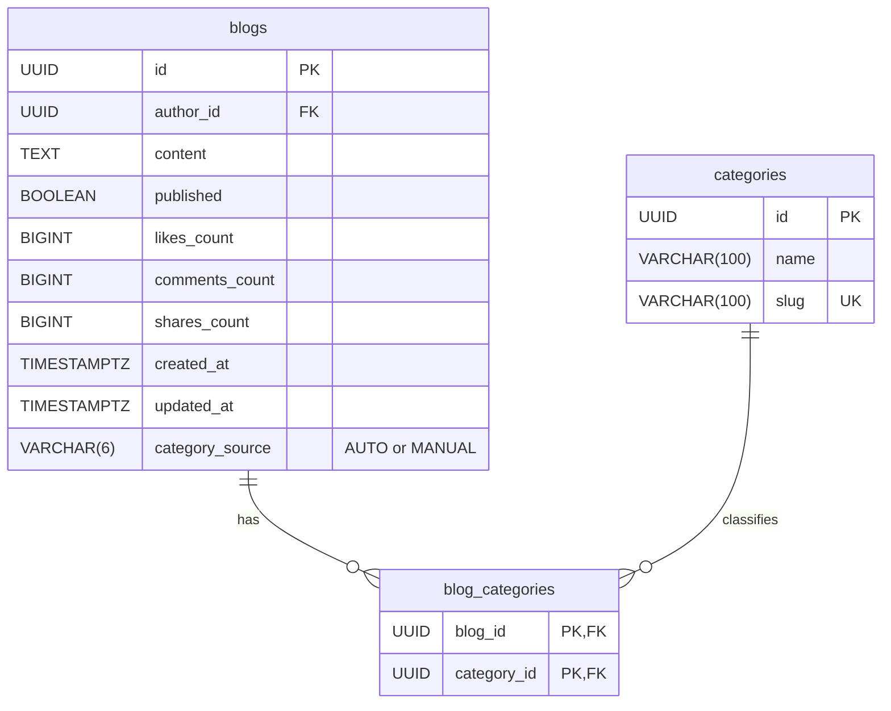

# Phân loại chủ đề bài viết

Ngày bổ sung: 30/10/2026. Trạng thái: đặc tả giai đoạn AI sau migration core; chưa triển khai model, API, migration hoặc frontend. Thiết kế này bổ sung cho [nghiệp vụ](01-nghiep-vu.md), [API](02-api.md), [PostgreSQL](03-postgresql.md) và [ERD](erd.md).

## Phạm vi

Tự động nhận dạng không hoặc nhiều chủ đề từ nội dung văn bản của bài viết. Người dùng đăng bài như hiện tại, không chọn chủ đề bắt buộc và không xác nhận kết quả model. Tác giả có thể đổi hoặc bỏ chủ đề trong phần chỉnh sửa bài viết.

Chủ đề là dữ liệu nền cho gợi ý nội dung sau này. Phiên bản này chưa triển khai feed cá nhân hóa, phân tích xu hướng, collaborative filtering, phân loại ảnh hoặc tìm kiếm ngữ nghĩa. Danh mục ban đầu được seed và ánh xạ với nhãn model; chưa thêm giao diện quản trị danh mục.

## Quy tắc nghiệp vụ

| Mã | Quy tắc |
| --- | --- |
| TOP01 | Tạo bài không yêu cầu categoryIds. Lưu bài và trả response trước; phân loại chạy ở nền sau DB commit. Lỗi hoặc timeout model không làm mất bài hay rollback thao tác đăng. |
| TOP02 | Mỗi bài có 0..n chủ đề; mỗi chủ đề thuộc 0..n bài. Model phân loại đa nhãn (multi-label), chỉ tự gắn các chủ đề đủ tin cậy thuộc danh mục hợp lệ; không tạo danh mục từ chuỗi do model trả về. |
| TOP03 | Nội dung trống, chỉ có ảnh, không thuộc danh mục hoặc dự đoán chưa đủ tin cậy thì giữ tập chủ đề rỗng (không có hàng blog_categories). Không ép vào một nhãn tùy ý; UI ẩn chip chủ đề và không hiện cảnh báo bắt người dùng xử lý. |
| TOP04 | Tác giả có thể chọn nhiều chủ đề hoặc chọn “Bỏ tất cả chủ đề”. Cả hai hành động đặt category_source=MANUAL, kể cả khi tập chủ đề rỗng; worker không được ghi đè lựa chọn này. |
| TOP05 | Tùy chọn “Tự động phân loại” chuyển category_source=AUTO, xóa nhãn hiện tại rồi phân loại lại sau commit. Không có bước xác nhận bắt buộc trong luồng đăng bài. |
| TOP06 | Khi sửa nội dung ở chế độ AUTO, xóa nhãn cũ và phân loại lại từ nội dung mới. Ở chế độ MANUAL, giữ lựa chọn của tác giả. Chỉ đổi ảnh hoặc published không cần phân loại lại văn bản. |
| TOP07 | Trước khi ghi kết quả, khóa hàng blog và kiểm bài còn tồn tại, vẫn AUTO, nội dung hiện tại giống snapshot đã suy luận. Nếu không khớp thì bỏ kết quả cũ; không tái tạo bài đã xóa. Không gọi model trong transaction giữ khóa DB. |
| TOP08 | Phân loại không đổi published, thời gian đăng, updated_at của chỉnh sửa bài hoặc counters. Chủ đề không cấp thêm quyền đọc; bài private vẫn chỉ chủ bài được xem. |

Ví dụ: người dùng đăng “Mai thi rồi mà giờ vẫn chưa học xong”; bài xuất hiện ngay, sau đó có thể được gắn “Học tập”. Một bài về học lập trình có thể đồng thời được gắn “Học tập” và “Công nghệ”. Nếu người dùng tự chọn lại tập chủ đề, model giữ nguyên lựa chọn đó ở các lần xử lý tiếp theo cho đến khi họ bật lại chế độ tự động.

## Dữ liệu mở rộng

Giữ nguyên chín bảng core. Thêm categories (3 cột), bảng nối blog_categories (2 cột) và blogs.category_source (1 cột) bằng Flyway mới sau version hiện hành, không sửa các migration V1–V4 đã có. Sau mở rộng: **11 bảng, 63 cột**; blogs tăng từ 9 lên 10 cột. Không đặt category_id trên blogs; quan hệ nhiều–nhiều đi qua blog_categories.

### Bảng categories

| Cột | Kiểu và ràng buộc | Ý nghĩa |
| --- | --- | --- |
| id | UUID, PK, do server/seed cấp | Khóa liên kết, không dùng tên hiển thị để nối dữ liệu. |
| name | VARCHAR(100), NOT NULL, CHECK char_length(btrim(name)) BETWEEN 1 AND 100 | Tên hiển thị, ví dụ “Học tập”. |
| slug | VARCHAR(100), NOT NULL, UNIQUE, CHECK slug ~ '^[a-z0-9]+(-[a-z0-9]+)*$' | Tên dùng trong URL/ánh xạ nhãn, ví dụ hoc-tap; chữ thường không dấu, phân tách bằng dấu gạch ngang. |

Slug ổn định khi đổi tên hiển thị; không tự sinh lại slug mỗi lần sửa tên. Danh mục ví dụ gồm Học tập, Công việc, Tình cảm, Gia đình, Giải trí; cần chốt tập nhãn với dữ liệu huấn luyện trước khi seed chính thức. Chưa thêm trang chủ đề hoặc route frontend theo slug trong phiên bản này.

### Cột bổ sung vào blogs

| Cột | Kiểu và ràng buộc | Ý nghĩa |
| --- | --- | --- |
| category_source | VARCHAR(6), NOT NULL DEFAULT 'AUTO', CHECK IN ('AUTO','MANUAL') | AUTO cho phép model xử lý; MANUAL bảo vệ lựa chọn của tác giả, kể cả không chọn chủ đề. |

category_source áp dụng cho toàn bộ tập chủ đề của bài: MANUAL bảo vệ cả tập rỗng và AUTO cho phép model thay thế toàn bộ tập. Không trộn nhãn thủ công và tự động trong bản này. AUTO với tập rỗng có thể là chưa xử lý, lỗi hoặc không có nhãn đủ tin cậy; UI không suy diễn thành trạng thái “đang xử lý” vô hạn. Chưa lưu điểm confidence, lịch sử dự đoán hoặc bảng sở thích người dùng khi chưa có nhu cầu sử dụng.

### Bảng nối blog_categories

| Cột | Kiểu và ràng buộc | Ý nghĩa |
| --- | --- | --- |
| blog_id | UUID, NOT NULL, FK blogs(id) ON DELETE CASCADE | Bài viết được gán chủ đề. |
| category_id | UUID, NOT NULL, FK categories(id) ON DELETE RESTRICT | Chủ đề thuộc danh mục hợp lệ. |

PRIMARY KEY (blog_id, category_id) ngăn gán trùng một chủ đề cho cùng bài; không thêm id riêng. Xóa bài sẽ xóa các liên kết của bài, không xóa danh mục. Không xóa danh mục còn được tham chiếu. Bài chưa có chủ đề không có hàng trong bảng nối; không dùng một hàng chứa NULL.

Backfill mặc định các bài cũ về tập chủ đề rỗng/category_source=AUTO. Phân loại dữ liệu cũ bằng batch có giới hạn, có thể chạy lại; không gọi model trong Flyway. PK ghép phục vụ tra cứu theo blog_id; chỉ thêm index bắt đầu bằng category_id khi có query và bằng chứng EXPLAIN cần nó.

## ERD mở rộng

Sơ đồ dưới hiển thị đủ cột của ba bảng liên quan. Những quan hệ core của blogs với users/comments/media/likes/shares giữ như [ERD đầy đủ](erd.md). Một category có 0..n bài và một blog có 0..n category qua bảng nối. Mỗi hàng blog_categories bắt buộc tham chiếu đúng một blog và một category.

[SVG mở rộng không cần Mermaid](assets/erd/phan-loai-chu-de.svg).

## Hợp đồng API bổ sung

Base path vẫn là /api/v1. Đây là hai endpoint giai đoạn AI, ngoài 35 endpoint core; tổng thiết kế khi triển khai cả hai giai đoạn là 37 endpoint. Không thêm public endpoint gọi model hoặc cho client ghi trực tiếp kết quả AUTO.

| Endpoint | Quyền | Request/response |
| --- | --- | --- |
| GET /categories | Guest và người đăng nhập | Array trực tiếp gồm {id,name,slug}; sắp name rồi id để kết quả ổn định. |
| PATCH /blogs/{blogId}/categories | Chỉ tác giả, session và CSRF | Request {mode:"MANUAL",categoryIds:["UUID-1","UUID-2"]} để thay thế toàn bộ tập; {mode:"MANUAL",categoryIds:[]} để bỏ tất cả; {mode:"AUTO"} để bật lại tự động. Trả HTTP 200 với BlogDTO hiện tại sau commit, không chờ model. |

MANUAL bắt buộc có categoryIds là mảng UUID, cho phép []; null, thiếu field, phần tử trùng hoặc UUID không thuộc danh mục trả 400. AUTO không nhận categoryIds. UUID/enum/body sai trả 400; phải kiểm toàn bộ danh sách trước khi ghi, không cập nhật một phần. Guest ghi nhận 401; user khác sửa bài public nhận 403; bài không tồn tại hoặc private không có quyền xem nhận 404. Không nhận categorySource/điểm dự đoán do client tự gửi. Nếu có nhiều thao tác đổi nhãn đồng thời, khóa hàng blog trước khi thay tập chủ đề và category_source trong cùng transaction; trạng thái commit sau cùng được giữ, không để lộ tập cập nhật dở. Worker cũng khóa cùng hàng blog và luôn tuân thủ TOP07.

BlogDTO và SharedBlogDTO bổ sung categories:[{id,name,slug}] (mảng rỗng [] khi chưa có chủ đề, sắp theo slug rồi id) và categorySource:"AUTO"|"MANUAL". Các DTO/endpoint core còn lại giữ contract. Bài share đọc chủ đề hiện tại của bài gốc, không lưu snapshot nhãn. Phân trang blogs trước, rồi batch lấy categories theo các blogId; không phân trang trực tiếp trên JOIN bảng nối vì sẽ lặp bài và sai số lượng. Bài chưa có nhãn vẫn xuất hiện, không gây N+1. POST tạo bài hiện tại vẫn không bắt buộc gửi nhãn.

## Xử lý nền, model và bảo mật

1. Sau transaction tạo/sửa bài hoặc bật AUTO thành công, gửi công việc phân loại với blogId và snapshot nội dung. Có timeout và số lần retry hữu hạn; không chặn request đăng bài.
2. Model chỉ nhận nội dung văn bản cần phân loại; không nhận mật khẩu, cookie, profile, danh sách người tương tác hoặc ảnh. Bản đầu chạy model do hệ thống quản lý; không gửi bài private sang dịch vụ bên thứ ba. Bài private vẫn được xử lý nội bộ và giữ nguyên quyền truy cập.
3. Đầu ra model là danh sách nhãn và điểm từng nhãn. Kiểm toàn bộ đầu ra: nhãn thuộc danh mục, không trùng và điểm hợp lệ theo contract; đầu ra sai thì không ghi kết quả và xử lý như lỗi model. Áp dụng ngưỡng từng nhãn được chọn từ tập validation, cho phép không nhãn nào vượt ngưỡng; không dùng softmax/argmax chỉ chọn một lớp. Điểm do model trả về không mặc nhiên là xác suất đã hiệu chỉnh.
4. Ghi kết quả theo TOP07 trong transaction ngắn: thay toàn bộ các hàng blog_categories của bài, không cộng dồn nhãn từ các lần suy luận cũ; lỗi ghi thì rollback toàn bộ tập. Ghi lặp kết quả cho cùng nội dung không tăng counters hoặc tạo dữ liệu trùng. Xóa bài/tài khoản khi tác vụ đang chạy không được tạo lại nội dung.
5. Nếu tiến trình dừng sau commit nhưng trước khi nhận việc, cho phép batch phân loại bù các bài AUTO chưa có nhãn. Batch có giới hạn tốc độ, phạm vi và số lượt; không quét lại vô hạn các bài thấp confidence. Chưa cam kết giao việc exactly-once hoặc tạo thêm queue service trong bản đầu.

Phương án thử nghiệm ban đầu: TF-IDF + One-vs-Rest Logistic Regression cho phân loại đa nhãn, so sánh trên dữ liệu tiếng Việt được gán tập nhãn theo cùng bộ categories (mỗi bài có thể nhiều nhãn). Đây là lựa chọn baseline, chưa phải model đã được chọn qua thực nghiệm. Tách train/validation/test theo bài, tránh bài trùng hoặc gần trùng rơi vào nhiều tập; báo cáo micro-F1/macro-F1, precision/recall từng nhãn, confusion matrix nhị phân từng nhãn và tỷ lệ model không gắn nhãn. Chọn model và ngưỡng trên validation; chỉ dùng test để đánh giá cuối cùng, chưa đặt con số accuracy thành cam kết.

Không dùng dữ liệu demo core 24 bài để khẳng định chất lượng model. Việc lấy bài thực tế làm dữ liệu huấn luyện cần phạm vi sử dụng phù hợp; không log toàn văn bài private vào log vận hành hoặc báo cáo nghiệm thu.

## Triển khai và nghiệm thu riêng

Sau khi hoàn tất core: chốt tập nhãn/dataset → thêm migration và seed categories → bổ sung API/DTO → nối tác vụ nền/model → thêm các chip và lựa chọn nhiều chủ đề trong chỉnh sửa → nghiệm thu. Các caller cần cập nhật gồm form sửa bài, feed, chi tiết bài, hồ sơ và danh sách share; tái sử dụng component/API client hiện có. Không cài dependency ML hay đổi runtime cho đến bước triển khai model.

| Mã | Kiểm tra | Kết quả cần có |
| --- | --- | --- |
| TOP-T01 | Model chậm, lỗi, timeout hoặc tiến trình dừng sau commit | Bài vẫn được lưu; request không chờ suy luận, batch bù có thể xử lý lại có kiểm soát. |
| TOP-T02 | Dự đoán hợp lệ/không đủ tin cậy/nhãn lạ; bài chỉ ảnh | Chỉ gắn nhãn hợp lệ đủ tin cậy; bài không có nhãn đủ tin cậy giữ tập rỗng; đầu ra nhãn lạ bị từ chối, không ghi một phần, không bắt xác nhận. |
| TOP-T03 | Đổi nhãn, bỏ nhãn rồi chạy worker; bật lại AUTO | MANUAL kể cả [] không bị ghi đè; AUTO cho phép phân loại lại. |
| TOP-T04 | Sửa nội dung hoặc chuyển MANUAL trong lúc suy luận | Kết quả cũ bị bỏ; nhãn khớp nội dung hiện tại hoặc lựa chọn tác giả. |
| TOP-T05 | Xóa bài/tài khoản trong lúc worker chạy | Không ghi hoặc tái tạo bài đã xóa. |
| TOP-T06 | Guest/user khác/CSRF sai; truy cập bài private | Áp dụng quyền/status như contract; không lộ bài private qua categories, DTO hoặc log. |
| TOP-T07 | Migration trên Docker và Neon, dữ liệu cũ và constraint | Thêm đúng 2 bảng/1 cột blogs; tổng 11 bảng/63 cột; PK ghép, FK, cascade liên kết khi xóa bài, RESTRICT danh mục, slug unique, source enum và MANUAL/tập rỗng đúng. |
| TOP-T08 | Feed/detail/profile/share với 0/1/nhiều chủ đề và phân trang | Không mất hoặc lặp bài, không sai phân trang, không N+1; share dùng nhãn hiện tại, tự gắn nhãn không đẩy bài lên đầu feed. |
| TOP-T09 | Đánh giá model trên tập test giữ riêng | Có dữ liệu/nhãn/version model, micro-F1/macro-F1, kết quả từng nhãn và tỷ lệ bỏ gắn nhãn; phân biệt kết quả thật với ví dụ. |
| TOP-T10 | Một bài nhiều chủ đề; một chủ đề nhiều bài; gán trùng cặp | Lưu được quan hệ N–N; PK ghép từ chối cặp trùng. |
| TOP-T11 | MANUAL thiếu/null/trùng/UUID lạ; lỗi giữa lúc thay tập | Trả 400 với request sai; lỗi ghi rollback toàn bộ, không lộ tập dở. |
| TOP-T12 | Chạy lặp worker; hai thao tác thay tập đồng thời | Không gán trùng hoặc cộng dồn kết quả cũ; ghi theo khóa blog, tập nhãn và source nhất quán. |

Các ca này là tiêu chí bổ sung cho giai đoạn AI; không đổi Definition of Done của migration core và chưa được đánh dấu PASS.
