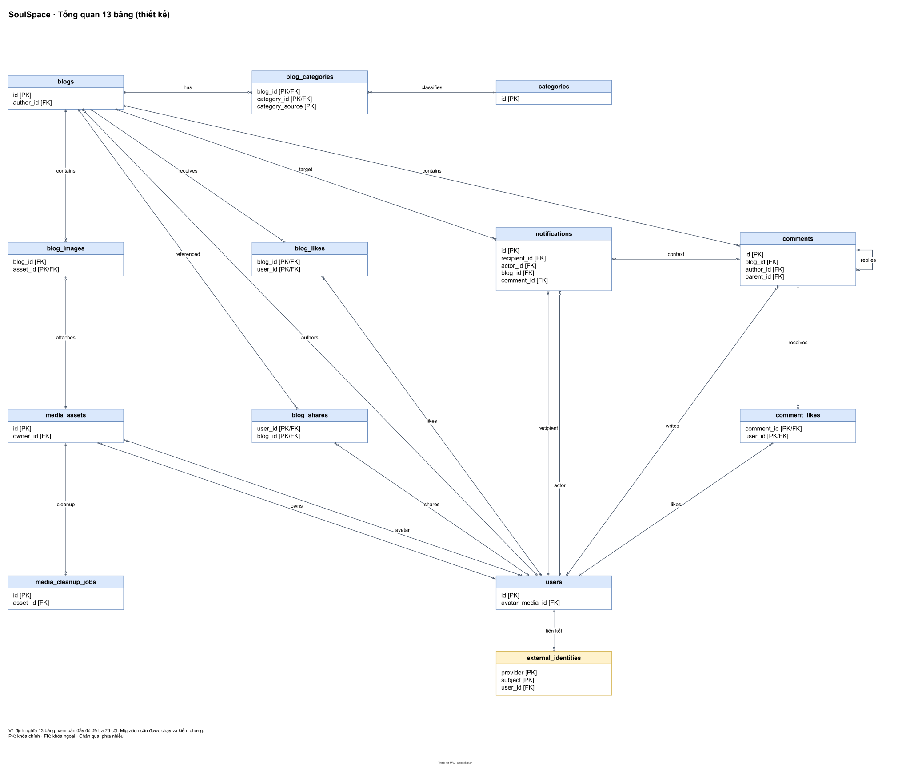
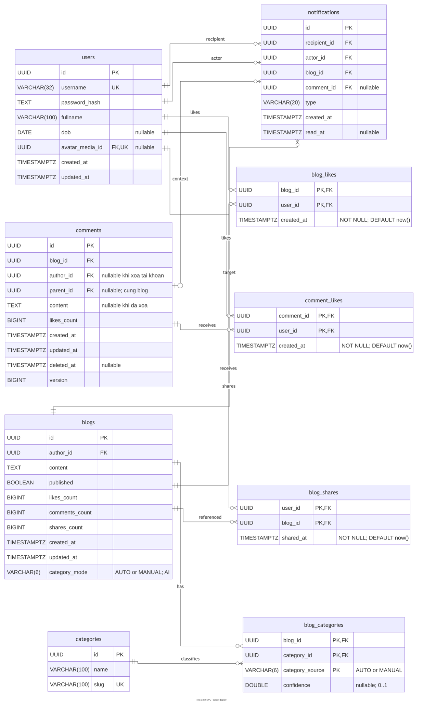

# Báo cáo thiết kế SQL — SoulSpace

Ngày cập nhật: 31/10/2026. Mục đích: lưu cơ sở thiết kế, phân tích và các quyết định đã thống nhất để sử dụng trong báo
cáo tổng kết project. Mã SQL và code Java triển khai theo thiết kế này. Nội dung tổ chức theo yêu cầu: **ERD, Index,
View, Stored Procedure, Trigger, Transaction và AI in SQL**.

## 1. Phạm vi và các quyết định đã chốt

Thiết kế dùng PostgreSQL, UUID cho định danh, Flyway để quản lý schema và JOIN để lấy thông tin hiện tại. Không lưu cây
comment hoặc danh sách người like trong một cột; không sao chép nội dung bài khi share. Docker phục vụ local, Neon phục
vụ môi trường dùng chung; mỗi backend chỉ kết nối một database tại một thời điểm.

| Nội dung         | Quyết định và nguồn                                                                                                                                       |
|------------------|-----------------------------------------------------------------------------------------------------------------------------------------------------------|
| Schema V1        | 13 bảng/76 cột, gồm chủ đề, nguồn nhãn, confidence và liên kết Google. [V1](../../soulspace/src/main/resources/db/migration/V1__core_schema.sql)                           |
| Index V2         | Giữ 19 index sau phân tích query, khóa sẵn có và chi phí duy trì. [V2](../../soulspace/src/main/resources/db/migration/V2__query_indexes.sql)             |
| View             | v_public_blog_feed: bài public kèm thông tin tác giả hiện tại, mỗi bài một hàng. [V5](../../soulspace/src/main/resources/db/migration/V5__read_views.sql) |
| Stored procedure | Bốn procedure tương tác trong V4; phần phân tích chi tiết bổ sung khi review V4.                                                                          |
| Trigger          | Các ràng buộc động và counters trong V3; phần phân tích chi tiết bổ sung khi review V3.                                                                   |
| Transaction      | Service Java điều khiển ranh giới; PostgreSQL thực thi commit/rollback.                                                                                   |
| AI và SQL        | Phân loại đa nhãn, lưu riêng tập AUTO/MANUAL và confidence để đối chiếu; hình thức đáp ứng tiêu chí AI in SQL cần được chốt riêng.                        |

V1 được bổ sung trực tiếp vì người dùng xác nhận mới chạy Docker Compose, chưa chạy Flyway lần đầu. Sau khi migration đã
áp dụng, thay đổi schema phải dùng migration mới, không sửa checksum/history để bỏ qua lỗi.

## 2. Sơ đồ ERD

### 2.1. Tổng quan



[Mở SVG tổng quan](assets/erd/tong-quan.svg).

| Bảng               |    Cột | Trách nhiệm                                                  |
|--------------------|-------:|--------------------------------------------------------------|
| users              |      8 | Tài khoản, hồ sơ, hash mật khẩu và avatar                    |
| external_identities |      3 | Liên kết danh tính Google với tài khoản SoulSpace            |
| blogs              |     10 | Bài viết, public/private, counters và chế độ chủ đề hiển thị |
| categories         |      3 | Danh mục chủ đề với tên và slug                              |
| blog_categories    |      4 | Liên kết bài/chủ đề/nguồn và confidence                      |
| comments           |     10 | Comment/reply, nội dung, trạng thái xóa và version           |
| blog_likes         |      3 | Quan hệ user like bài                                        |
| comment_likes      |      3 | Quan hệ user like comment                                    |
| blog_shares        |      3 | Quan hệ user share bài gốc                                   |
| media_assets       |     10 | Chủ sở hữu, trạng thái và metadata ảnh                       |
| blog_images        |      3 | Asset gắn vào bài và vị trí hiển thị                         |
| media_cleanup_jobs |      8 | Công việc dọn media, retry và lease                          |
| notifications      |      8 | Lịch sử tương tác, người nhận và trạng thái đã đọc           |
| **Tổng**           | **76** | **13 bảng**                                                  |

### 2.2. Bài viết và bình luận



[Mở SVG bài viết và bình luận](assets/erd/bai-viet-binh-luan.svg).

Một user có nhiều bài. Comments dùng chung một bảng cho node gốc và replies: parent_id=NULL là gốc; parent_id có giá trị
là reply. blog_id giữ trực tiếp để truy vấn toàn cây theo bài; FK ghép giữ parent và child trong cùng bài. Xóa mềm giữ
node và replies, bỏ nội dung. Không giới hạn cứng độ sâu; UI chỉ thụt lề tối đa 3 tầng và vẫn giữ đúng quan hệ trả lời.

### 2.3. Likes và shares



[Mở SVG likes/shares](assets/erd/luot-thich-chia-se.svg).

Likes/shares là các quan hệ riêng có khóa chính ghép, chống trùng theo cặp user/tài nguyên. Share trỏ đến bài gốc; không
tạo bản sao blogs. Nếu An share bài của Bình, tác giả bài vẫn là Bình; danh sách share của An lấy qua blog_shares.

### 2.4. Media và cleanup



[Mở SVG media](assets/erd/media-avatar.svg).

Quan hệ sở hữu asset và quan hệ chọn avatar là hai quan hệ khác nhau. Bảng blog_images quản lý vị trí ảnh, không chứa
URL provider. Cleanup job tham chiếu asset, không phụ thuộc trực tiếp vào user/blog đã bị xóa.

### 2.5. Chủ đề và kết quả AI



[Mở SVG chủ đề](assets/erd/phan-loai-chu-de.svg).

categories giữ danh mục; blog_categories giữ các liên kết theo nguồn AUTO/MANUAL và confidence. blogs.category_mode chọn
tập chủ đề hiển thị. Lưu cả hai nguồn cho phép đối chiếu dự đoán AI với lựa chọn của tác giả, kể cả cùng chủ đề xuất
hiện ở cả hai nguồn.

Thiết kế chấp nhận phần dư thừa có chủ đích: blog_id trên reply và các counters tổng hợp. Không khẳng định toàn schema
đạt BCNF tuyệt đối; ưu tiên truy vấn theo tính năng, dễ cập nhật và đối soát được dữ liệu. Chi tiết từng cột nằm
trong [03 PostgreSQL](03-postgresql.md), hình và nguồn ở [erd.md](erd.md).

## 3. V1 — bảng và ràng buộc

### 3.1. Khóa và kiểu dữ liệu

- Thiết kế chốt tất cả ID sinh mới dùng UUID v7, bao gồm notifications.id do database sinh. V1 đã dùng DEFAULT uuid_v7(); cần kiểm chứng generator tương thích PostgreSQL 17 trước khi nghiệm thu. Seed/fixture có ID cố định được giữ để tái hiện kiểm thử. PRIMARY KEY không đồng nghĩa SQL tự sinh UUID khi chưa có DEFAULT. Xem [chính sách sinh UUID](03-postgresql.md#chính-sách-sinh-uuid); phiên bản generator là quyết định thiết kế, chưa có kết quả chạy Java/JDBC cho chính sách mới.
- DATE dùng cho dob; TIMESTAMPTZ dùng cho thời gian sự kiện. DEFAULT now() chỉ áp dụng lúc INSERT bỏ qua cột, không tự
  sửa updated_at khi UPDATE.
- BIGINT NOT NULL DEFAULT 0 và CHECK không âm cho counters; nguồn đối soát là các bảng quan hệ.
- UNIQUE username chống đăng ký trùng; UNIQUE avatar_media_id cho phép nhiều NULL nhưng không cho hai user dùng cùng
  asset.
- Không tạo thêm index đơn trên những cột PK/UNIQUE đã có index phù hợp.

### 3.2. Users và avatar

Username chỉ nhận chữ thường/số dài 3–32; fullname sau btrim phải có nội dung. Kiểm password bằng Argon2id và kiểm dob
trong service; database không tự xác nhận một chuỗi bất kỳ là hash đúng. CHECK btrim chỉ kiểm điều kiện, không tự trim
giá trị được lưu.

Tạo users trước, media_assets sau, rồi ALTER TABLE thêm FK avatar. Xóa asset đang dùng làm avatar đưa avatar_media_id về
NULL; owner_id của asset về NULL khi tài khoản bị xóa để giữ metadata phục vụ cleanup.

### 3.3. Comments và chính sách xóa

```sql
FOREIGN KEY (parent_id, blog_id)
REFERENCES comments(id, blog_id) ON DELETE CASCADE
```

FK ghép ngăn reply sang bài khác; UNIQUE(id,blog_id) là đích tham chiếu. CHECK parent_id IS DISTINCT FROM id chặn tự
trỏ. V3 theo thiết kế mới yêu cầu parent tồn tại trước child và khóa cấu trúc ID/blog_id/parent_id sau tạo. Với dữ liệu
ban đầu không vòng, node mới chỉ gắn vào cây đã có nên không tạo vòng; không cần đếm ancestor để chặn độ sâu.

Quyết định ngày 31/10/2026: cho phép trả lời liên tục, kể cả cấp 6 trở đi. Giữ một bảng và parent_id giúp sửa/xóa một
node không phải cập nhật depth của cả nhánh; không cần thêm bảng root/reply hoặc sửa cột/index. So với chặn 5 cấp,
cuộc hội thoại không bị ngắt vì số lần trả lời nối tiếp; UI thụt lề tối đa 3 tầng để tránh nội dung bị ép hẹp. Reply
sâu vẫn chỉ rõ đang trả lời ai và lưu đúng parent, không chuyển liên kết sang ancestor để làm phẳng hình thức.
Đánh đổi là cần kiểm soát khối lượng đọc và tránh phụ thuộc call stack khi dựng/duyệt cây. API core giữ DTO hiện tại;
phân trang/tải từng nhóm phải có hợp đồng riêng trước khi phục vụ bài có nhiều bình luận.

```sql
CHECK (
    (deleted_at IS NULL AND content IS NOT NULL
     AND char_length(btrim(content)) BETWEEN 1 AND 2000)
    OR (deleted_at IS NOT NULL AND content IS NULL)
),
CHECK (author_id IS NOT NULL OR deleted_at IS NOT NULL)
```

Comment đang sống phải có tác giả/nội dung. Placeholder có content=NULL; frontend dựng thông báo xóa. Không lưu chuỗi
thông báo thay cho nội dung. version là số trên cùng một hàng, không phải bảng lịch sử.

Xóa riêng comment dùng UPDATE thành placeholder, không gọi DELETE vật lý. ON DELETE CASCADE ở parent_id chỉ áp dụng khi
xóa vật lý và có thể xóa cả nhánh. Khi xóa bài, toàn bộ cây thuộc bài được xóa.

Không dùng riêng DELETE users làm chức năng xóa tài khoản. Thứ tự transaction: thu thập media/enqueue cleanup; xóa likes
và anonymize comments ở bài người khác; xóa các bài của user; xóa user cuối cùng. CHECK có thể chặn DELETE user trực
tiếp nếu author bị SET NULL trong khi comment vẫn còn nội dung, kể cả comment nằm trong bài của chính user. Thứ tự chủ
động giúp không phụ thuộc vào thứ tự cascade.

### 3.4. Metadata ảnh, vị trí và cleanup

Media có ba trạng thái PENDING, ATTACHED, DELETE_PENDING. PENDING gồm receipt chưa xác nhận hoặc ảnh đã xác nhận nhưng
chưa gắn; bộ provider_asset_id/format/size_bytes phải cùng NULL hoặc cùng có giá trị. ATTACHED bắt buộc đã xác nhận;
format chỉ jpeg/png, size dương.

```sql
CHECK (provider_asset_id IS NULL OR length(btrim(provider_asset_id)) > 0)
```

CHECK này bổ sung sau review để chặn trường hợp ID provider rỗng nhưng asset vẫn được coi là đã xác nhận. FK chỉ kiểm
tồn tại, không thay điều kiện owner/purpose/state khi attach; service phải khóa và kiểm lại.

blog_images dùng asset_id làm PK, position từ 0 đến 9 và UNIQUE(blog_id,position), nên tối đa 10 ảnh/bài. UNIQUE có thể
trì hoãn trong transaction để đổi chỗ ảnh. Xóa bài xóa liên kết; xóa asset đang được bài dùng bị RESTRICT. Provider được
dọn sau commit qua queue.

Cleanup có attempts 0–5; RUNNING phải có lease, PENDING/DEAD phải không có lease. CHECK không tự xác nhận worker còn sở
hữu lượt claim; query worker phải kiểm đúng cặp attempts/lease_until và thời gian hiện tại sau khi lấy khóa.

### 3.5. Chủ đề, nguồn và confidence

```sql
-- Trên blogs: chọn tập nhãn hiển thị, kể cả khi tập đó rỗng.
category_mode VARCHAR(6) NOT NULL DEFAULT 'AUTO'
    CHECK (category_mode IN ('AUTO', 'MANUAL'))
```

```sql
CREATE TABLE blog_categories (
    blog_id UUID NOT NULL REFERENCES blogs(id) ON DELETE CASCADE,
    category_id UUID NOT NULL REFERENCES categories(id) ON DELETE RESTRICT,
    category_source VARCHAR(6) NOT NULL CHECK (category_source IN ('AUTO', 'MANUAL')),
    confidence DOUBLE PRECISION CHECK (confidence >= 0 AND confidence <= 1),
    PRIMARY KEY (blog_id, category_id, category_source),
    CONSTRAINT category_confidence_source CHECK (
        (category_source = 'AUTO' AND confidence IS NOT NULL)
        OR (category_source = 'MANUAL' AND confidence IS NULL)
    )
);
```

Mỗi blog có 0..n chủ đề và mỗi chủ đề có 0..n blog. category_source là một phần khóa ghép, không là khóa riêng. AUTO và
MANUAL cho cùng cặp bài/chủ đề là hai hàng hợp lệ; trùng trong cùng nguồn bị từ chối. AUTO bắt buộc có confidence hữu
hạn trong [0,1]; MANUAL để NULL, không gán 1 như thể đó là điểm model.

category_mode trên blogs vẫn cần để biểu diễn tác giả đã chọn MANUAL và bỏ hết chủ đề. Nếu chỉ nhìn bảng nối rỗng sẽ
không phân biệt được với AUTO chưa có nhãn. Query hiển thị chỉ đọc nguồn khớp mode, không tự hợp nhất hai tập.

## 4. V2 — cơ sở chọn từng index

Tất cả index V2 là B-tree, bổ sung cho PK/UNIQUE của V1. Đánh giá theo query, số hàng phải đọc/sort, khóa sẵn có và chi
phí ghi. Planner có dùng index chưa đủ chứng minh index đáng giữ; không ép planner dùng index chỉ để có hình minh họa.
Các query có :thamSo dưới đây là dạng bind trong repository, không phải lệnh psql chạy nguyên văn.

### I01. blogs_public_feed_idx

```sql
CREATE INDEX blogs_public_feed_idx ON blogs (created_at DESC, id DESC) WHERE published;
```

Phục vụ SELECT từ v_public_blog_feed ORDER BY created_at DESC,blog_id DESC LIMIT :limit. Index chỉ chứa bài public, sắp
theo thời gian và ID để lấy trang đầu ổn định. PK id không cung cấp thứ tự theo thời gian. Không có index phù hợp có thể
phải đọc nhiều bài rồi sort để lấy một trang nhỏ. Đổi public/private và ghi bài public làm phát sinh công duy trì index.
Quyết định: giữ cho feed.

### I02. blogs_author_idx

```sql
CREATE INDEX blogs_author_idx ON blogs (author_id, created_at DESC, id DESC);
```

Phục vụ WHERE author_id=:userId ORDER BY created_at DESC,id DESC, gồm cả public/private. author_id đứng đầu để khoanh
đúng người trước khi sắp bài; cũng hỗ trợ thu thập/xóa bài của tài khoản. Không thay bằng index chỉ theo thời gian vì sẽ
phải lọc bài của các user khác. Quyết định: giữ.

### I03. blogs_public_author_idx

```sql
CREATE INDEX blogs_public_author_idx ON blogs (author_id, created_at DESC, id DESC) WHERE published;
```

Phục vụ v_public_blog_feed WHERE author_id=:profileUserId theo thứ tự mới nhất. So với I02, index này bỏ bài private; có
ích khi đọc trang công khai thường xuyên và tác giả có nhiều private. I02 vẫn có thể tìm bài theo tác giả rồi lọc
public, nên đây là phần đánh đổi thêm dung lượng/ghi để phục vụ riêng đường đọc công khai. Người dùng xác nhận thường
xuyên xem trang cá nhân người khác và chốt giữ I03. Khi có dữ liệu thật, tiếp tục đo so với chỉ dùng I02; không coi tần
suất là bằng chứng duy nhất về mức tăng tốc.

### I04. comments_blog_idx

```sql
CREATE INDEX comments_blog_idx ON comments (blog_id, created_at DESC, id DESC);
```

Phục vụ WHERE blog_id=:blogId ORDER BY created_at DESC,id DESC để lấy hàng phẳng rồi dựng cây; root và các replies cùng
parent giữ thứ tự mới nhất trước. Dựng cây theo ID/parent_id, không phụ thuộc hàng cha xuất hiện trước hàng con.
Query vẫn phải ghi ORDER BY; index chỉ hỗ trợ thực thi, không tự bảo đảm thứ tự kết quả. UNIQUE(id,blog_id) không có
blog_id đứng đầu nên không thay thế tốt query này. Giữ cả placeholder, không thêm WHERE deleted_at IS NULL vì sẽ làm
thiếu node cha của replies. Quyết định: giữ.

### I05. comments_parent_idx

```sql
CREATE INDEX comments_parent_idx ON comments (parent_id, blog_id) WHERE parent_id IS NOT NULL;
```

Phục vụ tìm con trực tiếp theo parent_id/blog_id và phía tham chiếu của FK khi cascade xóa vật lý. Chỉ chứa replies, bỏ
node gốc parent=NULL. Index này không dùng để tìm cha bằng ID, việc đó đã có PK. Quyết định: giữ cho cây và cascade.

### I06. comments_author_idx

```sql
CREATE INDEX comments_author_idx ON comments (author_id);
```

Phục vụ WHERE author_id=:userId khi xóa tài khoản, tìm các bài còn sống chứa comments cần anonymize. Index theo blog
không giải quyết hướng tìm từ user vì chưa biết người đó đã comment ở đâu. Không cần thêm thời gian khi tác vụ chưa có
yêu cầu sort. Quyết định: giữ.

### I07. blog_likes_user_idx

```sql
CREATE INDEX blog_likes_user_idx ON blog_likes (user_id, created_at DESC, blog_id DESC);
```

Phục vụ WHERE user_id=:userId ORDER BY created_at DESC,blog_id DESC LIMIT :limit để lấy lượt thích bài gần đây làm
đầu vào gợi ý cá nhân hóa; created_at là thời điểm thích, không phải thời điểm đăng bài. Vẫn hỗ trợ tìm/dọn tương tác
theo user khi xóa tài khoản. Kiểm đúng một cặp blog/user đã có PK(blog_id,user_id). Query phải ghi ORDER BY;
index không tự tạo hệ thống gợi ý. Người dùng chốt giữ và bổ sung thứ tự theo thời gian; chưa đo lại index mới.

### I08. comment_likes_user_idx

```sql
CREATE INDEX comment_likes_user_idx ON comment_likes (user_id, created_at DESC, comment_id DESC);
```

Phục vụ WHERE user_id=:userId ORDER BY created_at DESC,comment_id DESC LIMIT :limit để lấy lượt thích bình luận gần
đây. Từ comment_id tìm bài chứa bình luận và chủ đề của bài làm tín hiệu gợi ý cá nhân hóa. Vẫn hỗ trợ dọn lượt like
comment khi xóa tài khoản. PK(comment_id,user_id) đã bảo đảm tính duy nhất và kiểm tra một cặp comment/user.
Query phải ghi ORDER BY. Quyết định: giữ và bổ sung thứ tự theo thời gian; chưa đo lại index mới.

### I09. blog_shares_blog_idx

```sql
CREATE INDEX blog_shares_blog_idx ON blog_shares (blog_id);
```

PK(user_id,blog_id) thuận lợi theo người share; index này phục vụ theo bài gốc, nhất là tìm/xóa các quan hệ khi xóa bài.
Chỉ cần blog_id vì chưa có query yêu cầu sort các lượt share của cùng bài. Quyết định: giữ.

### I10. blog_shares_user_time_idx

```sql
CREATE INDEX blog_shares_user_time_idx ON blog_shares (user_id, shared_at DESC, blog_id DESC);
```

Phục vụ WHERE user_id=:userId ORDER BY shared_at DESC,blog_id DESC LIMIT :limit. PK đã tìm được share theo user nhưng
sắp tiếp theo blog_id, không theo shared_at. Một bài cũ vừa được share cần lên đầu danh sách share theo thời điểm share,
không theo ngày đăng gốc. Với ít share, PK rồi sort có thể đủ rẻ; phép thử thăm dò chưa cho thấy giảm buffer cho query
này. Người dùng vẫn chốt giữ để phục vụ thứ tự mới nhất; cần đo tiếp với phân bố share thực tế. Các lượt share gần đây
cũng là đầu vào dự kiến cho gợi ý cá nhân hóa; index không thay thế logic chấm điểm chủ đề.

### I11. media_assets_owner_idx

```sql
CREATE INDEX media_assets_owner_idx ON media_assets (owner_id);
```

Phục vụ WHERE owner_id=:userId để thu thập cả media đã gắn và upload dở khi xóa tài khoản. PK asset ID không trả lời
được toàn bộ tài sản của một user. Quyết định: giữ.

### I12. media_assets_stale_idx

```sql
CREATE INDEX media_assets_stale_idx ON media_assets (state, created_at);
```

Phục vụ WHERE state='PENDING' AND created_at<:cutoff ORDER BY created_at LIMIT :batchSize. Điều kiện bằng trên state
khoanh nhóm, sau đó điều kiện khoảng trên thời gian tìm hàng cũ. Chỉ index state không loại được PENDING mới; chỉ thời
gian có thể phải đọc nhiều ATTACHED cũ. Metadata vẫn phải được kiểm để phân biệt hai loại PENDING. Quyết định: giữ cho
scanner định kỳ.

### I13. cleanup_ready_idx

```sql
CREATE INDEX cleanup_ready_idx ON media_cleanup_jobs (available_at, id) WHERE status = 'PENDING';
```

Phục vụ job PENDING, attempts<5, available_at đến hạn; ORDER BY available_at,id LIMIT :batchSize FOR UPDATE SKIP LOCKED.
Chỉ chứa nhóm chờ, tránh lặp quét cả RUNNING/DEAD. Index không thay kiểm attempts hoặc cơ chế claim/lease. Query worker
phải thể hiện trạng thái PENDING cố định để khớp partial index. Quyết định: giữ.

### I14. cleanup_expired_idx

```sql
CREATE INDEX cleanup_expired_idx ON media_cleanup_jobs (lease_until) WHERE status = 'RUNNING';
```

Phục vụ job RUNNING có lease_until hết hạn để thu hồi sau worker crash. I13 không thay thế vì chứa nhóm trạng thái và
cột thời gian khác. Chỉ chứa RUNNING, không index lease=NULL của PENDING/DEAD. Quyết định: giữ.

### Chi phí và cách kiểm chứng

Không đánh index cho mọi cột. INSERT/DELETE và UPDATE các cột liên quan phải duy trì index; cần tính dung lượng và ảnh
hưởng ghi. Các index phục vụ đọc không thay thế quyền, CHECK, UNIQUE hoặc transaction. Không thêm
GIN/trigram/vector/index confidence khi chưa có query yêu cầu.

Phép thử thăm dò trong phiên review dùng PostgreSQL WASM 17.5: 1.000 users, 10.000 blogs, 10.000 comments, 50.000 blog
likes, 30.000 comment likes, 20.000 shares, 10.000 assets, 3.000 jobs. So sánh 14 query trước/sau V2, giữ PK/UNIQUE và
dữ liệu như nhau, chạy ANALYZE, không ép index. V3 không được nạp trong phép đo này để tách ảnh hưởng ghi/trigger. Kết
quả query trước/sau giống nhau; planner chọn các index tương ứng. Đây là thăm dò kế hoạch đọc, không phải benchmark vận
hành.

| Query mẫu                 | Lượt truy cập shared buffer trước/sau V2 | Nhận xét                                         |
|---------------------------|------------------------------------------|--------------------------------------------------|
| Feed qua view             | 3.264 / 64                               | Từ quét/sort sang blogs_public_feed_idx          |
| Comments theo blog        | 85 / 12                                  | Dùng comments_blog_idx thay cách tìm kém phù hợp |
| Share theo user/thời gian | 22 / 22                                  | Không có lợi ích buffer rõ với mẫu nhỏ theo user |

Các số trên ghi lại kết quả thăm dò của phiên review, không phải tốc độ phản hồi hoặc cam kết p95. Trước báo cáo nghiệm
thu phải lưu script/dataset/query plan tái lập, đo nhiều lượt trên Docker, ghi môi trường và chi phí ghi/dung lượng; đo
Neon riêng để không trộn độ trễ mạng với lợi ích index. Kịch bản theo [06 nghiệm thu](06-nghiem-thu.md).

## 5. View — dùng chung cách đọc bài public

```sql
CREATE VIEW public.v_public_blog_feed WITH (security_invoker = true) AS
SELECT b.id AS blog_id, b.author_id, u.username, u.fullname,
       u.avatar_media_id, b.content, b.likes_count, b.comments_count,
       b.shares_count, b.created_at, b.updated_at
FROM public.blogs b
JOIN public.users u ON u.id = b.author_id
WHERE b.published = true;
```
View có 11 cột; không tăng số bảng/cột lưu trữ. Mục đích là tái sử dụng JOIN và điều kiện public cho feed/trang tác giả,
giảm việc lặp quy tắc ở repository. Bài viết lấy tên/avatar hiện tại, không phải cập nhật snapshot khi sửa hồ sơ. Query
JOIN trực tiếp cũng đạt kết quả này; lợi ích riêng của view là đóng gói và dùng chung định nghĩa, không tự tăng tốc.

| Thao tác                     | Kết quả khi đọc lại sau commit                     |
|------------------------------|----------------------------------------------------|
| Đăng bài public              | Thêm hàng kết quả                                  |
| Đăng bài private             | Không xuất hiện                                    |
| Sửa nội dung hoặc tên/avatar | Lấy giá trị mới                                    |
| Chuyển private/public        | Ẩn/xuất hiện lại, không xóa/tạo bản sao            |
| Share/unshare                | Vẫn một hàng bài gốc, shares_count đổi qua trigger |
| Xóa bài                      | Không còn hàng kết quả                             |

Frontend gọi API; repository SELECT view có ORDER BY/phân trang, thêm WHERE author_id khi xem tác giả. Trang của chính
mình cần private và danh sách share dùng query riêng. Ảnh bài, trạng thái like viewer và chủ đề theo mode lấy batch sau
phân trang; không JOIN quan hệ nhiều hàng trực tiếp làm lặp blog. Confidence và hai tập nhãn không được tự thêm vào DTO
công khai.

View thường không lưu bản sao kết quả, không cần REFRESH; bảng gốc là nơi ghi. V5 chỉ cấp SELECT cho runtime và thu hồi
quyền ghi có thể được default privileges cấp trước đó; security_invoker dùng quyền đọc bảng gốc của role gọi. Không chứa
password_hash/dob/provider IDs; view không thay kiểm quyền toàn hệ thống.

## 6. Stored Procedure — khung phân tích V4

V3/V4 được trình bày lại ngày 12/11/2026: khai báo function/procedure/trigger, truy vấn EXISTS lồng nhau và điều kiện dài được tách dòng; mỗi mệnh đề truy vấn (WHERE, SET, VALUES, ON CONFLICT, FOR UPDATE/FOR KEY SHARE) xuống dòng riêng; các điều kiện AND trong WHERE được căn theo cùng truy vấn. Thay đổi chỉ là khoảng trắng/thụt lề, giữ nguyên comment, logic và mã lỗi. Các khối SQL trong tài liệu giải thích V3 và mốc dòng sơ đồ được đồng bộ tương ứng.

Nguồn: [V4__interaction_procedures.sql](../../soulspace/src/main/resources/db/migration/V4__interaction_procedures.sql).

Bổ sung sơ đồ [chia sẻ](../diagram/v4/03-share-blog-trigger.drawio.png) và [gỡ chia sẻ](../diagram/v4/04-unshare-blog-trigger.drawio.png): đường procedure → blog_shares → blog_shares_counter → update_relation_counter → blogs.shares_count. Share yêu cầu public và báo ALREADY_SHARED khi INSERT bỏ qua cặp trùng; unshare cho phép private/blog vắng và không lỗi nếu DELETE không có hàng. Các nhánh lỗi/thành công cùng ý nghĩa dùng nút kết thúc chung. Trigger chạy trong câu DML, không chạy sau commit; các hình thoi số hàng giải thích DML/trigger, không bổ sung IF vào SQL. Đây là đối chiếu code, không thay bằng chứng kiểm thử thực thi.

Bổ sung [sơ đồ sp_set_comment_like](../diagram/v4/README.md#02-thíchbỏ-thích-bình-luận-và-cập-nhật-bộ-đếm) cho chuỗi procedure → comment_likes → comment_likes_counter → update_relation_counter → comments.likes_count. Sơ đồ giữ thứ tự khóa user/blog/comment, kiểm bình luận đúng bài/chưa xóa, năm lỗi chung một nút kết thúc; thể hiện riêng BEFORE INSERT guard_comment_like và AFTER row trigger cập nhật counter. BEFORE INSERT vẫn có thể chạy khi ON CONFLICT bỏ qua hàng trùng, còn counter không đổi nếu không có hàng thực sự thêm/xóa. Đây là đối chiếu code, không phải kết quả kiểm thử database.

Quan hệ procedure → DML → trigger → counter được mô tả trong [sơ đồ sp_set_blog_like](../diagram/v4/README.md). INSERT/DELETE thật sự thay đổi hàng mới kích hoạt row trigger `blog_likes_counter`, gọi `update_relation_counter()` để sửa `blogs.likes_count` trong cùng transaction. Các nhánh không thay đổi hàng giữ nguyên counter; sơ đồ không bổ sung logic IF hoặc COMMIT vào SQL.

Bản trình bày ngày 11/11/2026 tách các IF báo lỗi thành nhiều dòng và bổ sung comment theo mục đích từng procedure. Phần cấp quyền được phân nhóm riêng: thu hồi quyền mặc định, cấp quyền runtime và bảo vệ Flyway history. Thay đổi này chỉ giúp đọc code, không đổi kiểm quyền, thứ tự khóa, SQLSTATE hoặc cách commit/rollback.
Ghi nhận thiết kế hiện tại; bổ sung phân tích từng nhánh, lỗi và bằng chứng sau khi review V4.

| Procedure           | Input                         | Vai trò                                                                    |
|---------------------|-------------------------------|----------------------------------------------------------------------------|
| sp_set_blog_like    | actor, blog, desired          | Khóa blog, kiểm quyền xem, insert/delete quan hệ theo trạng thái mong muốn |
| sp_set_comment_like | actor, blog, comment, desired | Khóa blog rồi comment; kiểm thuộc bài, quyền và trạng thái chưa xóa        |
| sp_share_blog       | actor, blog                   | Đòi bài public, tạo share; trùng báo ALREADY_SHARED                        |
| sp_unshare_blog     | actor, blog                   | Gỡ share của actor, lặp khi không còn quan hệ vẫn thành công               |

Actor lấy từ session phía server. Procedure SECURITY INVOKER không tự COMMIT; service gọi trong transaction và đọc trạng
thái/counter sau thao tác. Trigger là nơi duy nhất tăng/giảm counters. Bộ test cần kiểm actor/quyền, desired=NULL, gọi
lặp, share trùng và rollback; không chỉ chứng minh CALL chạy được.

## 7. Trigger — khung phân tích V3

Nguồn: [V3__counters_and_invariants.sql](../../soulspace/src/main/resources/db/migration/V3__counters_and_invariants.sql).
Giải thích từng khối code, ví dụ và đánh đổi trong [09 — giải thích V3](09-giai-thich-v3.md); sơ đồ tình huống/SQL ở [bộ diagram V3](../diagram/README.md).
Ghi nhận mục đích; review chi tiết V3 sẽ bổ sung tình huống sai, thứ tự khóa và kiểm chứng đồng thời. Bảng dưới mô tả
thiết kế không giới hạn cứng độ sâu. V3 và invariants.sql đã đồng bộ ngày 01/11/2026 theo
[đặc tả cây reply](03-postgresql.md#cây-reply-và-cách-hiển-thị): bỏ CTE đếm cấp, giữ parent đã tồn tại và cấu trúc bất biến để ngăn vòng; không thêm bảng/cột depth.

| Nhóm trigger                                                   | Mục đích nghiệp vụ                                                                                     |
|----------------------------------------------------------------|--------------------------------------------------------------------------------------------------------|
| comments_validate                                              | Giữ cấu trúc bất biến, kiểm parent tồn tại/cùng bài/chưa xóa; cây không vòng và không giới hạn cứng độ sâu; cập nhật version/updated_at khi nội dung/xóa/tác giả đổi |
| blog_likes_counter, comment_likes_counter, blog_shares_counter | Cộng/trừ counter khi quan hệ thật sự được thêm/xóa                                                     |
| comments_counter                                               | Chỉ tính node hoạt động; placeholder không giảm lần hai                                                |
| *_immutable trên likes/shares                                  | Quan hệ thay bằng INSERT/DELETE, không đổi khóa qua UPDATE                                             |
| comment_like_active, deleted_comment_no_likes                  | Không like node đã xóa; cuối transaction placeholder không còn likes                                   |
| image_blog_lock, blogs_nonempty, blog_images_nonempty          | Phối hợp ghi ảnh và kiểm bài còn text hoặc ảnh ở cuối transaction                                      |
| media_identity_immutable                                       | Giữ định danh/metadata đã xác nhận và chặn phục hồi trạng thái chờ xóa                                 |

Lợi ích là ràng buộc chạy theo thay đổi dữ liệu, bao gồm cascade. Đánh đổi là logic ghi không chỉ nằm trong Java; phải
có test insert/delete/update/cascade/rollback và refresh dữ liệu sau trigger. Không gọi model/Cloudinary trong trigger,
không giữ hai nơi cùng sửa counter.

Tối ưu phạm vi hai constraint trigger trong V3:

- `blogs_nonempty AFTER INSERT OR UPDATE OF content ON blogs`: like/share và cập nhật published không xếp lịch kiểm bài rỗng; thay content vẫn kiểm. `SET content=content` vẫn là UPDATE nhắm tới cột content.
- `deleted_comment_no_likes ... FOR EACH ROW WHEN (NEW.deleted_at IS NOT NULL)`: WHEN được xét ngay sau khi ghi hàng; chỉ comment đã xóa mới xếp lịch deferred. Hàm vẫn SELECT lại trạng thái cuối, không kiểm một bản NEW cũ thay cho dữ liệu hiện tại.
- `blog_images_nonempty` giữ INSERT/UPDATE/DELETE. Có thể tạo bài rỗng rồi thêm ảnh, hoặc đặt placeholder rồi gỡ likes trong cùng transaction; trạng thái không hợp lệ vẫn bị chặn khi ép kiểm/commit.

Kiểm chứng sau thay đổi bằng PostgreSQL WASM 17.5: V1–V5 và ba bộ smoke test đạt; phép đếm lần gọi hàm deferred xác nhận like bài/comment, đổi published và sửa comment còn hoạt động không gọi hai hàm kiểm này. Sửa content và xóa comment vẫn được kiểm. Chuỗi 100 cấp và reply cấp 101 dưới ancestor đã xóa được chấp nhận; parent sai bài/không tồn tại, tự trỏ, vòng trong INSERT và đổi cấu trúc qua UPDATE đều bị chặn. Bộ test mới tái hiện lỗi giới hạn khi chạy V3 cũ, chạy đạt sau sửa. Đây chưa phải Docker/Flyway/JDBC/Neon hoặc kiểm thử đồng thời.

## 8. Transaction — ranh giới nghiệp vụ

Service Java dùng @Transactional để nhóm nhiều thao tác; PostgreSQL thực thi transaction. Repository, procedure và
trigger tham gia cùng transaction khi dùng đúng transaction manager/connection. Flyway quản lý transaction chạy
migration; không cần đặt BEGIN/COMMIT thủ công vào mỗi file V1–V5.

| Nghiệp vụ          | Thay đổi phải cùng commit/rollback                                                                         |
|--------------------|------------------------------------------------------------------------------------------------------------|
| Tạo/sửa bài        | Blog, ảnh liên kết, trạng thái asset và cleanup ảnh gỡ                                                     |
| Sửa/xóa comment    | Quyền/expectedVersion, nội dung/placeholder, likes và counter                                              |
| Like/share         | Quan hệ và counter do procedure/trigger cập nhật                                                           |
| Xóa tài khoản      | Chuẩn bị media, anonymize comments ngoài bài, xóa bài rồi xóa user                                         |
| Thay chủ đề MANUAL | Chỉ thay hàng nguồn MANUAL và mode hiển thị, giữ AUTO để đối chiếu                                         |
| Ghi dự đoán        | Kiểm snapshot, thay toàn bộ tập AUTO kèm confidence, giữ MANUAL/mode                                       |
| Cleanup            | Claim/lease là transaction ngắn; gọi provider bên ngoài; ghi kết quả trong transaction kiểm lại lượt claim |

Ví dụ kịch bản xóa tài khoản để đưa vào báo cáo: gây lỗi sau khi đã chuẩn bị job nhưng trước DELETE user; sau rollback
phải còn nguyên dữ liệu trước thao tác và không có job cleanup mới được commit. Thành công thì replies của người khác ở
bài còn sống được giữ. Không dùng một DELETE users để thay cả quy trình.

Upload, suy luận AI và destroy Cloudinary không thuộc atomic transaction PostgreSQL; transaction DB không rollback được
tác động bên ngoài. Gọi mạng ngoài thời gian giữ khóa; chuẩn bị receipt/queue và cơ chế đối soát khi cần. Bằng chứng
transaction phải có ca lỗi giữa các bước, rollback và chạy nhiều connection, không chỉ có annotation trong code.

## 9. AI in SQL — dữ liệu và phần cần chốt tiếp

### 9.1. Thiết kế dữ liệu đã chọn

Model phân loại văn bản đa nhãn thành các category hợp lệ. Kết quả AUTO lưu vào blog_categories cùng confidence. Tác giả
chỉnh nhãn tạo/thay tập MANUAL; giữ tập AUTO để so sánh. Bật mode MANUAL với tập rỗng thể hiện chủ động bỏ nhãn, không
fallback sang AUTO.

Sửa nội dung làm tập AUTO cũ mất hiệu lực và cần phân loại lại; ghi kết quả chỉ khi blog còn tồn tại và nội dung khớp
snapshot. Worker chỉ cập nhật nguồn AUTO, không đổi mode hoặc hàng MANUAL. Hai nguồn phục vụ so sánh nhãn hiện tại;
không phải lịch sử nhiều model/version, không ghi nhãn bị loại hoặc mọi điểm đầu ra. MANUAL là lựa chọn tác giả, không
mặc định là ground truth chuẩn để báo accuracy.

Query minh họa đối chiếu hai tập cho một bài, dùng bind ở backend/công cụ phân tích có quyền:

```sql
SELECT c.id, c.name,
       bool_or(bc.category_source = 'AUTO') AS predicted,
       bool_or(bc.category_source = 'MANUAL') AS selected_by_author,
       max(bc.confidence) FILTER (WHERE bc.category_source = 'AUTO') AS confidence
FROM blog_categories bc
JOIN categories c ON c.id = bc.category_id
WHERE bc.blog_id = :blogId
GROUP BY c.id, c.name
ORDER BY c.name, c.id;
```

Query hiển thị lấy category_source=blogs.category_mode; query phân tích có thể lấy cả hai nguồn. Model baseline và đánh
giá micro/macro-F1, từng nhãn, tỷ lệ không gắn nhãn theo [07 phân loại chủ đề](07-phan-loai-chu-de.md). Lưu confidence
hữu ích cho phân tích phân bố điểm, không thay dữ liệu đánh giá có nhãn và thông tin model cần để tái lập thực nghiệm.

### 9.2. Tiêu chí AI in SQL

Lưu/đối chiếu kết quả AI bằng SQL và thực hiện suy luận trực tiếp qua SQL là hai phạm vi khác nhau. Luồng thiết kế hiện
tại gọi model tại tác vụ nền rồi ghi kết quả bằng transaction SQL. Nếu yêu cầu môn học bắt buộc gọi suy luận từ câu SQL
hoặc dùng công cụ AI trong database, cần chốt giao diện/công nghệ đó trước khi kết luận đáp ứng AI in SQL. Chưa tự chọn
pgai/pgvector hoặc thêm extension khi chưa có nhiệm vụ tương ứng.

Khi hoàn thiện mục này cần có: chức năng AI cụ thể, dữ liệu vào/ra, vai trò SQL, đoạn query/function thực dùng, version
model/dataset, cách kiểm đầu ra, đo chất lượng và xử lý dữ liệu private. Không dùng model demo hoặc sự tồn tại của bảng
categories làm bằng chứng đã đạt tiêu chí AI in SQL.

## 10. Nguồn kiểm chứng và cách hoàn thiện báo cáo cuối kỳ

| Phần                    | Nguồn để tái sử dụng                                                                                                                   |
|-------------------------|----------------------------------------------------------------------------------------------------------------------------------------|
| DDL                     | [V1](../../soulspace/src/main/resources/db/migration/V1__core_schema.sql) và bảng mô tả trong [03](03-postgresql.md)                   |
| Index                   | [V2](../../soulspace/src/main/resources/db/migration/V2__query_indexes.sql), I01–I14 và kế hoạch benchmark ở [06](06-nghiem-thu.md)    |
| View                    | [V5](../../soulspace/src/main/resources/db/migration/V5__read_views.sql), [test view](../../infra/postgres/tests/public_blog_feed.sql) |
| Ràng buộc và tương tác  | [invariants.sql](../../infra/postgres/tests/invariants.sql)                                                                            |
| Chủ đề/nguồn/confidence | [blog_categories.sql](../../infra/postgres/tests/blog_categories.sql), [07](07-phan-loai-chu-de.md)                                    |
| Môi trường và lệnh chạy | [infra/postgres/README.md](../../infra/postgres/README.md)                                                                             |

V1/V2 và view được chốt ở mức thiết kế sau phân tích. Các thử nghiệm SQL trong quá trình review dùng PostgreSQL WASM;
phép thử V1 cũ gồm 76 trường hợp trước bổ sung chủ đề, còn phần chủ đề/nguồn/confidence có test riêng. Kết quả thực thi
mới phải ghi ngày, version và bộ test tương ứng, không áp số ca cũ cho schema mới mà không kiểm lại.

Kiểm tra ngày 31/10/2026: V1–V5 và cả ba file smoke SQL trong bảng nguồn chạy đạt trên PostgreSQL WASM 17.5, fixtures
được ROLLBACK. Kết quả cũ trước khi bổ sung thông báo: tên/thứ tự cột của 11 bảng trong SQL khớp nguồn Mermaid; năm SVG có đủ cột của các bảng xuất hiện, gồm
category_source và confidence. Các link tài liệu/ảnh và định nghĩa 14 index trong báo cáo đã được đối chiếu với nguồn.

Phần sẽ bổ sung sau khi chốt từng mục: review V3, review V4, implementation transaction service và cách đáp ứng AI in
SQL. Trước nộp báo cáo tổng kết, gắn bằng chứng từ môi trường chạy thật, query plan, ca rollback/concurrency và số đo
model. Thiết kế và kết quả nghiệm thu là hai loại thông tin riêng; không chuyển tiêu chí dự kiến thành kết quả PASS.

## Bổ sung thông báo — 12/11/2026

notifications thêm 8 cột và external_identities thêm 3 cột: schema 13 bảng/76 cột. V2 tổng 19 index, gồm 5 index thông báo (recipient/time, unread, blog, comment và actor). V3 tổng 10 function/18 trigger; create_interaction_notification được 4 AFTER INSERT trigger gọi. Counters hiện có giữ nguyên. V4 thêm quyền notifications, không thêm procedure; V5 giữ nguyên.

Thông báo lưu cùng transaction và chỉ khi hàng mới thực sự được thêm. UNIQUE chống spam khi thích/chia sẻ lại, CHECK loại/ngữ cảnh, FK cascade khi xóa và quyền chỉ cập nhật read_at. [Thiết kế](10-thong-bao.md), [ERD](assets/erd/thong-bao.svg), [diagram trigger](../diagram/v4/05-interaction-notification.drawio.png).

Đã chạy V1–V5 và 4 SQL suite trên PostgreSQL WASM 17.5; chưa chạy Docker/Neon/JDBC và concurrency nhiều connection. API/UI thông báo chưa triển khai.
