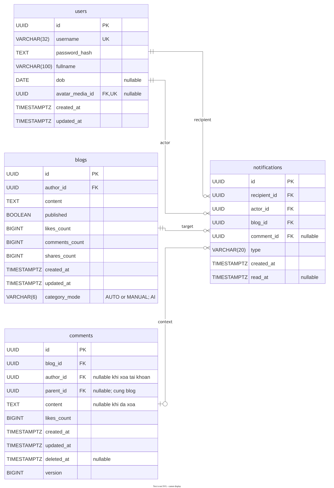
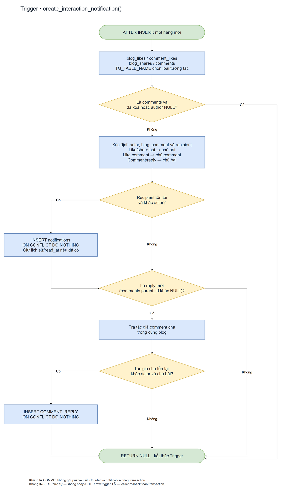

# Thông báo tương tác trong ứng dụng

Chốt ngày 12/11/2026. SQL gộp vào V1–V4 theo xác nhận chưa chạy migration; không tạo V6. API và giao diện bên dưới là hợp đồng để triển khai tiếp, chưa có code backend/frontend tương ứng.

## Phạm vi và người nhận

Một bảng notifications dùng chung cho mọi user. Không tạo bảng riêng cho từng tài khoản. Mỗi hàng là một thông báo gửi một người nhận.

| type | Khi nào tạo? | Người nhận | comment_id |
| --- | --- | --- | --- |
| BLOG_LIKE | Thực sự thêm hàng blog_likes | Tác giả bài | NULL |
| COMMENT_LIKE | Thực sự thêm hàng comment_likes | Tác giả bình luận | Bình luận được thích |
| BLOG_SHARE | Thực sự thêm hàng blog_shares | Tác giả bài | NULL |
| BLOG_COMMENT | Thêm bình luận hoặc reply đang hoạt động | Tác giả bài | Bình luận/reply mới |
| COMMENT_REPLY | Thêm reply có tác giả cha khác chủ bài | Tác giả bình luận cha | Reply mới |

Luôn bỏ qua recipient = actor và tác giả NULL. Không tạo thông báo khi INSERT placeholder đã deleted_at. Nếu chủ bài đồng thời là tác giả comment cha, chỉ tạo BLOG_COMMENT cho người đó. Ví dụ A đăng bài, B bình luận, C trả lời B: A nhận BLOG_COMMENT, B nhận COMMENT_REPLY. A trả lời B: chỉ B nhận COMMENT_REPLY. B trả lời comment của chính B: chỉ A nhận BLOG_COMMENT.

Không báo khi sửa/xóa comment, unlike hoặc unshare. Đây là lịch sử tương tác: unlike/unshare không xóa thông báo. Like/share lại cùng đối tượng không tạo thêm, không đổi created_at và không đặt lại read_at. Bình luận mới có ID mới nên vẫn sinh thông báo mới. Chưa bổ sung push, email, websocket, tùy chọn đăng ký hoặc gộp nhiều người thành một thông báo.

## Dữ liệu và ràng buộc

| Cột | Kiểu | Ý nghĩa |
| --- | --- | --- |
| id | UUID PK; DEFAULT gọi hàm `uuid_v7()` tại database | UUID v7 do PostgreSQL sinh khi trigger tạo thông báo. |
| recipient_id | UUID NOT NULL FK users | Người nhận |
| actor_id | UUID NOT NULL FK users | Người thao tác |
| blog_id | UUID NOT NULL FK blogs | Bài chứa tương tác |
| comment_id | UUID nullable | Bình luận/ngữ cảnh, FK kép với blog_id |
| type | VARCHAR(20) NOT NULL | Một trong năm giá trị trên |
| created_at | TIMESTAMPTZ NOT NULL DEFAULT now() | Lúc ghi thông báo |
| read_at | TIMESTAMPTZ nullable | NULL = chưa đọc, có giá trị = đã đọc |

Schema V1 định nghĩa 13 bảng/76 cột, gồm bảng liên kết Google theo [tài liệu 11](11-dang-nhap-google.md). CHECK cấm tự thông báo và buộc comment_id NULL cho BLOG_LIKE/BLOG_SHARE, NOT NULL cho ba loại bình luận. UNIQUE NULLS NOT DISTINCT(recipient_id,actor_id,blog_id,type,comment_id) chống trùng kể cả comment_id NULL (PostgreSQL 15+). FK(comment_id,blog_id) tham chiếu comments(id,blog_id), ngăn liên kết comment sai bài.

Xóa vĩnh viễn actor, recipient, blog hoặc comment xóa thông báo liên quan bằng ON DELETE CASCADE. Xóa tài khoản vẫn phải thực hiện quy trình placeholder comment theo 01/03 trước khi xóa user. Soft delete comment không xóa hàng thông báo nhưng API không trả ngữ cảnh comment đã xóa. Không lưu snapshot nội dung hoặc tên/avatar; JOIN dữ liệu hiện tại khi đọc.

V2 thêm 5 index: recipient/time/id cho danh sách mới nhất; partial recipient khi read_at NULL cho unread; blog_id, (comment_id,blog_id) partial và actor_id cho truy vấn/FK cleanup. Unique đã có recipient đứng đầu. Index không tự sắp xếp kết quả; SELECT luôn ghi ORDER BY created_at DESC,id DESC.



[Flowchart nghiệp vụ dễ đọc](../diagram/v3/11-interaction-notification-business.drawio.png) · [Flowchart nguồn tương tác → trigger → notifications](../diagram/v3/11-interaction-notification.drawio.png). Đây là luồng tạo thông báo; ERD chỉ nối các FK thực tế.

notifications.id dùng UUID v7 để đồng nhất với ID đối tượng do Java sinh mới. Database vẫn chịu trách nhiệm sinh ID thông báo; trigger bỏ qua cột id khi INSERT. V1 đã định nghĩa hàm `uuid_v7()` và đặt DEFAULT tương ứng; cần kiểm chứng migration trên PostgreSQL thật. Không thêm generator Java cho notification trong luồng trigger này. Xem [chính sách sinh UUID](03-postgresql.md#chính-sách-sinh-uuid).

## Trigger và transaction

V3 có create_interaction_notification() dùng TG_TABLE_NAME và NEW để xác định actor/ngữ cảnh, tra tác giả từ database rồi INSERT notifications. Bốn AFTER INSERT row trigger:

- blog_likes_notify trên blog_likes.
- comment_likes_notify trên comment_likes.
- blog_shares_notify trên blog_shares.
- comments_notify trên comments.

Các trigger counter hiện có vẫn hoạt động độc lập. PostgreSQL chạy các trigger cùng loại theo tên; không dựa vào thứ tự counter/notify để tính người nhận. INSERT ON CONFLICT DO NOTHING không thêm hàng thì AFTER row trigger không chạy. Trigger thông báo dùng ON CONFLICT ON CONSTRAINT notifications_interaction_unique DO NOTHING cho relike/reshare.

Cả tương tác, counter và thông báo cùng transaction do service quản lý. Nếu bất kỳ bước nào lỗi, rollback toàn bộ; chỉ báo thành công sau commit. Không gọi dịch vụ mạng hay COMMIT trong trigger. Trigger chỉ ghi thông báo, không thay thế quyền xem/đăng bài của service/procedure.

Giữ thứ tự khóa nghiệp vụ hiện có user → blog → comment. FK tới người nhận có thể phải khóa thêm user sau đó khi xóa tài khoản đồng thời; cần kiểm nhiều connection trên PostgreSQL thật. Service phải rollback/retry toàn transaction với 40P01/40001 theo chính sách retry hiện có, không retry một phần thông báo và không khẳng định đã loại hết deadlock.

V4 thu hồi quyền mặc định trên notifications rồi cấp runtime SELECT, INSERT và UPDATE(read_at); không cho UPDATE người nhận/ngữ cảnh/thời gian tạo hoặc DELETE trực tiếp. INSERT cần thiết vì function dùng quyền caller. Đây là role tin cậy của backend; không cung cấp credential/runtime SQL cho trình duyệt. FK cascade vẫn được database thực hiện khi xóa đối tượng nguồn.



## API bổ sung khi triển khai backend

Tổng hợp đồng dự kiến 39 route: 35 core + 2 chủ đề + 2 thông báo. Cả hai API yêu cầu session; actor/recipient lấy từ session, không nhận từ request body.

### GET /api/v1/notifications?limit=20&cursor=...

limit mặc định 20, tối đa 50; sai kiểu/phạm vi hoặc cursor không hợp lệ trả 400. Cursor opaque chứa cặp created_at/id đã kiểm định. Truy vấn WHERE recipient_id=:sessionUser, ORDER BY created_at DESC,id DESC, trang sau dùng (created_at,id) < (:time,:id), lấy limit+1 để xác định nextCursor.

Response HTTP 200:

```json
{
  "items": [{
    "id": "uuid",
    "type": "BLOG_LIKE",
    "actor": {"id": "uuid", "fullname": "Tên hiện tại"},
    "blogId": "uuid",
    "commentId": null,
    "createdAt": "2026-11-12T10:00:00Z",
    "readAt": null
  }],
  "nextCursor": null,
  "unreadCount": 1
}
```

List và unreadCount dùng cùng điều kiện quyền: blog public hoặc người nhận hiện là tác giả; thông báo có comment chỉ hiện khi comment chưa xóa. Không gửi text bài/comment đã mất quyền xem. Số chưa đọc tính trên tập hiện được phép xem; giữ read_at của lịch sử ẩn. Có thể thêm avatar qua cơ chế media đã chốt, không xuất credential hoặc entity user. Đọc list/count trong cùng snapshot của một statement hoặc transaction phù hợp để không lệch ngay trong một response.

### PATCH /api/v1/notifications/{id}/read

Cần CSRF; không cần body. UUID sai định dạng trả 400. UPDATE notifications SET read_at=COALESCE(read_at,now()) WHERE id=:id AND recipient_id=:sessionUser, kèm điều kiện quyền ngữ cảnh như GET, RETURNING id,read_at. Không tìm thấy/không sở hữu/không còn quyền xem trả 404; chưa đăng nhập trả 401. Lặp lại giữ timestamp cũ, trả HTTP 200 với id/readAt. Không cho client đặt read_at hoặc đổi về chưa đọc.

## Giao diện và triển khai

Bổ sung chuông/dropdown vào Navigation hiện có: hiển thị unreadCount, danh sách mới nhất, tải trang tiếp theo và trạng thái đã đọc. Mở mục gọi PATCH rồi điều hướng tới bài/comment; backend vẫn kiểm quyền đích. Tải lại sau đăng nhập vẫn giữ lịch sử/read_at. Tải lại khi mở dropdown là đủ cho phạm vi đầu; chưa cần realtime.

SQL đã có trong V1–V4. Backend controller/service/repository, CSRF integration và frontend là mốc tiếp theo theo 05. Seed tương tác tự sinh thông báo qua trigger, không seed notification trùng bằng tay.

## Kiểm chứng

[notifications.sql](../../infra/postgres/tests/notifications.sql) kiểm người nhận, tự like, comment/share/reply, chống trùng, đã đọc, rollback, quyền cột và cascade. Đã chạy V1–V5, bốn suite SQL và kiểm phạm vi deferred constraint trên PostgreSQL WASM 17.5 ngày 12/11/2026.

Chưa kiểm JDBC/Flyway Docker/Neon, API/UI, phân trang/quyền ở service hay concurrency nhiều connection. Nghiệm thu thực tế phải bổ sung các trường hợp đó, đặc biệt xóa actor/recipient đồng thời tương tác. Chi tiết ở [06 nghiệm thu](06-nghiem-thu.md).
