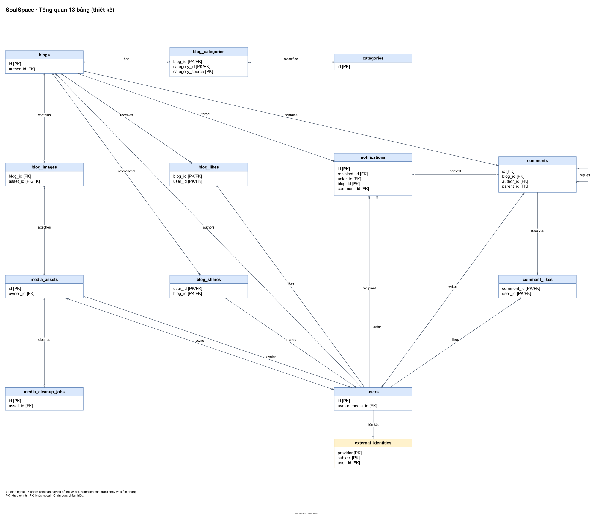
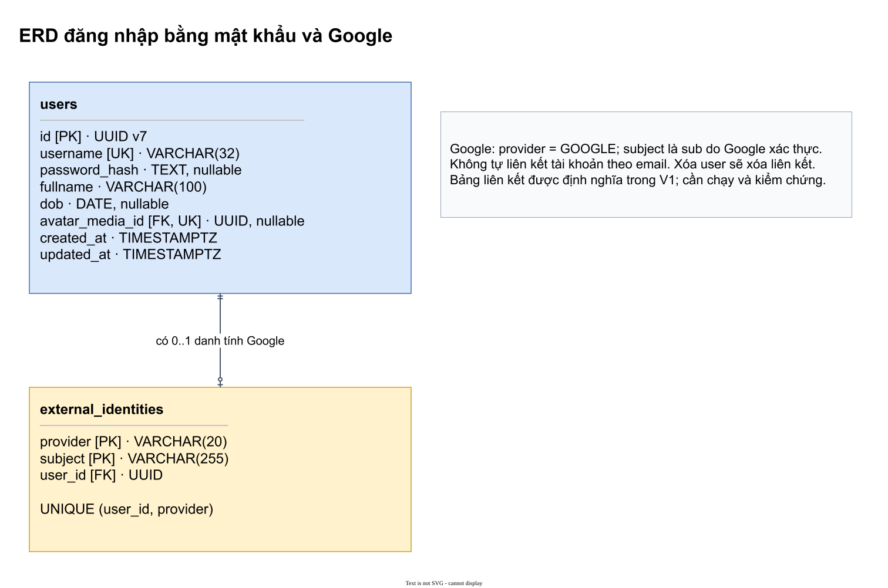
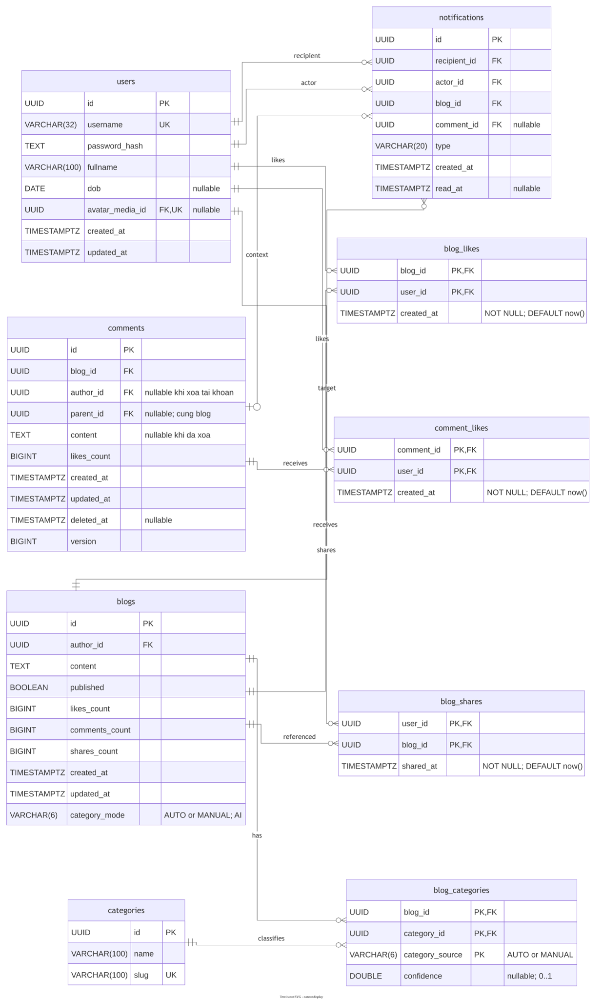
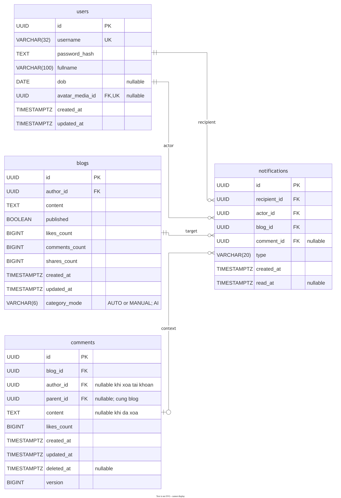

# ERD PostgreSQL — SoulSpace

Cập nhật 13/11/2026: V1 định nghĩa **13 bảng/76 cột**, bao gồm `external_identities` với 3 cột; migration cần được chạy và kiểm chứng. `users.password_hash` trong V1 hiện nullable. Xem [đặc tả đăng nhập Google](11-dang-nhap-google.md).

Bản tổng quan gọn và bản đầy đủ thể hiện 13 bảng trong V1; các hình nhóm thể hiện những bảng liên quan đến từng chức năng. Các hình nhóm ghi chú `users.password_hash` có thể NULL. Nguồn draw.io có thể chỉnh sửa kèm SVG tương ứng.

## Ký hiệu

| Ký hiệu | Ý nghĩa |
| --- | --- |
| PK | Khóa chính; nhiều cột cùng đánh dấu PK tạo khóa chính ghép. Riêng blog_images dùng asset_id làm PK. |
| FK | Khóa ngoại; cột giữ FK xác định phía tham chiếu. |
| UK | Ràng buộc duy nhất trên một cột. |
| Hai vạch ở đầu quan hệ | Đúng một. |
| Vòng tròn và một vạch | Không hoặc một. |
| Vòng tròn và chân quạ | Không hoặc nhiều. |

Bản tổng quan gọn hiển thị khóa và quan hệ của 13 bảng trong V1. [Bản đầy đủ](assets/erd/tong-quan-day-du.svg) có 76 cột; [ERD đăng nhập](assets/erd/dang-nhap-google.svg) trình bày `external_identities` và `users`. Giá trị mặc định, CHECK và ràng buộc nhiều cột xem ở tài liệu nguồn.

| Bảng               | Số cột |
|--------------------|--------|
| users              | 8      |
| external_identities | 3 |
| blogs              | 10     |
| categories         | 3      |
| blog_categories    | 4      |
| comments           | 10     |
| blog_likes         | 3      |
| comment_likes      | 3      |
| blog_shares        | 3      |
| media_assets       | 10     |
| blog_images        | 3      |
| media_cleanup_jobs | 8      |
| notifications      | 8      |
| **Tổng**  | **76** |

Hình tổng quan chứa nhiều thông tin; dùng liên kết mở SVG bên dưới mỗi ảnh và phóng to để đọc rõ từng cột.

## 1. Tổng quan mười ba bảng (thiết kế)

[Mở tổng quan gọn](assets/erd/tong-quan.svg) · [Bản đầy đủ: 76 cột](assets/erd/tong-quan-day-du.svg) · [ERD đăng nhập Google](assets/erd/dang-nhap-google.svg) · [Nguồn ERD đăng nhập](assets/erd/dang-nhap-google.drawio) · [Nguồn bản đầy đủ](assets/erd/tong-quan-day-du.drawio).

Tổng quan gọn dùng đường thẳng và tách riêng các quan hệ song song. Bản đầy đủ và các sơ đồ theo nhóm dùng để tra kiểu dữ liệu/cột thường. Không bỏ bảng hoặc quan hệ dữ liệu.

Gồm bảng `external_identities` cùng `users`, `categories`, `blog_categories`, `blogs`, `comments`, `blog_likes`, `comment_likes`, `blog_shares`, `media_assets`, `blog_images`, `media_cleanup_jobs` và `notifications`. Quan hệ sở hữu media và quan hệ avatar là hai liên kết riêng.

## 2. Bài viết và bình luận

[Mở SVG bài viết và bình luận](assets/erd/bai-viet-binh-luan.svg).

- categories, bảng nối blog_categories và blogs.category_mode được hiển thị đầy đủ trong cả bốn sơ đồ có blogs. Mỗi bài
  có 0..n chủ đề; mỗi chủ đề có 0..n bài. PK ghép (blog_id, category_id, category_source) ngăn trùng liên kết.
- Một user có nhiều bài viết và bình luận; mỗi bài có nhiều bình luận, bao gồm replies.
- Bình luận gốc có `parent_id = NULL`. FK ghép `(parent_id, blog_id)` tham chiếu `comments(id, blog_id)` giữ reply trong cùng bài; không giới hạn cứng độ sâu.
- Không lưu depth; parent phải tồn tại, không tự trỏ; ID/blog_id/parent_id cố định sau tạo để giữ cây không vòng. UI chỉ thụt lề tối đa 3 tầng, vẫn giữ đúng parent và chỉ rõ người được trả lời ở nhánh sâu.
- Không tạo reply mới trực tiếp vào placeholder; parent được khóa và kiểm chưa xóa. Replies cũ vẫn được giữ, comment con chưa xóa vẫn được trả lời ở mọi độ sâu.
- Xóa riêng comment đặt content=NULL/deleted_at, gỡ likes và giữ replies. comments_count chỉ đếm các node chưa xóa; UI dựng dòng "Bình luận đã xóa" từ trạng thái.
- author_id nullable phục vụ xóa tài khoản: xóa nội dung và gỡ tác giả của các comment ở bài người khác trong cùng transaction, giữ replies. Bài của tài khoản bị xóa vẫn bị xóa vĩnh viễn cùng toàn bộ cây.
- version dùng cho sửa/xóa comment, không tạo record lịch sử: client gửi expectedVersion, bản cũ bị từ chối 409. updated_at/version không thay đổi khi chỉ like.

## 3. Lượt thích và chia sẻ

[Mở SVG lượt thích và chia sẻ](assets/erd/luot-thich-chia-se.svg).

- Khóa chính ghép ngăn một user like hoặc share trùng cùng tài nguyên; timestamp thuộc quan hệ tương ứng.
- Timestamp like/share NOT NULL DEFAULT now(), do database đặt cho thao tác runtime.
- Comment đã xóa không nhận like mới. Xóa các like của node đó và chuyển nó thành placeholder trong cùng transaction; không xóa likes/replies của các comment con còn sống.
- `blog_shares` tham chiếu bài gốc hiện tại; không lưu snapshot nội dung. Share bị ẩn khi bài gốc riêng tư và bị cascade xóa khi bài gốc bị xóa.

## 4. Media và avatar

[Mở SVG media và avatar](assets/erd/media-avatar.svg).

- `users.avatar_media_id` nullable và unique: một user có tối đa một avatar; một asset không làm avatar của hai user.
- `media_assets.owner_id` có thể null sau khi xóa user để giữ thông tin phục vụ cleanup.
- `blog_images.asset_id` là PK và FK; blog_id và position NOT NULL, `UNIQUE(blog_id, position)` giữ thứ tự ảnh không trùng trong một bài. position từ 0 đến 9, không bắt buộc liên tục.
- Không lưu mime_type; format được xác minh/canonical hóa thành jpeg/png, backend dùng một hàm chung suy ra Content-Type.
- Cleanup job được ghi cùng transaction nghiệp vụ; worker gọi Cloudinary sau commit. Chi tiết trạng thái asset, quyền xem ảnh và xử lý lỗi nằm trong [bảo mật và media](04-bao-mat-media.md).
- Media có ba trạng thái: PENDING (receipt chưa xác nhận hoặc upload đã xác nhận nhưng chưa gắn), ATTACHED và DELETE_PENDING. Attach/scanner/cleanup khóa asset trước kiểm tra; chỉ PENDING đã xác nhận đủ metadata và đúng owner/purpose mới được gắn. Job RUNNING có lease; job PENDING/DEAD không giữ lease. Worker chỉ ghi kết quả khi cặp attempts/lease của lượt claim còn khớp và chưa hết hạn. Tối đa 5 lượt claim tự động.

## 5. Mở rộng phân loại chủ đề (giai đoạn AI)

[Mở SVG chủ đề ở kích thước đầy đủ](assets/erd/phan-loai-chu-de.svg). Nguồn Mermaid, kiểu dữ liệu, CHECK, API và nghiệm thu nằm trong [07 phân loại chủ đề](07-phan-loai-chu-de.md).

Thêm categories(id, name, slug), blog_categories(blog_id, category_id, category_source, confidence) với PK ghép và
blogs.category_mode=AUTO/MANUAL. Không đặt category_id trên blogs. Mỗi bài có 0..n chủ đề và mỗi chủ đề có 0..n bài qua
bảng nối; MANUAL kể cả tập rỗng giữ quyền chọn của tác giả. Model đa nhãn chỉ ghi tập AUTO khi nội dung chưa đổi; giữ
tập MANUAL để đối chiếu, blogs.category_mode chọn nguồn hiển thị. AUTO bắt buộc có confidence trong [0,1]; MANUAL bắt
buộc NULL. PK ghép giữ riêng hai nguồn cho cùng bài/chủ đề. Slug là tên URL không dấu, duy nhất và ổn định. FK
blog_categories.blog_id dùng ON DELETE CASCADE; FK category_id dùng ON DELETE RESTRICT. Tổng cấu trúc: categories 3 cột,
blog_categories 4 cột, blogs 10 cột, các bảng còn lại 48 cột và notifications 8 cột, trước bổ sung liên kết Google là 12 bảng/73 cột; thêm external_identities thành 13 bảng/76 cột.

## Nguồn chỉnh sửa

Mã Mermaid của bốn hình chính nằm trong phần **Mô hình và kiểu dữ liệu** của [03-postgresql.md](03-postgresql.md). Sơ đồ chủ đề riêng lấy Mermaid từ [07-phan-loai-chu-de.md](07-phan-loai-chu-de.md). File này nhúng các SVG tại `assets/erd/`; khi sao chép tài liệu cần giữ cả thư mục ảnh và cấu trúc đường dẫn tương đối.

## Phạm vi chuẩn hóa

Giữ blog_id trên comments để truy vấn theo bài và kiểm quyền trực tiếp, dù trên các reply nó được suy ra từ parent. Thiết kế chấp nhận phần dư thừa này, không chứng nhận toàn bộ schema đạt BCNF. Counters là dữ liệu tổng hợp do trigger quản lý; quan hệ like/comment/share là nguồn đối soát. UNIQUE nullable thông thường chỉ bảo đảm duy nhất khi có giá trị, không mặc nhiên là khóa ứng viên của toàn bảng.

## 6. Thông báo tương tác

[Mở SVG](assets/erd/thong-bao.svg) · [Nguồn draw.io](assets/erd/thong-bao.drawio) · [Đặc tả](10-thong-bao.md).

notifications có 8 cột, liên kết hai vai trò user (recipient và actor), blog và comment (comment_id nullable). FK kép comment_id/blog_id giữ comment đúng bài. UNIQUE gồm recipient/actor/blog/type/comment, coi NULL bằng nhau; mỗi tương tác gửi một lần cho từng người nhận. Tất cả FK thông báo dùng cascade khi xóa vĩnh viễn đối tượng. Soft delete giữ hàng lịch sử; API ẩn ngữ cảnh không còn được phép xem.

Riêng notifications dùng UNIQUE NULLS NOT DISTINCT để chống trùng cả khi comment_id NULL. Nguồn draw.io tổng quan và nhóm tương tác nằm cạnh SVG; chúng được nhập từ Mermaid trong 03 rồi chỉnh bố cục/routing để tách các quan hệ. Tổng quan gọn dùng các đoạn thẳng; bản đầy đủ và nhóm nghiệp vụ giữ nguồn riêng để tra cứu.
