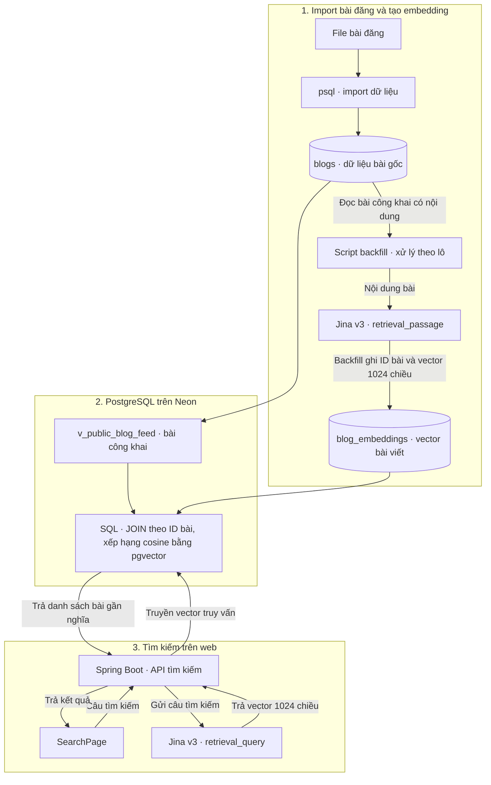

# Luồng chính Semantic Search của SoulSpace

Jina v3 tạo embedding từ bài đăng và câu tìm kiếm. PostgreSQL trên Neon dùng `pgvector` để xếp hạng các bài công khai theo khoảng cách cosine.

## Phần làm riêng và phần tích hợp

- **Làm và kiểm thử riêng.** Dùng Python để tạo vector bằng Jina v3. Dùng `psql` để import bài, lưu vector và thử SQL trên Neon. Các bước này chạy được khi Spring Boot đang tắt.
- **Tích hợp vào backend.** Spring Boot nhận câu tìm kiếm từ `SearchPage`, gọi dịch vụ embedding và chạy SQL trên Neon. Khi backend hỗ trợ tạo hoặc sửa bài, worker sẽ cập nhật embedding sau khi thay đổi được lưu thành công.

Neon hiện đã có `pgvector`, bảng `blogs` và view `v_public_blog_feed` từ phần chuẩn bị V1–V5. Migration V6 dự kiến tạo `blog_embeddings` để lưu vector. Khi có file bài đăng, import vào `blogs` rồi chạy backfill để tạo vector ban đầu. Xem thêm [kế hoạch triển khai](plan.md).
